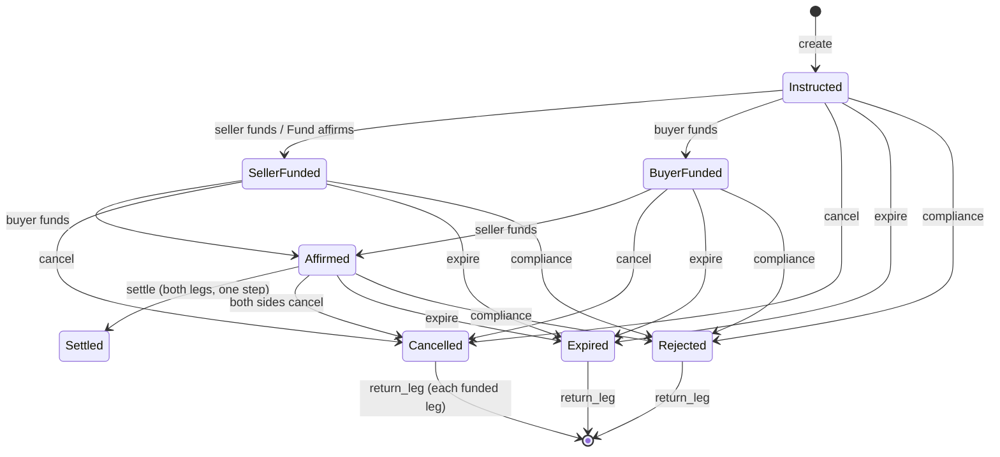
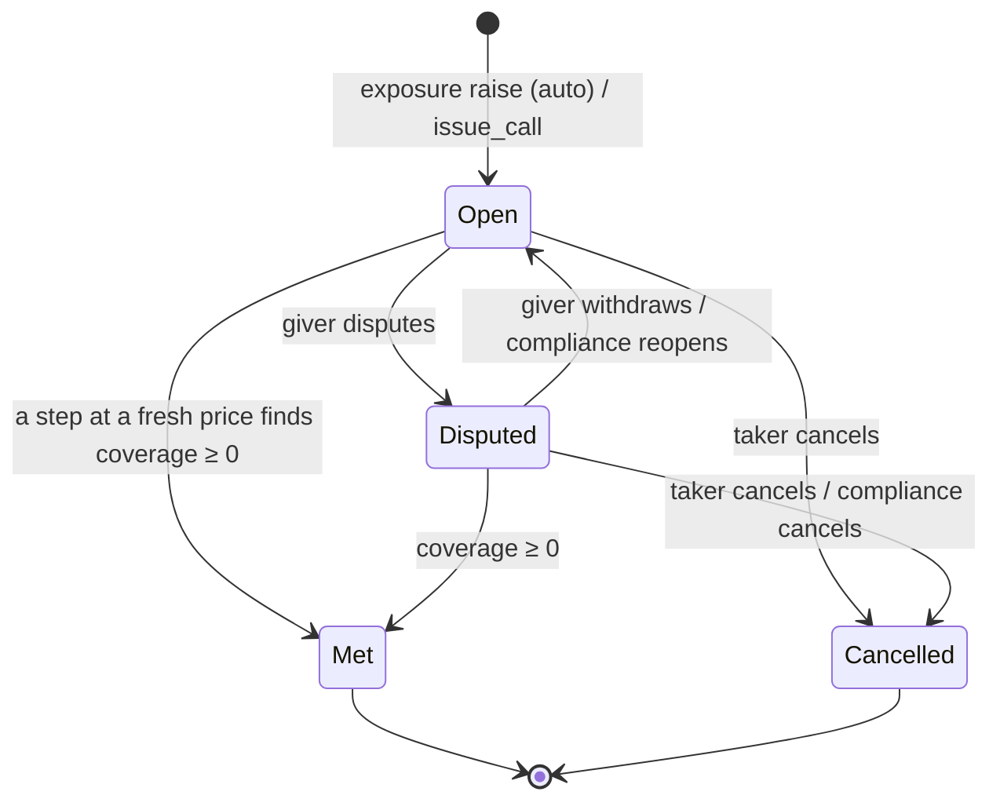
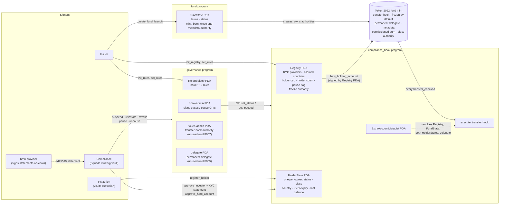
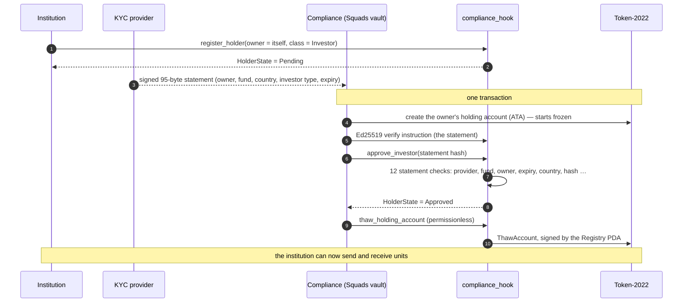
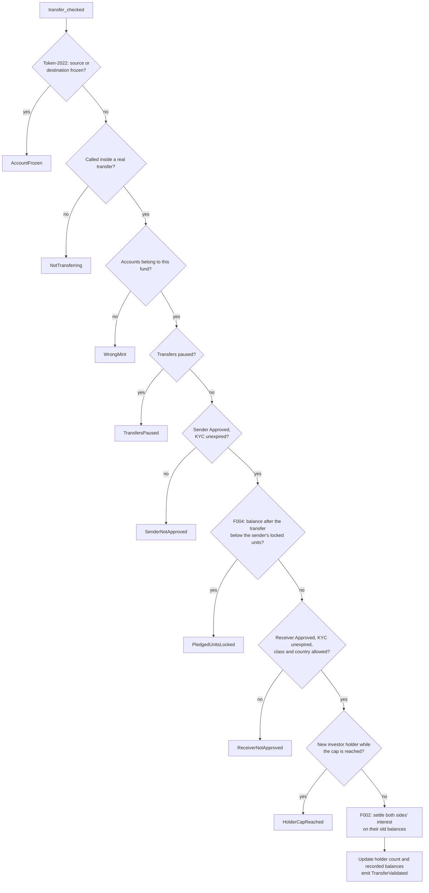
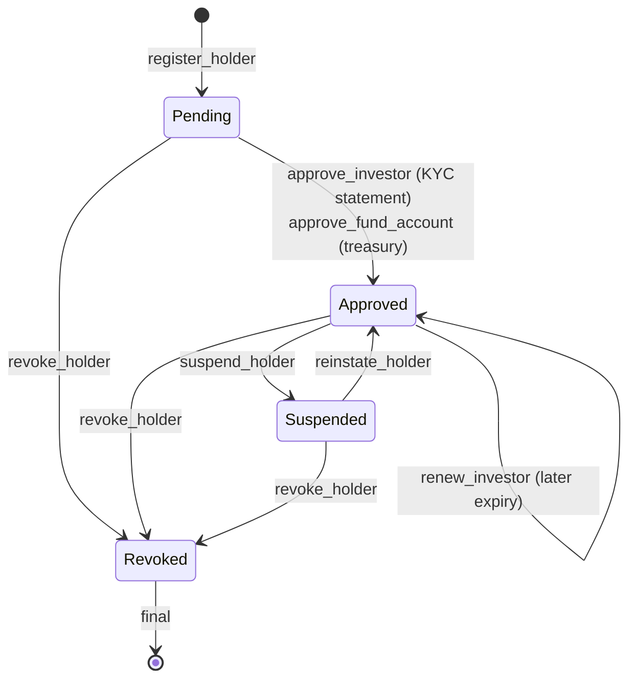
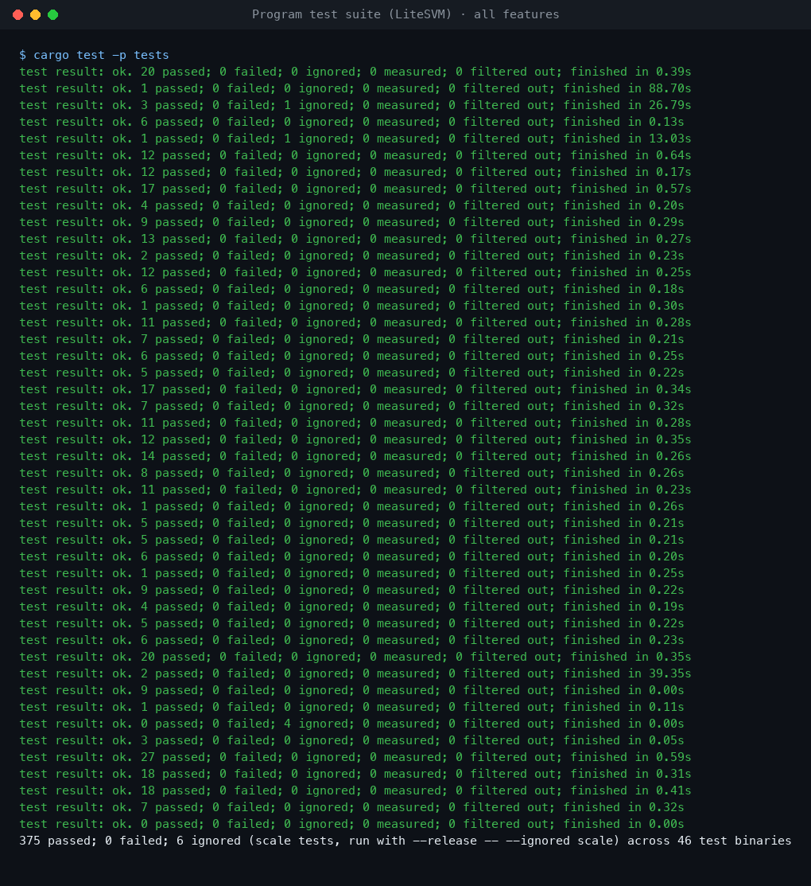
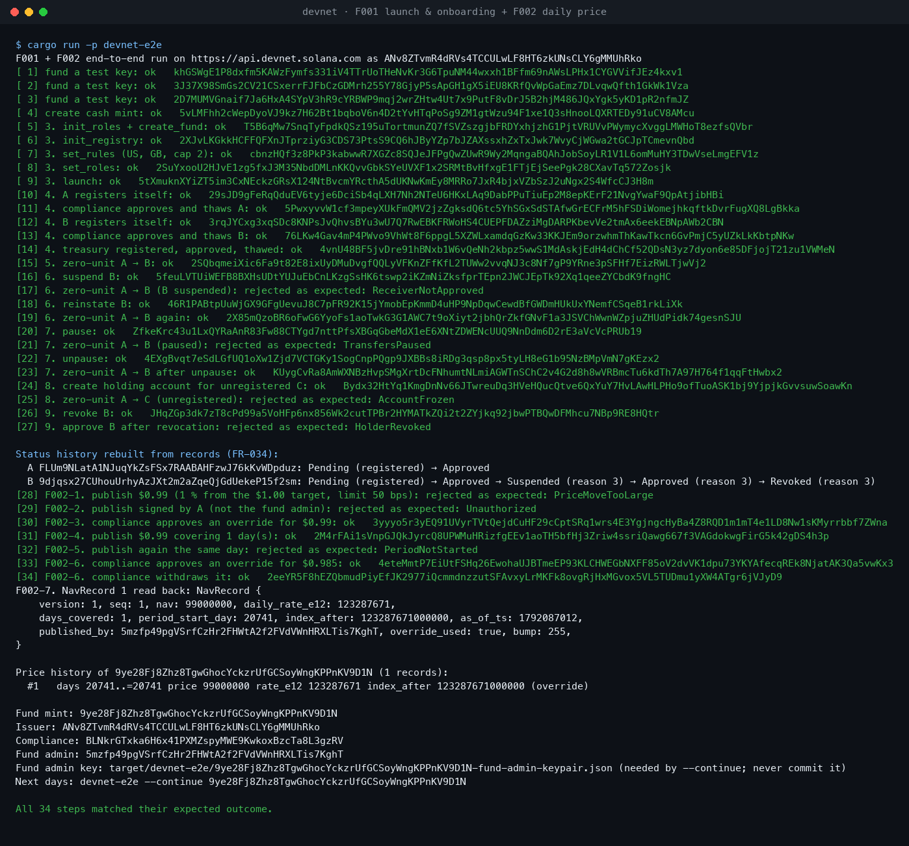
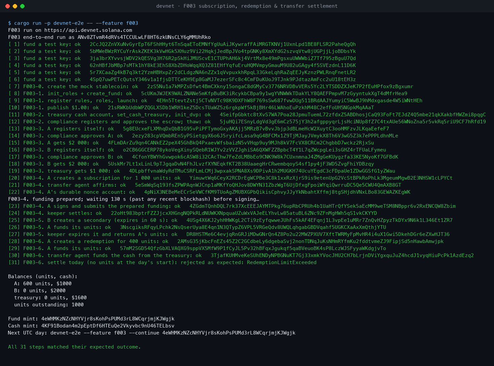
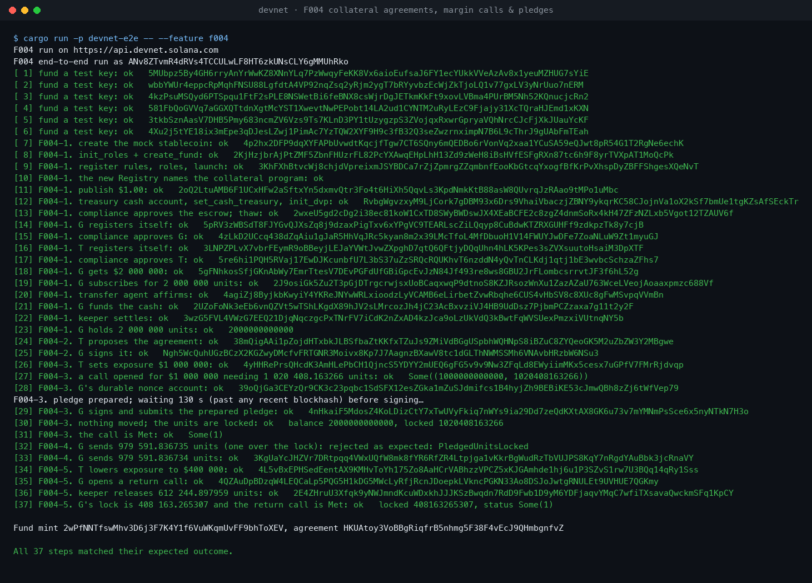

# Tokenized MMF Collateral

Open-source, issuer-side infrastructure for a tokenized money market fund on Solana, built to be
used as collateral. The fund's token enforces its own rules: only approved, KYC-checked
institutions can hold it, and every compliance action is on-chain and on record.

Built feature by feature with [Spec Kit](https://github.com/github/spec-kit). **F001 — fund
launch, roles and holder onboarding**, **F002 — daily price and interest accrual**, **F003 —
subscription, redemption and transfer settlement** and **F004 — collateral agreements, margin
calls and pledges** are merged and deployed on devnet. F005–F008 (enforcement, distributions,
governance, operator tooling) follow in order; see [docs/speckit-inputs.md](docs/speckit-inputs.md).

## Devnet deployment

All five programs are deployed on **devnet**, and the end-to-end tests pass there (102 of 102
steps, [below](#passing-on-devnet)). The deploy signatures and run details are in
[specs/004-collateral-pledges/devnet-run.md](specs/004-collateral-pledges/devnet-run.md).

| Program | Devnet Program ID | Role |
|---|---|---|
| `fund` | [`HV75Ur4qgfHHTNwbJdpiTMkq2sA7YoynBXFtzpsZzYT5`](https://explorer.solana.com/address/HV75Ur4qgfHHTNwbJdpiTMkq2sA7YoynBXFtzpsZzYT5?cluster=devnet) | Fund and mint creation, launch, daily price and interest, mint/burn for settlement |
| `compliance_hook` | [`A2R9A9xmCpicyUAYixJZr63oBPmKSR95CxxLoSPQfqtM`](https://explorer.solana.com/address/A2R9A9xmCpicyUAYixJZr63oBPmKSR95CxxLoSPQfqtM?cluster=devnet) | Token-2022 transfer hook: holder register, KYC check, interest settlement, pledge lock |
| `governance` | [`8Z7an6h8k8dbq7Bxzxyh4HseyaNgTHpVzSwvcq5H9pTV`](https://explorer.solana.com/address/8Z7an6h8k8dbq7Bxzxyh4HseyaNgTHpVzSwvcq5H9pTV?cluster=devnet) | Roles, reason-coded compliance actions, price overrides, dispute resolution |
| `dvp_settlement` | [`418DJ7wBLXAWBGA81vGLxEJTMxZMNMqrmj6t3sErck6w`](https://explorer.solana.com/address/418DJ7wBLXAWBGA81vGLxEJTMxZMNMqrmj6t3sErck6w?cluster=devnet) | Cash-for-units escrow: subscription, redemption, secondary transfer, unwinds |
| `collateral` | [`2RGrj5Jp8PGFVNRFNbJJtZVAph9mBYEubX6QMgqup6Yi`](https://explorer.solana.com/address/2RGrj5Jp8PGFVNRFNbJJtZVAph9mBYEubX6QMgqup6Yi?cluster=devnet) | Collateral agreements, margin calls, pledges, releases, substitution, disputes |

## What F001 does

- **Launch**: the issuer creates a fund and its Token-2022 mint in one instruction, sets holder
  rules (KYC providers, allowed countries, holder cap) and roles, then opens it.
- **Onboarding**: an institution registers; compliance approves it with an ed25519-signed KYC
  statement; its one holding account is thawed.
- **Transfer rules**: a transfer hook rejects any transfer whose sender or receiver isn't approved
  with valid KYC, while transfers are paused, or past the holder cap — however the transfer is
  built.
- **Compliance actions**: suspend, reinstate, revoke, pause, unpause, each reason-coded and
  recorded. Roles can be Squads multisig vaults.
- **No unpaid units**: no instruction mints or burns in F001, and Token-2022's permissioned burn
  stops holders destroying their own units.

## What F002 does

- **Daily publish**: the fund admin publishes the price per unit and the daily interest rate for
  the days it covers: 1 normally, 3 on a Friday, more before a holiday or after an outage.
  Coverage is contiguous: each publish starts the day after the last covered day and can't start
  in the future, so no day is skipped or paid twice. Each publish is kept forever as a numbered
  price record that later features cite. A price that moves more than the fund's daily limit is
  rejected unless compliance has approved an override for exactly that price.
- **Override**: compliance (a Squads vault, typically) approves or withdraws an override through
  governance, with a reason code. The next publish uses it up whether or not it needed it, so an
  old override can never be used later.
- **Interest without touching holders**: a publish adds `rate × days` to one counter on the fund
  and writes no holder account, so it costs the same with 10 or 10 000 holders. The transfer hook
  settles each side's interest on its old balance before every transfer, exactly (in units ×
  10^18, no rounding). Whoever holds units at a publish earns it, whatever their status. Rounding
  to whole units happens only at payout (F006).

## What F003 does

Cash for units, and back, so that either both sides move or neither does. Units come into
existence only at the moment their cash reaches the fund's treasury.

- **Agree**: an investor or the transfer agent creates a subscription or redemption; two holders
  create a secondary transfer. It is priced from the latest price record (which can't be more than
  a day old) and keeps that price: subscription cash rounds up, redemption cash down.
- **Fund**: each side places its leg in one per-fund escrow when it is ready (the Fund's side of
  a subscription only affirms: its units are created at settlement). Units go in through the
  transfer hook, so every holder rule applies. A step prepared on the signer's durable nonce stays
  valid for hours, so custodians' approval flows fit.
- **Settle**: anyone (normally the keeper) triggers settlement once both legs are in. One
  instruction moves both legs: a subscription's units are minted into escrow, delivered and its
  cash paid to the treasury; a redemption's units are burned within the daily limit (10 % of the
  units outstanding at the start of the UTC day, by default) and its cash paid; a secondary
  transfer swaps units and cash. If any part fails, nothing moves.
- **Unwind**: either side cancels before both legs are in (both must agree once they are),
  anyone expires an instruction after its expiry (24 h by default), and compliance rejects one
  through governance. Each funded leg is earmarked and returned by a separate step anyone can
  trigger and retry, so an unwind never depends on a return being deliverable right away.



## What F004 does

A holder pledges fund units to a counterparty as margin without moving them, and the pledge
follows the exposure. The units stay in the giver's account and keep earning interest; the
token's own transfer rules stop them leaving.

- **Agree**: the giver or the taker proposes the enforceable terms of their legal collateral
  agreement (haircut, time to meet a call, grace period, minimum transfer amount, pledge limit,
  maximum price age, the legal document's fingerprint, whether the taker may raise exposure
  alone); it is Active once the other party signs. Both must be approved investors.
- **Call**: the taker records its exposure. When the collateral value (pledged units × the latest
  price × (1 − haircut), rounded down) falls short by more than the minimum transfer amount, a
  delivery call opens in the same step with a deadline and an enforce-after time. The agreement
  tracks the part of the shortfall already demanded, so a later rise gets its own call.
- **Pledge**: the giver locks units. `collateral` asks the hook's `set_lien` to raise the
  holder's locked units, and the hook checks the balance covers them. From then on the hook
  refuses any transfer — direct, by a delegate, or into settlement escrow — that would leave the
  balance below the lock. When a step finds coverage zero or more, every open call is met.
- **Release, substitute, dispute**: when exposure falls the giver opens a return call and the taker
  (or the keeper, against that call) unlocks the excess, never below cover. The giver can swap a
  pledge for an equal or larger one in one step, and dispute a call; compliance resolves disputes
  through governance.



The specifications, plans and designs are in [specs/](specs/); the rules every feature follows
are in the [constitution](.specify/memory/constitution.md) and
[docs/shared-model.md](docs/shared-model.md).

## Architecture


This is the target design. Layers 3–5 are built and deployed: the five programs, the Token-2022
fund mint and the cash mint. The off-chain services in layer 2 and the `netting` stretch goal
come in later features. The lifecycle flow and the end-to-end sequence are in
[docs/diagrams/](docs/diagrams/). The diagrams below show each part in detail.

### Programs, accounts and authorities

Five Anchor programs share one Token-2022 mint (the diagram shows F001's three; F003's
`dvp_settlement` owns the escrow and asks `fund` to mint and burn, see
[specs/003-dvp-settlement/plan.md](specs/003-dvp-settlement/plan.md); F004's `collateral` owns
agreements, pledges and calls and changes locked units only through the hook's `set_lien`, see
[specs/004-collateral-pledges/plan.md](specs/004-collateral-pledges/plan.md)). Every authority over the mint is a program PDA, so
no person's key can mint, freeze or reconfigure the token.



### Onboarding: two transactions (SC-005)



### Every transfer: the hook's fixed check order (FR-026)



### Holder status



Suspend, reinstate, revoke, pause and unpause each carry a reason code and emit a permanent event; a
holder's full status history can be rebuilt from those events alone.

## Tests

**375 tests pass in the LiteSVM suite, plus 72 program, shared-crate and SDK unit tests** (6 more
— the scale tests and long property runs — are `#[ignore]`d and run in release).
- Every rule has a rejection test asserting the exact error; all 160 error variants are covered.
- 128 randomized F001 operation sequences, now with publishes interleaved, are checked against a
  reference model.
- F002 suites: `f002_publish`, `f002_override` and `f002_accrual`. The spec's own test is in
  `f002_accrual`: A holds 1 000 000 units for 10 days at a different rate each day, sends half to
  B, then 10 more days; interest matches a day-by-day calculation exactly.
- `accrual_prop`: 64 randomized 90-day simulations with transfers, suspensions and pauses. Every
  holder's interest equals an independent day-by-day model exactly after every step, and an
  auditor's rebuild from the records alone agrees.
- F003 suites, one per story and rule group: `f003_setup`, `f003_create`, `f003_fund`,
  `f003_subscribe`, `f003_redeem`, `f003_secondary`, `f003_cancel_expire_reject`, `f003_reject`,
  `f003_returns`, `f003_slow_signers` (durable nonces with LiteSVM's blockhash check on),
  `f003_escrow`, `f003_mint_burn_guard`, `f003_accrual`, `f003_rebuild`. The spec's own tests:
  a $2M subscription at $1.00, a 500 000-unit redemption, a 1 000 000-unit secondary for
  $999 500, and three one-sided instructions cancelled, expired and rejected with every funder
  restored exactly.
- `dvp_prop`: randomized settlement sequences (creates, funding, settles, cancels, expiries,
  rejections, returns, suspensions, pauses, publishes, clock moves) against an independent model;
  outcomes, including which error comes first, and every balance must agree after every step.
- F004 suites: `f004_agreement`, `f004_exposure`, `f004_calls`, `f004_pledge`, `f004_lock` (every
  way a locked unit could leave — hand-built transfers, delegates, settlement funding, a second
  pledge — is refused), `f004_lien`, `f004_release`, `f004_substitute`, `f004_dispute` (incl. a
  2-of-3 Squads compliance vault), `f004_status`, `f004_interest` (locked units earn exactly what
  unlocked units earn), `f004_slow_signers` and `f004_rebuild`. The spec's own tests: a $1M call
  met by one pledge of 1 020 408.163266 units with no balance anywhere changing, and the excess
  returned exactly when exposure falls to $400 000.
- `collateral_prop`: randomized collateral sequences (exposure, calls, pledges, releases,
  substitutions, cancels, disputes, transfers, price moves, clock moves, suspensions) against an
  independent model; outcomes and every lock, agreement and call status must agree after every
  step, and invariants I1, I2, I15 and I16 hold on chain.
- Scale tests, run in release. The hook's cost and a publish's cost are identical with 10 or
  10 000 holders. A settlement's cost doesn't change with the number of holders or with how many
  publishes have passed since the holder's last one; it varies by 1–2 compute units with the
  amounts involved, and the test allows a 16-unit band. A subscription's and a redemption's
  settlement cost the same with 10 or 10 000 holders and 1 or 1 000 open instructions. A pledge,
  a call and a release cost the same with 10 or 10 000 holders and 1 or 300 agreements.

### Program test suite (LiteSVM)



### Passing on devnet

The end-to-end script runs every feature against the programs deployed on devnet. Each step is
checked against its expected outcome, including the rejections, which must fail with the exact
error. The run exits 0 only if all of them match. The run on 2026-10-15 matched **102 of 102
steps**. The full logs are in [docs/devnet-runs/](docs/devnet-runs/), and every signature can be
looked up on the explorer.

**F001 + F002: 34 of 34.**
- **Launch and onboarding:** a fund is launched, two institutions are onboarded, and transfers
  are refused for a suspended holder, while paused, for an unregistered account and after
  revocation.
- **Status history:** each holder's status history is rebuilt from on-chain records.
- **Daily price:** a price moving past the daily limit is refused, an override is approved, and a
  same-day publish is refused.

Transfers in this run move zero units, because no units can be created before F003. A zero-unit
transfer still runs every hook check.



**F003: 31 of 31.**
- **Subscription:** funded through a durable-nonce step prepared earlier and signed later.
- **Expired secondary:** a secondary transfer expires and its funded leg is returned.
- **Redemption limit:** a redemption over today's limit is refused.



**F004: 37 of 37.**
- **The call and the pledge:** a $1M margin call is met by a pledge prepared on a durable nonce
  and signed 130 s later, without any balance changing.
- **The lock:** a send one unit over the lock is refused by the token itself.
- **The release:** the excess is released against a return call when exposure falls.



Screenshots are rendered from the captured output with `scripts/render_terminal.py`.

## Repository layout

```text
programs/
  fund/             fund terms, status, the Token-2022 mint, daily price records (create_fund,
                    launch, publish_daily, set_/clear_nav_override)
  compliance_hook/  holder register, onboarding, and the transfer hook (incl. interest settlement)
  governance/       roles, compliance actions, price overrides, settlement rejection, dispute
                    resolution
  dvp_settlement/   escrowed settlement of subscriptions, redemptions and secondary transfers
                    (init_dvp, create_instruction, affirm_and_fund, settle, cancel, expire,
                    reject, return_leg)
  collateral/       agreements, margin calls and lien pledges (propose/sign_agreement,
                    update/confirm_exposure, issue_call, check_coverage, pledge, release,
                    substitute, cancel_call, dispute/withdraw/resolve)
crates/
  mmf-common/       program ids, seeds, enums, ISO 3166 table, KYC statement format, account
                    views, settlement and collateral formulas, cash-token checks
  mmf-sdk/          instruction builders, PDA helpers, mock KYC provider, hooked transfers,
                    durable-nonce prepared steps
tests/              LiteSVM harness and test suites; mainnet fixtures in tests/fixtures/
scripts/
  devnet-e2e/       end-to-end run against devnet or a local validator
  check-error-coverage.sh, check-duplicate-crates.sh
docs/               design, shared model, Spec Kit inputs, workflow
specs/              one folder per feature: spec, plan, research, data model, contracts, tasks
```

## Build and test

Requirements: Rust 1.90 (pinned in `rust-toolchain.toml`), Anchor CLI 1.1.2 (`avm use 1.1.2`),
Solana CLI 3.1.10 or newer.

```bash
anchor build                                          # the five programs
cargo test -p mmf-common                              # shared types
cargo test -p tests                                   # LiteSVM suites, incl. randomized invariants
cargo test -p tests --release -- --ignored            # scale (10 vs 10 000 holders) and long property runs
scripts/check-error-coverage.sh                       # every error variant has a test
```

The test fixtures (Token-2022 v11 and Squads v4, dumped from mainnet) are committed; how to refresh
and verify them is in [tests/fixtures/README.md](tests/fixtures/README.md).

## End-to-end run

`scripts/devnet-e2e` runs the whole F001 flow and F002's first publish and override against a
cluster, using zero-unit transfers (no units can be created before F003, and a zero-unit transfer
still runs every hook check). `--continue <mint>` publishes the next record on a later UTC day.
Rehearse it free on a local validator. On devnet, all three runs pass against the deployed
programs ([Devnet deployment](#devnet-deployment)).

To run them against the devnet deployment, use a wallet with about 3 devnet SOL. It becomes the
issuer and pays for every account:

```bash
cargo run -p devnet-e2e                       # F001 + F002: 34 steps
cargo run -p devnet-e2e -- --feature f003     # F003: 31 steps
cargo run -p devnet-e2e -- --feature f004     # F004: 37 steps
# optional: RPC_URL=<devnet RPC> WALLET=<keypair.json>; defaults are api.devnet.solana.com and ~/.config/solana/id.json
```

Each run prints every step's signature and outcome, and exits 0 only if all of them match.

Commands are in the [F001](specs/001-fund-launch-onboarding/quickstart.md#devnet-run-r16) and
[F002](specs/002-daily-price-accrual/quickstart.md#devnet-run-research-r13) quickstarts.
`devnet-e2e --feature f003` runs settlement on a new fund with real units and a mock stablecoin
(a subscription funded through a prepared durable-nonce step, an expired secondary and its return,
and a redemption that today's limit refuses); `--feature f003 --continue <mint>` settles that
redemption on a later UTC day. See the
[F003 quickstart](specs/003-dvp-settlement/quickstart.md). `devnet-e2e --feature f004` runs the
collateral flow on a new fund: a $1M call met by a pledge signed 130 s after it was prepared on a
durable nonce, a send over the lock refused by the token, and the excess released against a
return call. See the [F004 quickstart](specs/004-collateral-pledges/quickstart.md).

## Demo

[`demo/`](demo/) holds a presenter demo of the core idea: an investor meets a margin call raised
elsewhere (a Tesla-backed loan) by pledging MMF shares, which keep earning interest while pledged.
A demo assistant, Tony, narrates each step. It uses a small, separate Anchor program on a local
validator and runs with one command (`demo/run.sh`). See [demo/README.md](demo/README.md).

## Status

F001–F004 are merged. All five programs have been on devnet since 2026-10-15, and every feature's end-to-end run passes
there. Their upgrade authority is still the deploy wallet: the handover to a Squads vault with a
time lock is still to do ([devnet-run.md](specs/004-collateral-pledges/devnet-run.md#still-open)).
Nothing here is audited — don't use it with real assets.
