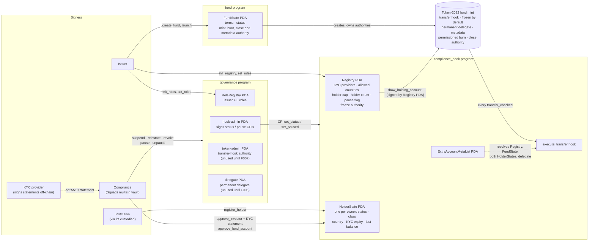
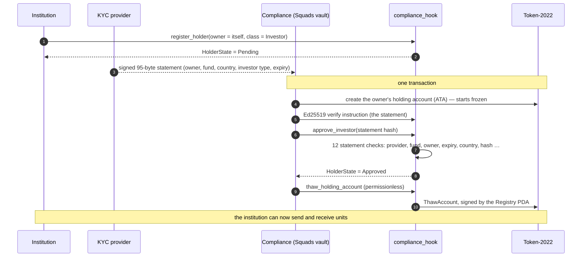
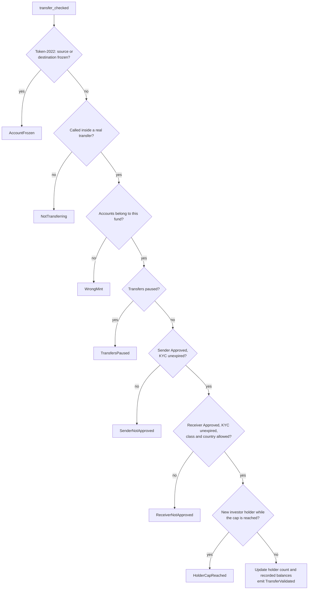
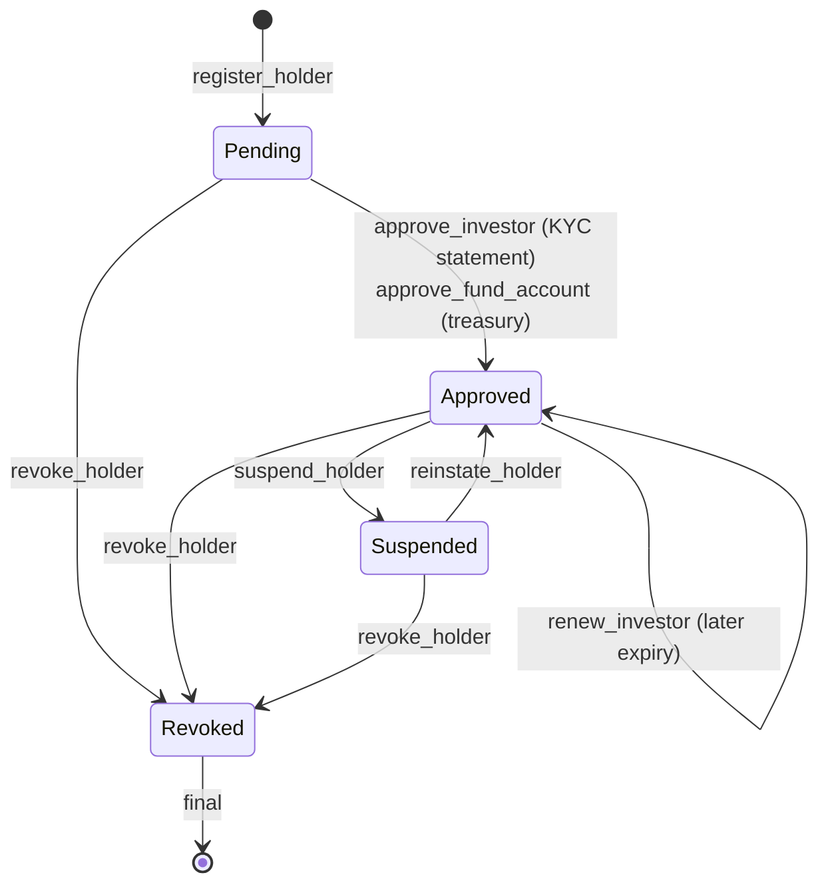
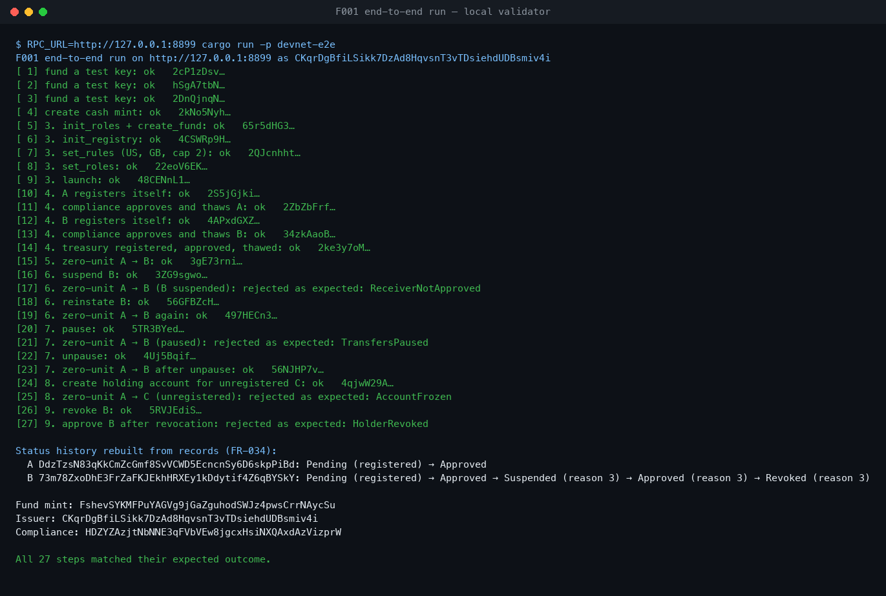

# Tokenized MMF Collateral

Open-source, issuer-side infrastructure for a tokenized money market fund on Solana, built to be
used as collateral. The fund's token enforces its own rules: only approved, KYC-checked
institutions can hold it, and every compliance action is on-chain and on record.

Built feature by feature with [Spec Kit](https://github.com/github/spec-kit). Feature **F001 — fund
launch, roles and holder onboarding** is implemented. F002–F008 (daily price and yield,
subscription/redemption, collateral, enforcement, distributions, governance, operator tooling)
follow in order; see [docs/speckit-inputs.md](docs/speckit-inputs.md).

## What F001 does

- **Launch**: the issuer creates a fund and its Token-2022 mint in one instruction, sets holder
  rules (KYC providers, allowed countries, holder cap) and roles, then opens it.
- **Onboarding**: an institution registers; compliance approves it with an ed25519-signed KYC
  statement; its one holding account is thawed.
- **Transfer rules**: a transfer hook rejects any transfer whose sender or receiver isn't approved
  with valid KYC, while transfers are paused, or past the holder cap — however the transfer is
  built.
- **Compliance actions**: suspend, reinstate, revoke, pause, unpause, each reason-coded and
  recorded. Roles can be Squads multisig vaults.
- **No unpaid units**: no instruction mints or burns in F001, and Token-2022's permissioned burn
  stops holders destroying their own units.

The specification, plan and design are in [specs/001-fund-launch-onboarding/](specs/001-fund-launch-onboarding/);
the rules every feature follows are in the [constitution](.specify/memory/constitution.md) and
[docs/shared-model.md](docs/shared-model.md).

## Architecture

### Programs, accounts and authorities

Three Anchor programs share one Token-2022 mint. Every authority over the mint is a program PDA, so
no person's key can mint, freeze or reconfigure the token.



### Onboarding: two transactions (SC-005)



### Every transfer: the hook's fixed check order (FR-026)



### Holder status



Suspend, reinstate, revoke, pause and unpause each carry a reason code and emit a permanent event; a
holder's full status history can be rebuilt from those events alone.

## Tests

**141 tests pass**: 110 program tests on LiteSVM (one rejection test per rule, each asserting the
exact error — all 63 error variants covered), unit tests in the shared crates, 128 randomized
operation sequences checked against a reference model, and a scale test showing the hook costs the
same 15 449 compute units with 10 or 10 000 holders.


The end-to-end script runs the full flow on a real validator (here a local
`solana-test-validator` with the programs and the mainnet Token-2022 build loaded): 27 steps, each
checked against its expected outcome, ending with each holder's status history rebuilt from
on-chain records.



Transfers on a cluster move zero units: F001 deliberately has no way to create units (FR-035), and a
zero-unit transfer still runs every hook check. Tests that move real units run on LiteSVM, which can
place units in an account. **Devnet deployment is pending**; the same script runs there unchanged
once the programs are deployed. Screenshots are rendered from the captured output with
`scripts/render_terminal.py`.

## Repository layout

```text
programs/
  fund/             fund terms, status, the Token-2022 mint (create_fund, launch)
  compliance_hook/  holder register, onboarding, and the transfer hook
  governance/       roles and compliance actions
crates/
  mmf-common/       program ids, seeds, enums, ISO 3166 table, KYC statement format, account views
  mmf-sdk/          instruction builders, PDA helpers, mock KYC provider, hooked transfers
tests/              LiteSVM harness and test suites; mainnet fixtures in tests/fixtures/
scripts/
  devnet-e2e/       end-to-end run against devnet or a local validator
  check-error-coverage.sh, check-duplicate-crates.sh
docs/               design, shared model, Spec Kit inputs, workflow
specs/              one folder per feature: spec, plan, research, data model, contracts, tasks
```

## Build and test

Requirements: Rust 1.90 (pinned in `rust-toolchain.toml`), Anchor CLI 1.1.2 (`avm use 1.1.2`),
Solana CLI 3.1.10 or newer.

```bash
anchor build                                          # the three programs
cargo test -p mmf-common                              # shared types
cargo test -p tests                                   # LiteSVM suites, incl. randomized invariants
cargo test -p tests --release --test scale -- --ignored   # 10 vs 10 000 holders
scripts/check-error-coverage.sh                       # every error variant has a test
```

The test fixtures (Token-2022 v11 and Squads v4, dumped from mainnet) are committed; how to refresh
and verify them is in [tests/fixtures/README.md](tests/fixtures/README.md).

## End-to-end run

`scripts/devnet-e2e` runs the whole F001 flow against a cluster, using zero-unit transfers (F001
can't create units, and a zero-unit transfer still runs every hook check). Rehearse it free on a
local validator, then run it on devnet once the programs are deployed. Commands are in
[quickstart.md](specs/001-fund-launch-onboarding/quickstart.md#devnet-run-r16).

## Status

F001 is implemented and tested; devnet deployment and the human review gate are pending before it
merges to `main`. Nothing here is audited — don't use it with real assets.
