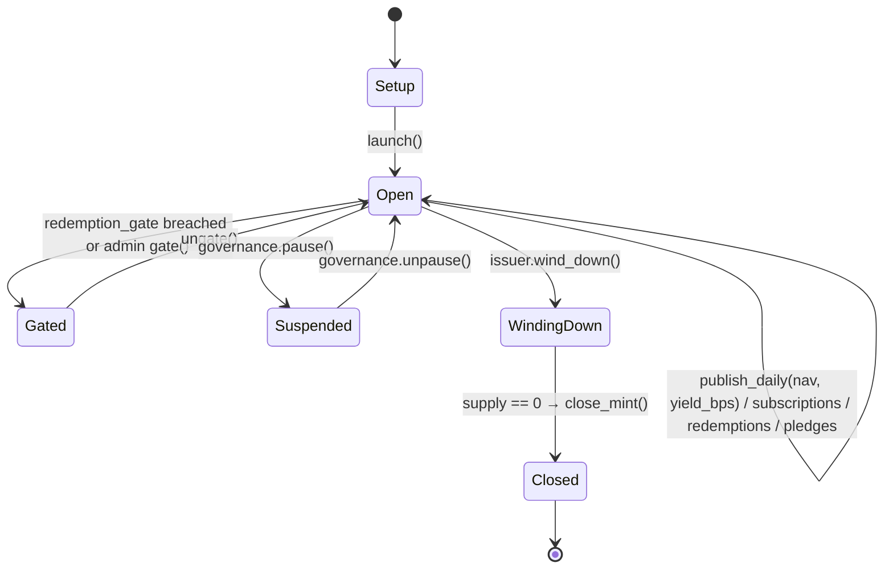
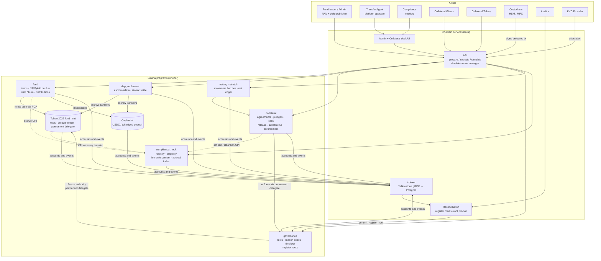
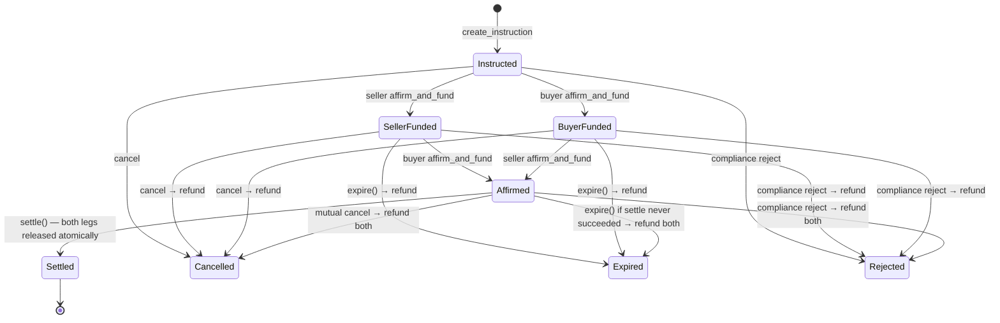
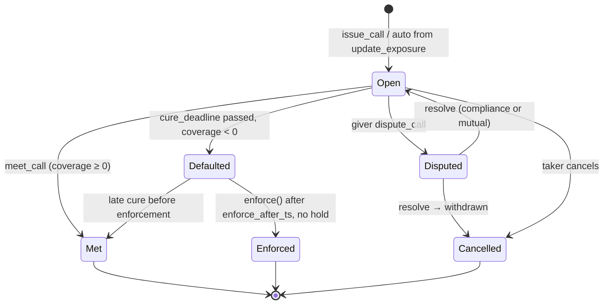
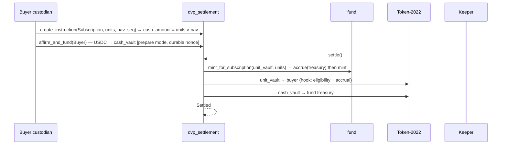

# Tokenized MMF Collateral Platform — Design Document

| | |
|---|---|
| **Status** | Draft v0.2 (theme changed from tokenized note to tokenized MMF collateral) |
| **Date** | 2026-09-01 |
| **Target** | Turbin3 capstone → open-source reference implementation |
| **Chain** | Solana (devnet first; mainnet-beta after audit) |
| **Positioning** | **Issuer-side infrastructure**: the stack a tokenized money-market fund's transfer agent runs — fund token with runtime-enforced compliance, subscription/redemption DvP, daily yield accrual, and a **collateral module** (pledge, margin call, release, substitution, enforcement) with bank-grade signing, audit, and netting of daily collateral movements. |

---

## 0. TL;DR

A tokenized money-market fund (TMMF) is a parking lot for institutional cash that earns yield. The 2026 story is not the yield; it is **collateral mobility** — posting fund units directly as margin instead of redeeming to cash first, which today takes a dealing window plus one or two settlement days while the margin call is due at 3 pm. [34][35][38]

This project is the on-chain stack a fund issuer / transfer agent would run to make that work on Solana:

1. **Fund token** on Token-2022 with compliance enforced by the runtime (transfer hook, default-frozen accounts, permanent delegate).
2. **Subscription / redemption / secondary DvP** — atomic, escrow-affirm, custodian-friendly (durable nonces, prepare-mode signing).
3. **Yield accrual** — a hook-maintained per-holder accrual index, so daily dividends are computed on-chain without a trusted snapshot service, and pledged units keep accruing to whoever legally owns them.
4. **Collateral** — pledge as *security interest* (units stay in the pledgor's account, locked by the hook) or *title transfer* (units move); haircuts against a published NAV; margin calls with deadlines; release, substitution, and pre-agreed **default enforcement** via permanent delegate.
5. **Controls & audit** — roles, multisig, reason-coded actions, timelocks, HSM-compatible signing, epoch merkle root of the register.
6. **(Stretch) Netting** — bilateral net exposure per agreement, and multilateral netting of the day's collateral deliveries when the platform acts as collateral agent (a stated legal assumption, §6.7).

The deliberately hard problems: §9.1 async DvP with custodian signing, §9.2 hook-enforced lien + accrual index, §9.3 enforcement semantics, §9.4 netting.

### 0.1 What this is *not* (read before pitching)

- Not a third-party collateral hub over BlackRock's or Franklin's tokens. Those funds own their mints and hooks; a hub would need a wrapping/receipt model, which breaks the legal chain and is exactly what banks dislike. This platform is what the *fund's* transfer agent runs.
- Not a CCP. Margin under non-cleared agreements is bilateral. Multilateral netting here applies only to *settlement of collateral movements* when a collateral-agent role is contractually in place.
- Not legal advice. Whether a pledge is a title transfer or a security interest, who receives income, and what price applies outside the dealing window are terms of the collateral agreement; the code enforces those terms, it does not decide them. [39]

---

## 1. Background and problem statement

### 1.1 Market context (mid-2026)

- Tokenized RWA AUM reached ~$8.4 B by May 2026 (+298 % vs 2024); tokenized Treasury/MMF products manage well over $15 B on-chain. Hashnote's USYC (~$3 B) and BlackRock's BUIDL (~$2.9 B) lead. [34]
- **Regulatory unlock:** on 8 Dec 2025 the CFTC launched a Digital Assets Pilot Program with guidance allowing tokenized versions of eligible collateral; the CFTC Global Markets Advisory Committee had recommended TMMFs as eligible collateral. [35][40]
- **Demand:** 66 % of surveyed institutions plan TMMFs by 2027; 44 % expect to *accept* TMMFs as eligible collateral. [34]
- **Pain, quantified:** ~$1.6 trillion of non-cleared initial and variation margin was posted/received at end-2025, on processes that remain dependent on manual reconciliation, fragmented systems, and settlement delays — worst under stress. [34][36]
- **Real transactions:** Lloyds Banking Group and Aberdeen Investments settled FX derivative trades using a TMMF as collateral; BUIDL tokens can now be posted as collateral. [35][38]
- **On Solana specifically:** Solana's tokenized RWA market reached $3.62 B in H1 2026; BUIDL holds ~$615 M on Solana via Securitize; Citi, JPMorgan/Galaxy, Franklin Templeton, and Western Union have production or pilot activity on the network. [1][2][3]

### 1.2 The operational problem in one paragraph

A fund holds cash in an MMF. At 11 am it receives a margin call due at 3 pm. The MMF units are perfectly good collateral, but the counterparty wants an asset it can take. Redeeming means waiting for the fund's dealing window, then T+1/T+2 settlement — so the desk either keeps an idle cash buffer (earning nothing) or draws a credit line. A tokenized unit can be pledged and moved in minutes, around the clock, without redeeming, and keeps earning while pledged. For a repo or margin desk the gain is timing risk removed, not extra yield. [38][40]

### 1.3 What institutions say is blocking them → design response

| Hurdle | Who says so | Design response |
|---|---|---|
| Custody: HSM / multi-party approvals take hours; Solana transactions expire in ~90 s | BIS via [4]; DFNS [22] | Prepare-mode signing + durable nonces (§7.3, §9.1) |
| DvP with qualified custodians is non-negotiable | Liquid Mercury [11]; MAS via [6] | `dvp_settlement` for subscriptions, redemptions, secondary transfers (§6.4) |
| Collateral agreement must fix title-transfer vs security-interest, income treatment, intraday accrual, valuation outside dealing window; haircuts must reflect liquidity and settlement-asset risk | Control-model analysis [39] | `collateral` program models both legal modes, income routing, NAV records, haircuts (§6.5) |
| Legally enforceable, custodian-usable, auditable by finance, recoverable under governance | Blockchain Council [7] | Governance + `ActionRecord` + register root (§6.6, §7.2) |
| Interconnection risk: shocks can transmit between funds, collateral users, stablecoins, and traditional markets; continuous ledger ≠ continuous liquidity | NY Fed analysis via [39] | Concentration limits per taker / platform in agreements; enforcement grace periods; no automatic redemption in enforcement (§6.5.6) |
| Netting efficiency and par convertibility; interoperability across ledgers | IMF [5]; DTCC/Euroclear/Clearstream [4] | Bilateral net exposure; hub netting of movements (§6.7); interop out of scope (§15) |
| Adoption is real where tokenization improves settlement, collateral movement, compliance checks, reporting | Blockchain Council [8]; Centrifuge [10] | The entire scope |

### 1.4 Gap in existing open source on Solana

| Project | Covers | Missing |
|---|---|---|
| Solana Developer Platform [12][13] | Issuance, wallets, payments, compliance ops API | DvP, collateral, accrual, netting; unaudited, hosted-first |
| Loopscale `rwa-token` [24] | Permissioned-token wrapper | Everything post-issuance |
| Upside OS Solana RWA [25] | Access control, hook restrictions, lockups, off-chain-snapshot dividends | On-chain accrual, pledge/lien, DvP, enforcement |
| Gitdigital KYC SDK [28] | Hook-enforced KYC registry | Everything post-issuance |

No open-source Solana project models pledge/lien semantics for a regulated fund token.

---

## 2. Goals and non-goals

### Goals

- G1. Token-level compliance for fund units (only approved holders; runtime-enforced).
- G2. Atomic DvP for subscriptions, redemptions, and secondary transfers; custody-compatible signing.
- G3. On-chain daily yield accrual per holder without a trusted snapshot service; correct under pledges in both legal modes.
- G4. Collateral: pledge (lien or title transfer), NAV-based valuation with haircuts, margin calls with deadlines, release, substitution, pre-agreed enforcement.
- G5. Governance with reason-coded, event-emitting actions; enforcement that is fast but never silent.
- G6. Verifiable reconciliation via epoch register roots.
- G7. Stretch: netting of daily collateral movements among hub participants; bilateral net exposure per agreement.

### Non-goals (v1)

- Fund legal structure, prospectus, transfer-agent licensing, ISDA/CSA drafting.
- Real KYC provider integration (attested interface, mocked).
- Fiat rails; the cash leg is USDC or a tokenized deposit (pluggable).
- Portfolio management of the fund's underlying T-bills (off-chain; only NAV/yield are published on-chain).
- Confidential balances (protocol-blocked, §12).
- Cross-chain collateral (Canton/Ethereum) — seam kept, not built (§15).
- Acting as a CCP; novation; close-out netting of derivatives.

---

## 3. Personas and roles

| Role | Description | On-chain representation |
|---|---|---|
| **Fund Issuer** | Legal fund entity | `ROLE_ISSUER` (Squads multisig) |
| **Fund Administrator / NAV publisher** | Publishes daily NAV and yield | `ROLE_FUND_ADMIN` |
| **Transfer Agent** | Maintains register, runs distributions, operates the platform | `ROLE_TRANSFER_AGENT` |
| **Compliance Officer** | Approves/suspends holders; freezes; holds on enforcement | `ROLE_COMPLIANCE` (multisig) |
| **Collateral Giver (pledgor)** | Institution posting fund units as margin | Approved holder; party to `PledgeAgreement` |
| **Collateral Taker (secured party)** | Institution receiving margin | Approved holder; party to `PledgeAgreement` |
| **Collateral Agent** | Operator of the hub for multilateral movement netting (optional role, contractual) | `ROLE_COLLATERAL_AGENT` |
| **Custodian** | Signs for givers/takers from HSM/MPC | Prepare-mode transactions; durable nonce accounts |
| **Auditor** | Independent verifier | `ROLE_AUDITOR`; commits register roots |
| **Keeper** | Automation: settle, expire, accrue, net | `ROLE_KEEPER`; permissionless where safe |
| **KYC Provider** | Eligibility attestations | Pubkey in `Registry.kyc_providers` |

---

## 4. Fund token model

### 4.1 Instrument

A tokenized share class of a government money-market fund. Constant-NAV target ($1.00) with a published daily NAV (so the design survives a NAV ≠ 1 event); daily yield accrued to holders of record at each daily publish; distributed monthly either as additional units (reinvest) or as cash. Units are transferable between approved holders 24/7; subscriptions and redemptions settle DvP against the cash mint.

```text
FundTerms {
  fund_id:            [u8; 12]
  cash_mint:          Pubkey            // USDC or tokenized deposit
  unit_decimals:      u8                // 6
  nav_decimals:       u8                // 8 (NAV in cash minor units × 10^2)
  target_nav:         u64               // 1.00
  distribution_mode:  enum { Reinvest, Cash }
  distribution_cadence_days: u16        // 30
  dealing_cutoff_utc: u32               // seconds after midnight
  redemption_gate_bps: u16              // max daily redemptions as % of AUM (liquidity control)
  terms_hash:         [u8; 32]
  terms_uri:          String
}
```

### 4.2 Fund state machine



### 4.3 Yield accrual — global index pattern

```text
Global:   accrual_index (u128, fixed 1e18), updated once per day at publish_daily:
          accrual_index += daily_yield_bps × 1e18 / 10_000
Holder:   index_at_last_touch (u128), accrued_units (u128)
On every balance change (hook / mint / burn) and on claim:
          accrued_units += balance_before × (accrual_index − index_at_last_touch) / 1e18
          index_at_last_touch = accrual_index
Distribution (monthly): pay accrued_units as new units (Reinvest) or accrued_units × NAV as cash.
```

The day's yield goes to whoever holds the units at the moment of `publish_daily` — the daily record-date semantics of a real MMF — with no snapshot storage and no off-chain calculation. Under a **lien** pledge the units stay in the pledgor's account, so accrual flows to the pledgor automatically; under **title transfer** it flows to the taker, and the agreement's `income_to` field determines whether the taker owes it back (a "manufactured" income payment, §6.5.4).

---

## 5. Architecture overview



### 5.1 Program inventory

| Program | Responsibility | Authorities |
|---|---|---|
| `compliance_hook` | Hook `Execute`; holder registry; eligibility; **lien enforcement** (pledged quantity cannot leave); **accrual index** updates | Freeze authority of fund mint (PDA) |
| `fund` | Terms, fund state, NAV/yield publishing, subscription/redemption mint & burn, distributions, gates | Mint authority, mint-close authority (PDA) |
| `dvp_settlement` | Escrow-affirm settlement of subscriptions (cash→units), redemptions (units→cash), secondary transfers | Vault owner (PDA) |
| `collateral` | Pledge agreements, pledges (lien / title), NAV-based valuation and haircuts, margin calls, release, substitution, enforcement | CPI rights into hook (lien) and governance (enforcement) |
| `governance` | Roles, reason-coded actions, timelocks, register roots, enforcement execution as permanent delegate | Permanent delegate of fund mint (PDA) |
| `netting` (stretch) | Batches of collateral movements; incremental net ledger; funding, chunked execute, unwind | Batch vault owner (PDA) |

### 5.2 Trust boundaries

- **Runtime-enforced:** eligibility, liens, accrual, atomic DvP, enforcement only within agreement terms.
- **Trusted with accountability:** fund admin's NAV/yield (signed, on-chain, auditable; stale-NAV guards in `collateral`), compliance multisig (time-locked, reason-coded, events), KYC attestations.
- **Untrusted:** indexer (verifiable via register root), API (builds transactions, holds no institutional keys), UI.

---

## 6. On-chain design

### 6.1 Fund mint configuration (Token-2022)

| Extension | Setting | Why |
|---|---|---|
| `TransferHook` | `compliance_hook` | Eligibility, lien enforcement, and accrual on every transfer, including escrow moves and enforcement transfers. [15][18] |
| `DefaultAccountState` | `Frozen` | Accounts unusable until `approve_holder` thaws them. |
| `PermanentDelegate` | `governance` PDA | Enforcement (seizure of pledged units on default), recovery, court orders — only via program instructions with records. |
| `MetadataPointer` + `TokenMetadata` | name, symbol, `fund_id`, `terms_hash`, `terms_uri`, `share_class` | Machine-readable link to fund documents. |
| `MintCloseAuthority` | `fund` PDA | Close on wind-down. |
| Mint authority | `fund` PDA | Mint/burn only through `fund` so accrual is settled first (hooks do not fire on mint/burn). |
| Freeze authority | `compliance_hook` PDA | Thaw on approval; freeze on suspension. |
| *Not used* | `ConfidentialTransfer`, `InterestBearing`, `TransferFee`, `NonTransferable` | Confidential: blocked (§12). InterestBearing is display-only. |

### 6.2 `compliance_hook`

#### 6.2.1 Accounts

```rust
#[account] // PDA ["registry", mint]
pub struct Registry {
    pub mint: Pubkey,
    pub authority: Pubkey,                // governance PDA
    pub fund: Pubkey,                     // FundState (for accrual_index)
    pub collateral_program: Pubkey,       // allowed CPI caller for lien updates
    pub kyc_providers: [Pubkey; 4],
    pub allowed_jurisdictions: u64,
    pub max_holders: u32,
    pub holder_count: u32,
    pub transfers_paused: bool,
    pub bump: u8,
}

#[repr(u8)] pub enum HolderStatus { Pending, Approved, Suspended, Revoked }
#[repr(u8)] pub enum HolderClass { Investor, FundTreasury, Escrow, CollateralVault, Treasury }

#[account] // PDA ["holder", mint, owner]
pub struct HolderState {
    pub mint: Pubkey,
    pub owner: Pubkey,
    pub status: HolderStatus,
    pub class: HolderClass,
    pub jurisdiction: u8,
    pub investor_type: u8,
    pub kyc_expiry_ts: i64,
    pub attestation_hash: [u8; 32],
    pub attested_by: Pubkey,
    // --- lien (security-interest pledges) ---
    pub pledged_amount: u64,              // Σ active lien pledges from this account
    pub active_liens: u16,
    // --- accrual ---
    pub index_at_last_touch: u128,
    pub accrued_units: u128,              // fixed 1e18 units
    pub last_balance: u64,
    pub last_slot: u64,
    pub bump: u8,
}
```

`ExtraAccountMetaList` (`["extra-account-metas", mint]`) resolves `Registry`, `FundState`, `HolderState(source.owner)`, `HolderState(destination.owner)`; holder PDAs are derived with `Seed::AccountData` from the token accounts' `owner` field. Holder states are **writable** extras; the original transfer accounts arrive read-only. [18][19][30]

#### 6.2.2 `execute`

```text
1. assert source.transferring && destination.transferring
2. if registry.transfers_paused && authority != governance_pda → reject
3. amount = ix.amount; post_src = source.amount; post_dst = destination.amount
   pre_src = post_src + amount; pre_dst = post_dst − amount
4. LIEN: if authority != governance_pda:
       require!(post_src >= source_holder.pledged_amount, PledgedUnitsLocked)
   // a pledgor can move only the unpledged part; enforcement (governance PDA) bypasses
5. eligibility(destination_holder): Approved; class allowed; kyc not expired; jurisdiction; holder cap
6. eligibility(source_holder): Approved unless authority == governance_pda (enforcement / recovery)
7. ACCRUAL (settle before balance change is "seen"):
       accrue(source_holder, pre_src); accrue(destination_holder, pre_dst)
       where accrue(h, bal): h.accrued_units += bal × (fund.accrual_index − h.index_at_last_touch) / 1e18
                              h.index_at_last_touch = fund.accrual_index
8. update last_balance / last_slot; emit TransferValidated
```

Step 4 is the security-interest pledge made real: the pledged quantity is locked *inside the pledgor's own account*, no title moves, yield keeps accruing to the pledgor, and the only key that can move those units is the governance permanent delegate acting under an enforcement instruction (§6.5.6).

#### 6.2.3 Registry instructions

| Instruction | Signer | Effect |
|---|---|---|
| `init_registry` | governance | Create `Registry`, `ExtraAccountMetaList` |
| `register_holder(owner, class)` | compliance or self | `HolderState` (Pending) |
| `approve_holder(owner, attestation)` | compliance; attestation ed25519-verified against `kyc_providers` | Approved; thaw account |
| `suspend_holder / revoke_holder(reason)` | compliance | Freeze; event |
| `accrue(owner, balance)` | CPI from `fund` (mint/burn) | Same accrual as step 7 |
| `set_lien(owner, +Δ / −Δ)` | CPI from `collateral` only | Adjust `pledged_amount`; require `balance ≥ pledged_amount` on increase |
| `set_rules(...)` | governance (time-locked) | Jurisdictions, cap |

### 6.3 `fund`

```rust
#[account] // PDA ["fund", mint]
pub struct FundState {
    pub mint: Pubkey,
    pub terms: FundTerms,
    pub state: FundStatus,                // §4.2
    pub nav: u64,                         // latest published NAV
    pub nav_ts: i64,
    pub nav_seq: u64,
    pub accrual_index: u128,
    pub last_publish_ts: i64,
    pub daily_yield_bps: u32,
    pub units_outstanding: u64,
    pub redeemed_today: u64, pub day_start_ts: i64,
    pub treasury_account: Pubkey,         // class FundTreasury: holds units for primary issuance
    pub bump: u8,
}

#[account] // PDA ["nav", fund, seq] — immutable history for auditors and for collateral valuation
pub struct NavRecord { pub seq: u64, pub nav: u64, pub daily_yield_bps: u32, pub as_of_ts: i64, pub published_by: Pubkey }

#[account] // PDA ["dist", fund, cycle]
pub struct DistributionCycle { pub cycle: u32, pub mode: u8, pub index_at_close: u128, pub total_units: u128, pub paid_units: u128, pub status: u8 }
```

| Instruction | Signer | Effect |
|---|---|---|
| `create_fund(terms)` | issuer | Mint + extensions + `FundState` (Setup) |
| `launch` | issuer | Open |
| `publish_daily(nav, daily_yield_bps)` | fund admin | New `NavRecord`; `accrual_index += yield`; resets daily redemption counter. Rejects if `nav` deviates from previous by more than `max_nav_move_bps` without a governance override (fat-finger guard). |
| `mint_for_subscription(to_escrow, units)` | CPI from `dvp_settlement` (subscription instruction Affirmed) | CPI `hook.accrue(treasury)`; mint to the settlement escrow; the escrow→investor release goes through the hook |
| `burn_for_redemption(from_escrow, units)` | CPI from `dvp_settlement` (redemption Affirmed) | Enforce `redemption_gate_bps`; CPI `accrue`; burn; the cash leg pays `units × nav` |
| `close_cycle(cycle)` | transfer agent | Freeze `index_at_close`; open `DistributionCycle` |
| `distribute(cycle, holder)` | keeper | Settle holder accrual up to `index_at_close`; pay as units (mint) or cash; receipt PDA; idempotent |
| `finalize_cycle(cycle)` | transfer agent | Counts verified; event |
| `gate / ungate` | fund admin | Liquidity gate |
| `wind_down / close_mint` | issuer | Per state machine |

Design note: primary issuance is DvP too — units are minted *into the settlement escrow* only when the cash leg is funded, so there is never an unpaid-for unit in circulation.

### 6.4 `dvp_settlement`

Unchanged in mechanism from the note design; three instruction kinds now.

```rust
#[repr(u8)] pub enum SettlementKind { Subscription, Redemption, SecondaryTransfer }
#[repr(u8)] pub enum SettlementStatus { Instructed, SellerFunded, BuyerFunded, Affirmed, Settled, Cancelled, Expired, Rejected }

#[account] // PDA ["settlement", fund, seq]
pub struct SettlementInstruction {
    pub fund: Pubkey, pub seq: u64, pub kind: SettlementKind,
    pub unit_mint: Pubkey, pub cash_mint: Pubkey,
    pub seller: Pubkey,                   // for Subscription: fund treasury PDA
    pub buyer: Pubkey,                    // for Redemption: fund treasury PDA
    pub units: u64, pub cash_amount: u64, // cash fixed at instruction time from NavRecord(seq) referenced below
    pub nav_seq: u64,
    pub not_before_ts: i64, pub expires_at_ts: i64,
    pub status: SettlementStatus,
    pub seller_funded_at: i64, pub buyer_funded_at: i64,
    pub external_ref: [u8; 32], pub batch: Option<Pubkey>, pub created_by: Pubkey, pub bump: u8,
}
```



- **Subscription:** buyer funds cash; `settle` CPIs `fund.mint_for_subscription` into the unit vault then releases units→buyer (hook) and cash→fund treasury, atomically.
- **Redemption:** seller (investor) funds units into escrow (hook: Investor→Escrow, lien check applies — pledged units cannot be redeemed); fund treasury funds cash at `units × nav(nav_seq)`; `settle` burns from escrow via `fund.burn_for_redemption` and releases cash.
- **Secondary transfer:** as in the note design.
- Atomicity, expiry, rejection, compute budget, and ALT considerations are unchanged (§9.1).

### 6.5 `collateral`

#### 6.5.1 Concepts

- **PledgeAgreement** — the on-chain shadow of the bilateral collateral agreement between one giver and one taker: legal mode, haircut, eligibility, valuation rules, income routing, enforcement terms. Both parties sign its creation (co-signed or two-step affirm). It does not replace the legal document; it stores the hash and the enforceable parameters.
- **Pledge** — a quantity of units posted under an agreement. Mode **Lien**: units remain in the giver's account, locked by the hook. Mode **TitleTransfer**: units move to a taker-controlled `CollateralVault` account (class `CollateralVault`, owned by the taker but administered by the program PDA for return obligations).
- **CollateralCall** — a demand by the taker (or the giver, for return of excess) for a value delta by a deadline.
- **Enforcement** — on an uncured shortfall after the agreement's grace period, the taker may take pledged units up to the shortfall value via the governance permanent delegate, without a discretionary governance timelock — because the parties pre-agreed the terms — but with a compliance **hold** veto (§6.5.6).

#### 6.5.2 Accounts

```rust
#[repr(u8)] pub enum PledgeMode { Lien, TitleTransfer }
#[repr(u8)] pub enum IncomeTo { Giver, Taker, TakerOwesGiver }
#[repr(u8)] pub enum AgreementStatus { Proposed, Active, Terminating, Terminated }

#[account] // PDA ["agreement", fund, giver, taker, nonce]
pub struct PledgeAgreement {
    pub fund: Pubkey, pub giver: Pubkey, pub taker: Pubkey,
    pub mode: PledgeMode,
    pub income_to: IncomeTo,
    pub haircut_bps: u16,                 // e.g. 200 = 2 %
    pub max_nav_age_secs: u32,            // reject valuation on stale NAV
    pub call_cure_secs: u32,              // time to meet a call (e.g. 4 h)
    pub enforcement_grace_secs: u32,      // additional grace after cure deadline
    pub min_transfer_value: u64,          // minimum transfer amount (MTA)
    pub concentration_cap_units: u64,     // max units pledged under this agreement
    pub agreement_hash: [u8; 32],         // hash of the legal CSA / annex
    pub status: AgreementStatus,
    pub giver_signed: bool, pub taker_signed: bool,
    pub pledged_units: u64,
    pub required_value: u64,              // current agreed exposure to be covered (cash minor units)
    pub bump: u8,
}

#[account] // PDA ["pledge", agreement, seq]
pub struct Pledge {
    pub agreement: Pubkey, pub seq: u64,
    pub units: u64, pub mode: PledgeMode,
    pub vault: Option<Pubkey>,            // TitleTransfer only
    pub posted_at: i64, pub nav_seq_at_post: u64,
    pub released_units: u64, pub enforced_units: u64,
    pub status: u8,                       // Active / Released / Enforced / Substituted
}

#[repr(u8)] pub enum CallKind { Delivery, Return }
#[repr(u8)] pub enum CallStatus { Open, Met, Disputed, Defaulted, Enforced, Cancelled }

#[account] // PDA ["call", agreement, seq]
pub struct CollateralCall {
    pub agreement: Pubkey, pub seq: u64, pub kind: CallKind,
    pub value_delta: u64,                 // cash minor units
    pub units_required: u64,              // computed at issuance from NAV & haircut, recomputed on cure
    pub nav_seq: u64,
    pub issued_at: i64, pub cure_deadline_ts: i64, pub enforce_after_ts: i64,
    pub status: CallStatus,
    pub external_ref: [u8; 32],           // margin-call reference from the taker's system
}

#[account] // PDA ["hold", call]
pub struct EnforcementHold { pub placed_by: Pubkey, pub reason: u8, pub case_ref_hash: [u8; 32], pub placed_at: i64, pub lifted_at: i64 }
```

#### 6.5.3 Valuation

```text
collateral_value(pledge) = units × nav(NavRecord ≥ agreement.max_nav_age) × (10_000 − haircut_bps) / 10_000
coverage(agreement)      = Σ collateral_value(active pledges) − agreement.required_value
units_required(Δvalue)   = ceil(Δvalue × 10_000 / (nav × (10_000 − haircut_bps)))
```

Valuation always references a specific `NavRecord` seq; if the latest record is older than `max_nav_age_secs`, calls cannot be issued and enforcement cannot proceed (stale-price guard). Intraday accrual is *not* counted in collateral value unless the agreement says so — a conservative default reflecting that accrual is realised only at `publish_daily`. [39]

#### 6.5.4 Instructions

| Instruction | Signer | Effect |
|---|---|---|
| `propose_agreement(params)` | giver or taker | `Proposed`; both must be Approved holders |
| `sign_agreement` | the other party | `Active` when both signed. Prepare-mode friendly. |
| `pledge(agreement, units)` | giver | **Lien:** CPI `hook.set_lien(giver, +units)`; no transfer. **TitleTransfer:** transfer giver→vault through the hook. Checks `concentration_cap`. Emits `Pledged`. |
| `update_exposure(agreement, required_value, ref)` | taker, with giver affirm (two-step) — or taker alone if the agreement's `taker_may_call_unilaterally` is set | Sets `required_value`; if coverage < 0 and shortfall ≥ MTA → auto-creates a `Delivery` call; if coverage > MTA → giver may create a `Return` call |
| `issue_call(kind, value_delta)` | taker (Delivery) / giver (Return) | `CollateralCall` with `cure_deadline = now + call_cure_secs`, `enforce_after = cure_deadline + grace` |
| `meet_call(call, units)` | giver (Delivery) → `pledge`; taker (Return) → `release` | `Met` when coverage ≥ 0 at current NAV |
| `release(pledge, units)` | taker (or keeper when a `Return` call is open and coverage allows) | **Lien:** CPI `set_lien(giver, −units)`. **TitleTransfer:** vault→giver through hook. |
| `substitute(old_pledge, new_units)` | giver, taker affirm | Atomic: new pledge posted then old released, coverage never dips |
| `dispute_call(call, ref)` | giver | `Disputed`; enforcement blocked until compliance or mutual resolution |
| `enforce(call, units)` | taker, after `enforce_after_ts`, no hold, not disputed | §6.5.6 |
| `manufactured_income(agreement, cycle)` | keeper | For `TitleTransfer` + `income_to = TakerOwesGiver`: computes the distribution the vault received for the cycle and creates a cash obligation taker→giver settled via `dvp_settlement` (cash-only leg) |
| `terminate_agreement` | mutual, or taker after all pledges released | `Terminated` |

#### 6.5.5 Call lifecycle



#### 6.5.6 Enforcement semantics

- Pre-condition: call `Defaulted`, `now ≥ enforce_after_ts`, not `Disputed`, no active `EnforcementHold`, NAV not stale.
- Quantity: `min(units_required_at_current_nav, pledge.units − released − enforced)`. Enforcement takes only the shortfall, never the whole pledge.
- Mechanism: `collateral` CPIs `governance.execute_enforcement(call)`; governance signs `transfer_checked` as **permanent delegate** from the giver's account (Lien) or from the vault (TitleTransfer) to the taker's account; the hook runs with `authority == governance_pda` (lien bypass, destination eligibility still checked, accrual settled). A `governance.ActionRecord{kind: Enforcement, reason: CollateralDefault, case_ref = call}` is written; events emitted.
- **No discretionary timelock**, because the parties pre-agreed the terms on-chain when signing the agreement — a 24-hour governance delay would defeat the purpose of margin. Instead: (a) the cure period and grace period are the agreed delay; (b) compliance may place an `EnforcementHold` at any time (sanctions, court order, operational error), which blocks enforcement until lifted; (c) every enforcement is permanently recorded with the call reference.
- Enforcement moves *units*, never triggers a fund redemption. Liquidating the units is the taker's decision afterwards (via a redemption DvP subject to the fund's gate). This keeps enforcement from becoming a run on the fund. [39]

### 6.6 `governance`

Unchanged from the note design except: `ActionKind` gains `Enforcement` and `EnforcementHold`; `execute_enforcement` is callable only via CPI from `collateral` with a `Defaulted` call account; `commit_register_root` unchanged.

```rust
#[repr(u8)] pub enum ReasonCode { CourtOrder, SanctionsHit, LostKey, OperationalError, CollateralDefault, IssuerWindDown, Other }
#[repr(u8)] pub enum ActionKind { FreezeHolder, ThawHolder, SuspendHolder, PauseTransfers, UnpauseTransfers, Seize, ForcedTransfer, Enforcement, EnforcementHold, RejectSettlement, SetRules, CommitRegisterRoot }
```

| Action | Timelock | Notes |
|---|---|---|
| Freeze / pause / suspend / hold | none | Protective, reversible |
| Thaw / unpause / lift hold | none | |
| `forced_transfer`, `seize`, `set_rules` | `timelock_secs` (24 h) | Discretionary — proposals visible and cancellable |
| `execute_enforcement` | none (agreement-defined delays apply) | Non-discretionary; only from `collateral` CPI with a `Defaulted` call |

### 6.7 `netting` (stretch)

Two distinct things, kept separate on purpose:

1. **Bilateral net exposure** lives in `PledgeAgreement.required_value`: many trades between two parties collapse to one number, one call, one collateral movement. This is standard CSA behaviour and needs no netting program.
2. **Multilateral netting of collateral movements** applies when the platform operator is contractually the **collateral agent** for a set of participants (triparty-like). Each day's deliveries and returns across all agreements are submitted as obligations; the program maintains incremental per-participant net unit positions, checks conservation, collects from net deliverers, pays net receivers, and unwinds on failure. Design identical to the note version (batch state machine, chunked execute) with obligations being `(from, to, units)` collateral movements.

Stated assumption: without the collateral-agent role, participants do not consent to their collateral being netted against third parties, and the module must not be enabled. This is a legal/contractual switch (`Registry.collateral_agent`), not a technical one.

### 6.8 PDA index

| Program | PDA seeds |
|---|---|
| compliance_hook | `["registry", mint]`, `["holder", mint, owner]`, `["extra-account-metas", mint]` |
| fund | `["fund", mint]`, `["nav", fund, seq]`, `["dist", fund, cycle]`, `["dreceipt", dist, owner]` |
| dvp_settlement | `["settlement", fund, seq]` + vault ATAs |
| collateral | `["agreement", fund, giver, taker, nonce]`, `["pledge", agreement, seq]`, `["call", agreement, seq]`, `["hold", call]`, `["cvault", agreement]` |
| governance | `["roles", fund]`, `["action", fund, seq]`, `["root", fund, epoch]` |
| netting | `["batch", fund, seq]`, `["net", batch, participant]` |

### 6.9 Events

`HolderApproved/Suspended`, `TransferValidated`, `LienSet`, `Accrued`, `NavPublished`, `Subscribed`, `Redeemed`, `SettlementCreated/LegFunded/Settled/Cancelled/Expired/Rejected`, `AgreementActive`, `Pledged`, `ExposureUpdated`, `CallIssued/Met/Disputed/Defaulted`, `Released`, `Substituted`, `Enforced`, `HoldPlaced/Lifted`, `CycleClosed`, `Distributed`, `ActionProposed/Executed`, `RegisterRootCommitted`, `BatchClosed/Settled/Unwound`. All carry `fund`, `slot`, `unix_ts`, and `external_ref` where relevant.

---

## 7. Off-chain services

All Rust (axum + sqlx + Postgres); thin TypeScript UI. No institutional signing keys are ever held by these services.

### 7.1 Indexer
Yellowstone gRPC streams for the six programs and the fund mint; slot-versioned tables for holders, liens, pledges, calls, settlements, NAV history, distributions, actions, batches; exports shaped for collateral-ops systems (agreement ref, call ref, units, value, NAV seq, deadline, status).

### 7.2 Reconciliation service
Per epoch: fetch all fund-mint token accounts and `HolderState`s at slot *s* from RPC (not the indexer) → sorted `(owner, balance, pledged_amount, status)` → merkle root → auditor commits via `governance.commit_register_root`. Three-way tie-out: on-chain root vs indexer root vs transfer agent's register export. A second root covers **pledges** `(agreement, pledge seq, units, mode, status)` so collateral positions are auditable independently of the UI.

### 7.3 API — prepare / execute / simulate
As in the note design [13]: `prepare` returns a v0 transaction with `AdvanceNonceAccount` at index 0 on a custodian-owned durable nonce, unsigned, plus an ALT reference; `simulate` returns CU, logs, and hook/collateral rejection reasons before signing. Standard transactions expire after ~150 slots (~60–90 s); durable nonces remove the expiry so approval flows that take hours can complete. [20][21][22][23] Additionally: a **collateral-desk API** — `GET /agreements/{id}/coverage`, `POST /calls`, `POST /calls/{id}/meet` — each returning prepared transactions.

### 7.4 UI
Fund admin view (NAV publish, gates, cycles), register, settlement queue, **collateral desk** (agreements, coverage at latest NAV, open calls with countdown, enforcement holds), action log, reconciliation status.

---

## 8. Key flows

### 8.1 Subscription (primary issuance is DvP)



### 8.2 Intraday margin call met with a lien pledge

```mermaid
sequenceDiagram
    participant TK as Taker (custodian)
    participant C as collateral
    participant H as compliance_hook
    participant GV as Giver (custodian)
    participant K as Keeper

    TK->>C: update_exposure(agreement, required_value=+50M, ref) [11:02]
    C-->>C: coverage < 0 → CollateralCall{Delivery, units_required @ nav_seq, cure 15:02, enforce_after 17:02}
    GV->>C: pledge(agreement, units) [11:40, prepare mode → Squads quorum → submit]
    C->>H: set_lien(giver, +units) — no transfer, units stay in giver's account
    C-->>C: coverage ≥ 0 → call Met [11:41]
    Note over GV,H: Giver's units keep accruing yield; giver cannot transfer/redeem the pledged quantity
    K->>C: (end of day) no action needed
```

### 8.3 Release after exposure falls

Taker `update_exposure(required_value = 20M)` → coverage > MTA → giver `issue_call(Return)` → taker `release(pledge, units)` (or keeper releases once the Return call is open and coverage remains ≥ 0) → `hook.set_lien(giver, −units)`.

### 8.4 Default and enforcement

```mermaid
sequenceDiagram
    participant TK as Taker
    participant C as collateral
    participant CO as Compliance
    participant G as governance
    participant T as Token-2022 (hook)

    C-->>C: cure_deadline passed, coverage < 0 → call Defaulted [15:02]
    Note over CO: compliance sees Defaulted event; may place EnforcementHold (sanctions / court / error)
    TK->>C: enforce(call, units) [17:05, after enforce_after_ts, no hold, not disputed, NAV fresh]
    C->>G: execute_enforcement(call) [CPI]
    G->>T: transfer_checked(giver → taker, units) as permanent delegate
    T-->>T: hook: authority == governance → lien bypass, taker eligibility checked, accrual settled
    G-->>G: ActionRecord{Enforcement, CollateralDefault, case_ref = call}, events
    C-->>C: call Enforced, pledge.enforced_units += units, hook.set_lien(giver, −units)
```

### 8.5 Daily yield and monthly distribution

`publish_daily(nav, yield_bps)` bumps `accrual_index`; every transfer settles holders' accrual lazily; at month end `close_cycle` freezes `index_at_close` and the keeper runs `distribute(cycle, holder)` for each holder (units minted or cash paid). For `TitleTransfer` pledges with `income_to = TakerOwesGiver`, `manufactured_income` creates the taker→giver cash obligation.

### 8.6 Redemption with lien check
Investor instructs Redemption → funds units into escrow (hook rejects if `post_balance < pledged_amount`) → treasury funds cash at NAV → `settle` burns and pays. Pledged collateral therefore cannot be redeemed out from under a taker.

### 8.7 Reconciliation epoch
As §7.2; register root and pledge root both committed and published.

---

## 9. Hard problems — decisions and alternatives

### 9.1 Asynchronous DvP with custodian signing
Unchanged from the note design: escrow-affirm chosen over co-signed single transactions; durable nonces so each party's *own* prepared transaction survives an hours-long approval; release-time compliance via the hook; explicit `Rejected` state for suspended parties mid-flight. [20][22]

### 9.2 Security-interest pledge enforced by the hook + hook-maintained accrual index

| Option | Legal fit | Yield | Mechanics | Decision |
|---|---|---|---|---|
| Move units to taker (title transfer only) | Title-transfer CSAs | Accrues to taker; manufactured income needed | Simple transfers | Supported as `TitleTransfer` |
| Move units to a program vault, track beneficial owner | Neither cleanly; looks like a wrapper | Program must route yield | Extra accounts, extra trust | Rejected |
| **Lien in `HolderState`, enforced by hook** | Security-interest / pledge CSAs | Accrues to giver automatically | `pledged_amount` check on every outbound transfer; enforcement bypass for governance PDA | **Chosen as `Lien`** |

Accrual: an off-chain snapshot (Upside model [25]) was rejected for trust reasons; a per-holder snapshot ring (the note design) was rejected because daily record dates would evict it; the **global accrual index** settles each holder lazily on every touch and at claim, costs O(1) per transfer, and gives exact daily-record-date semantics because the index only moves at `publish_daily`. Mint/burn paths CPI `accrue` because hooks do not fire on them.

Subtleties tested: transfer in the same slot as `publish_daily`; lien increase when balance is exactly equal; enforcement partially consuming a lien; redemption attempt of pledged units; accrual for a vault under `TitleTransfer`.

### 9.3 Enforcement without a discretionary timelock

A 24-hour governance delay is right for court orders and wrong for margin: by the time it elapses the exposure has moved. Decision: enforcement is **non-discretionary** — it can only execute against a `Defaulted` call whose agreed cure and grace periods have passed — and **haltable** — compliance can place a hold instantly for legitimate reasons. Alternatives considered: (a) taker-held permanent delegate (rejected: unbounded power); (b) enforcement through a separate multisig of the two parties (rejected: the defaulting party would simply not sign); (c) fully automatic enforcement by keeper at `enforce_after_ts` (rejected: takers may prefer to negotiate; enforcement should be an affirmative act with a record).

### 9.4 Netting
Bilateral net exposure is free (one number per agreement). Multilateral netting of movements reuses the incremental on-chain net ledger with conservation checks and chunked execute/unwind; enabled only under a collateral-agent role (§6.7). Recursive re-netting on a defaulting participant remains future work.

### 9.5 Verifiable reconciliation
Register root plus pledge root per epoch, committed by the auditor, reproducible by anyone from RPC. [7]

### 9.6 Confidential balances — deferred
Hooks and confidential transfers are not composable [16]; the ZK ElGamal program is disabled pending audit [17]. Collateral positions are therefore public on-chain in v1 — a real limitation for institutions, stated openly. Mitigation until the protocol catches up: omnibus custodian accounts (positions visible per custodian, not per client).

---

## 10. Security and threat model

| # | Threat | Mitigation |
|---|---|---|
| T1 | Hook bypass via mint/burn | Mint authority = `fund` PDA; `fund` CPIs `accrue`; burn only through redemption DvP |
| T2 | Direct invocation of hook `execute` / `set_lien` / `accrue` | `transferring` flag check; CPI caller checks (`collateral`, `fund` program IDs + PDA signers) |
| T3 | Hook re-pointing or malicious upgrade | Hook authority and upgrade authority = governance multisig + timelock; revoke before mainnet |
| T4 | Permanent-delegate abuse | Discretionary actions time-locked and reason-coded; enforcement only via `collateral` CPI with a `Defaulted` call; holds |
| T5 | Giver moves units out around a call | Lien check on every outbound transfer including redemption escrow |
| T6 | Double-pledging the same units | `set_lien` requires `balance ≥ pledged_amount + Δ`; `TitleTransfer` units physically leave |
| T7 | Stale or false NAV → wrong haircuts / wrongful enforcement | `NavRecord` history; `max_nav_age`; `max_nav_move_bps` guard; NAV publisher is a distinct role; enforcement blocked on stale NAV |
| T8 | Taker griefing with spurious calls | Calls tied to `required_value` under a signed agreement; giver `dispute_call`; MTA threshold; compliance hold |
| T9 | Enforcement racing a late cure | `meet_call` allowed in `Defaulted`; `enforce` re-checks coverage at execution and takes only the remaining shortfall |
| T10 | Escrow griefing | Expiry + refund |
| T11 | Indexer compromise | Register and pledge roots on-chain; `distribute` verifies accrual on-chain |
| T12 | Concentration / run risk (enforcement triggers mass redemption) | Enforcement never redeems; `redemption_gate_bps`; per-agreement concentration cap [39] |
| T13 | Key loss (giver or taker) | `forced_transfer` with `LostKey` + attestation, time-locked |
| T14 | Compute exhaustion in hook | O(1) work; no loops over holders; CU asserted in CI |
| T15 | Clock manipulation | `Clock` sysvar; deadlines carry tolerance |
| T16 | Program bugs | Property tests (accrual conservation, valuation rounding), scenario suite, adversarial tests, audit before mainnet; SDP itself is unaudited pre-mainnet [12] — same bar |

---

## 11. Compliance and control mapping

| Institutional requirement (source) | Mechanism |
|---|---|
| Collateral agreement defines title vs security interest, income treatment, intraday accrual, valuation outside dealing window; haircuts reflect liquidity and settlement-asset risk [39] | `PledgeAgreement{mode, income_to, haircut_bps, max_nav_age}`; accrual excluded from value by default |
| Smart-contract automation executes agreed rules, does not substitute for them [39] | Enforcement bound to agreement parameters; holds; disputes |
| Concentration limits by platform, settlement asset, custodian, collateral taker [39] | `concentration_cap_units`; registry-level caps (v2) |
| Continuous ledger ≠ continuous liquidity [39] | Enforcement moves units, never forces redemption; fund gates |
| Custody: hours-long approvals; HSM signing [4][22] | Prepare mode + durable nonces |
| Freeze / pause / seize / allowlist with audit memo (SDP [13]) | `governance` + `ActionRecord` |
| DvP non-negotiable [11]; safe settlement asset [6] | `dvp_settlement`; pluggable cash mint |
| Enforceable, custodian-usable, auditable, recoverable [7] | Agreement hash on-chain; register/pledge roots; reason-coded recovery |
| Netting efficiency [5][4] | Bilateral in-agreement; hub netting under collateral-agent role |
| CFTC tokenized-collateral guidance and pilot [35][40] | Tokenized MMF units as the collateral asset; eligibility and haircut parameters explicit |

---

## 12. Runtime constraints and assumptions

| Constraint | Value / status | Impact |
|---|---|---|
| Transaction size | 1 232 bytes | Chunked netting; ALTs |
| Compute budget | ≤ 1.4 M CU | Hook O(1); CI gates |
| Blockhash validity | ~150 slots ≈ 60–90 s [20][23] | Durable nonces |
| Hook accounts | Original accounts read-only; extras writable [18][30] | Liens and accrual in `HolderState` |
| Hooks on mint/burn | Not invoked | `fund` CPIs `accrue` |
| Confidential transfers + hooks | Not composable [16] | Positions public in v1 |
| ZK ElGamal program | Disabled pending audit [17] | Same |
| SDP | Pre-mainnet, unaudited [12] | Reference only |
| Multisig | Squads v4 | Role keys are Squads vaults |
| NAV | Published on-chain by fund admin, once daily (intraday republish allowed) | No third-party oracle dependency in v1 |

---

## 13. Testing strategy

- **Property tests:** accrual conservation (`Σ accrued == supply × Δindex` across arbitrary transfer sequences); valuation rounding; lien invariants (`balance ≥ pledged_amount` always).
- **Program integration (LiteSVM/bankrun):** every instruction and state transition; hook exercised via real `transfer_checked`.
- **Scenario suite (demo):** launch → NAV publish → two subscriptions DvP → agreement signed via two prepared transactions → exposure update → call → lien pledge met in minutes → NAV publish, accrual continues to giver → exposure falls → return → second call defaulted → hold placed and lifted → enforcement → redemption blocked on pledged units → monthly distribution → reconciliation tie-out.
- **Adversarial:** one failing-by-design test per threat row.
- **CU/size gates:** `settle`, `pledge`, `enforce`, `distribute`, `pay_net_receiver`.
- **Fuzz:** random transfers/pledges/releases/publishes vs a reference model computing accrual and coverage exactly.
- **Devnet soak:** compressed 30-day schedule with daily publishes and reconciliation.

---

## 14. Milestones (Turbin3, ~8 weeks)

| Week | Deliverable |
|---|---|
| 1 | Repo, CI; Token-2022 mint with extensions; `compliance_hook` skeleton; first hook-validated transfer on devnet |
| 2 | Eligibility rules; **accrual index** in hook + `fund.publish_daily`; fuzz vs reference model |
| 3 | `fund` (terms, state, mint/burn, cycles); indexer v0 |
| 4 | `dvp_settlement` (subscription, redemption, secondary); `settle` CU gate; ALT |
| 5 | API prepare/execute/simulate; durable-nonce manager; Squads; async subscription demo |
| 6 | `collateral`: agreements, **lien pledge**, valuation, calls, release, substitution |
| 7 | Enforcement + holds via `governance`; reconciliation service with register + pledge roots |
| 8 | Hardening, scenario suite, devnet soak, README with 30-second explainer, three design posts, demo video |
| Stretch | `netting` for hub movements; `TitleTransfer` mode + manufactured income |

Scope cuts if behind (in order): netting → TitleTransfer mode → UI → reconciliation tooling (keep the on-chain root). Never cut: hook + lien + accrual, DvP, calls + enforcement.

---

## 15. Open questions and future work

1. **Cross-network collateral** — units on Solana, exposure on Canton/Ethereum. Keep the `SettlementLeg` / `PledgeLeg` seam; atomicity across networks needs a notary or HTLC model with stated trust assumptions.
2. **Recursive re-netting** on a failed hub participant.
3. **Confidential positions** once ZK ElGamal returns and hook composability lands.
4. **Multiple share classes / multiple funds per registry** with cross-fund collateral baskets and per-fund haircuts.
5. **Automatic substitution** when NAV moves (top-up from a giver's designated pool) — needs giver pre-authorisation semantics.
6. **Regulatory reporting** — CFTC/ESMA-shaped exports of pledges and enforcements.
7. **Fund-side liquidity modelling** — how much of AUM can be pledged before enforcement-driven redemptions threaten the gate (NY Fed concern [39]).
8. **Travel Rule** payloads on settlement instructions.

---

## 16. References

1. The Crypto Basic — *Solana Tokenized RWA Market Soars 4x, Hits Record $3.62B in H1 2026* (10 Jul 2026). https://thecryptobasic.com/2026/07/10/solana-tokenized-rwa-market-soars-4x-hits-record-3-62b-in-h1-2026/
2. Cointelegraph via TradingView — *Solana enters 2026 with last-minute boost in RWA momentum* (2 Jan 2026). https://www.tradingview.com/news/cointelegraph:2b324f6f0094b:0-solana-enters-2026-with-last-minute-boost-in-rwa-momentum/
3. Vocal Media — *Solana RWA Tokenization Platform Development* (JPMorgan/Galaxy, Franklin Templeton). https://vocal.media/01/solana-rwa-tokenization-platform-development
4. CoinDesk — *Market infrastructure firms warn tokenized securities face higher costs, split liquidity without interoperability* (DTCC, Euroclear, Clearstream, 4 Mar 2026). https://www.coindesk.com/markets/2026/03/04/market-infrastructure-firms-warn-tokenized-securities-face-higher-costs-split-liquidity-without-interoperability — and G. Chandrasekaran, *The Institutional Tokenization Blueprint, Part III* (BIS custody bottleneck). https://medium.com/@cgayathrisai/the-institutional-tokenization-blueprint-banks-barriers-the-road-ahead-part-iii-31256307b02a
5. IMF — *Tokenized Finance*, IMF Notes 2026/001. https://www.elibrary.imf.org/view/journals/068/2026/001/article-A001-en.xml
6. InvestaX — *RWA Tokenization: Trends and Outlook for 2026* (CACEIS, MAS). https://investax.io/blog/real-world-asset-tokenization-trends-and-outlook-for-2026
7. Blockchain Council — *Institutional Tokenized Asset Adoption in 2026*. https://www.blockchain-council.org/news/institutional-tokenized-asset-adoption-2026-trends-challenges-opportunities/
8. Blockchain Council — *Institutional Tokenization Trends 2026*. https://www.blockchain-council.org/news/institutional-tokenization-enterprise-blockchain-adoption-2026/
9. Zeeve — *Institutional Tokenization in 2026: 5 Signals*. https://www.zeeve.io/blog/institutional-tokenization-in-2026-5-signals-banks-and-asset-managers-should-watch/
10. Centrifuge — *Tokenization Outlook 2026*. https://centrifuge.io/tokenization-outlook-2026
11. Liquid Mercury — *RWA Tokenization Platform Guide for Institutions*. https://www.liquidmercury.com/resources/rwa-tokenization
12. Solana Foundation — `solana-developer-platform` (pre-mainnet, unaudited). https://github.com/solana-foundation/solana-developer-platform
13. SDP docs — *What is Solana Developer Platform?* https://platform.solana.com/docs/what-is-solana-developer-platform
14. Solana Foundation — *Solana Foundation Launches Solana Developer Platform*. https://solana.com/news/solana-developer-platform
15. Solana — *Real World Assets* solutions page. https://solana.com/solutions/real-world-assets
16. Solana — *Token Extensions* (hook/confidential incompatibility). https://solana.com/solutions/token-extensions
17. Solana docs — *Confidential Transfer: Transfer Tokens* (ZK ElGamal disabled). https://solana.com/docs/tokens/extensions/confidential-transfer/transfer-tokens
18. Solana developer guide — *Token Extensions: Transfer Hook*. https://solana.com/developers/guides/token-extensions/transfer-hook
19. solana-program.com — *Transfer Hook Interface: Examples*. https://www.solana-program.com/docs/transfer-hook-interface/examples
20. Solana docs — *Durable Nonces*. https://solana.com/docs/core/transactions/durable-nonces
21. Solana developer guide — *Durable & Offline Transaction Signing using Nonces*. https://solana.com/developers/guides/advanced/introduction-to-durable-nonces
22. DFNS — *Solana Durable Nonces Support* (Jun 2026). https://dfns.co/article/solana-durable-nonces-support
23. Chainstack — *Solana: Durable nonces for offline signing* (Jul 2026). https://docs.chainstack.com/docs/solana-durable-nonces
24. Loopscale Labs — `rwa-token`. https://github.com/LoopscaleLabs/rwa-token
25. Upside OS — `upsideos-solana-rwa`. https://github.com/upsideos/upsideos-solana-rwa — docs: https://docs.upside.gg/solana-rwa/overview/
26. QuillAudits — *Solana sRFC 00020*. https://www.quillaudits.com/research/rwa-development/non-evm-standards/solana-srfc-00020
27. QuillAudits — *Solana RWA Token Program Explained*. https://www.quillaudits.com/research/rwa-development/non-evm-standards/solana-rwa-token-program
28. Gitdigital — `solana-kyc-compliance-sdk`. https://github.com/Gitdigital-products/solana-kyc-compliance-sdk
29. Chainstack — *Solana Transfer Hooks: Anchor 0.31 Token-2022 Guide*. https://chainstack.com/solana-transfer-hooks-anchor-token-2022/
30. CrossChainCode — *Transfer Hooks on Solana with Token Extensions*. https://www.crosschaincode.dev/blog/solana-transfer-hooks
31. QuickNode — *Confidential Transfers on Solana*. https://www.quicknode.com/guides/solana-development/spl-tokens/token-2022/confidential
32. LBank — *Top Blockchain Chains for RWA Tokenization 2026*. https://www.lbank.com/creator/top-rwa-tokenization-blockchain-chains-tvl
33. B2Broker — *Institutional Adoption of Crypto: 2026*. https://b2broker.com/news/institutional-adoption-of-crypto/
34. Yahoo Finance — *66% of Institutions Plan Tokenized Money Market Funds by 2027: Report* (8 Jul 2026; $1.6 T margin, 44 % collateral acceptance, AUM figures). https://finance.yahoo.com/markets/crypto/articles/66-institutions-plan-tokenized-money-182904201.html
35. CoinDesk — *Tokenization's Breakout Asset Class: Tokenized Money Market Funds* (CFTC GMAC recommendation, Lloyds/Aberdeen). https://www.coindesk.com/coindesk-indices/2025/12/10/crypto-for-advisors-tokenization-trends
36. GDF / U.S. Tokenized MMF Working Group — *Unlocking Capital with U.S. Tokenized Money Market Funds for Collateral Mobility* (Jul 2026). https://www.gdf.io/wp-content/uploads/2026/07/6.07.26_Unlocking-Capital-with-U.S-Tokenized-Money-Market-Funds-for-Collateral-Mobility.pdf
37. Taurus — *Tokenized Money Market Funds: What They Are + How They Work* (Jul 2026); *Tokenized Funds in 2026*. https://www.taurushq.com/blog/tokenized-money-market-funds/ · https://www.taurushq.com/blog/tokenized-funds-what-they-are-how-they-work-in-2026/
38. GL Insight — *Tokenized Money Market Funds as Valuable Collateral* (Jun 2026; BUIDL collateral use). https://www.glinsight.com/tokenized-money-market-funds-collateral/
39. Global Banking & Finance — *Tokenised Money Market Funds: 2026 Control Model* (collateral-agreement terms, haircuts, NY Fed interconnection analysis). https://www.globalbankingandfinance.com/tokenised-money-market-funds-control-model/
40. ETHNews — *Tokenized Money Market Funds Unlock Trillions in Collateral* (CFTC Digital Assets Pilot Program, 8 Dec 2025; Federated Hermes). https://ethnews.com/tokenized-money-market-funds-unlock-trillions-in-collateral/

Unlinked references: Squads v4; ERC-3643 (T-REX); ISDA Credit Support Annex (title-transfer and security-interest forms); SPL Token-2022 source in the `solana-program` GitHub organisation.
