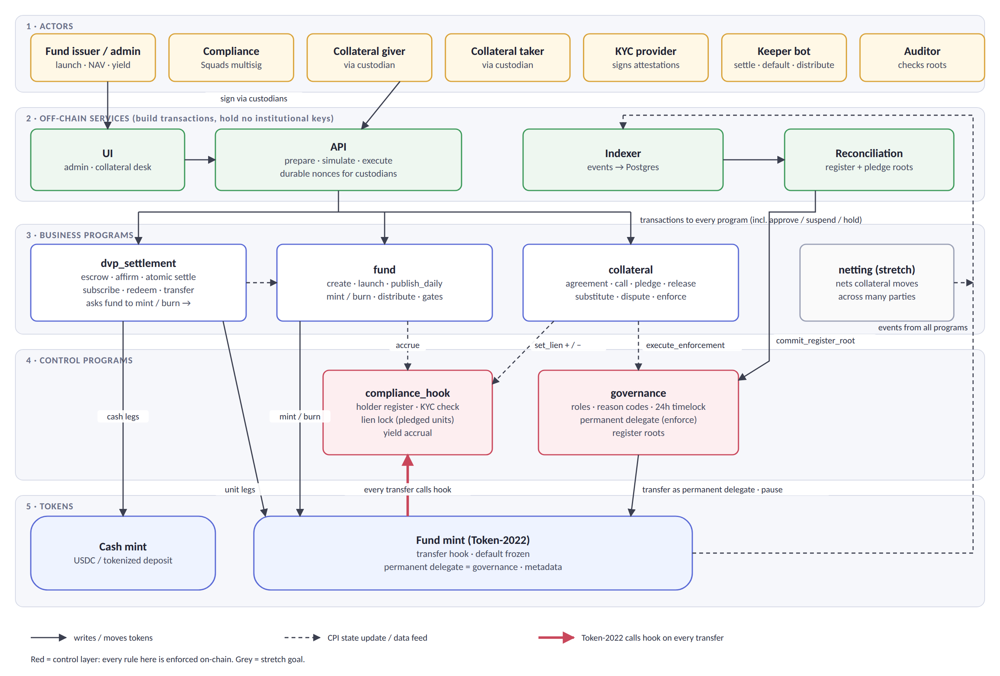
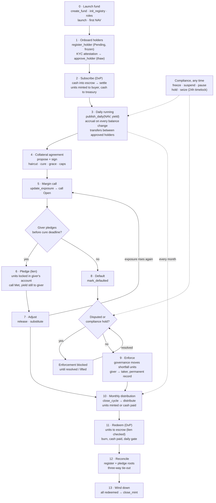
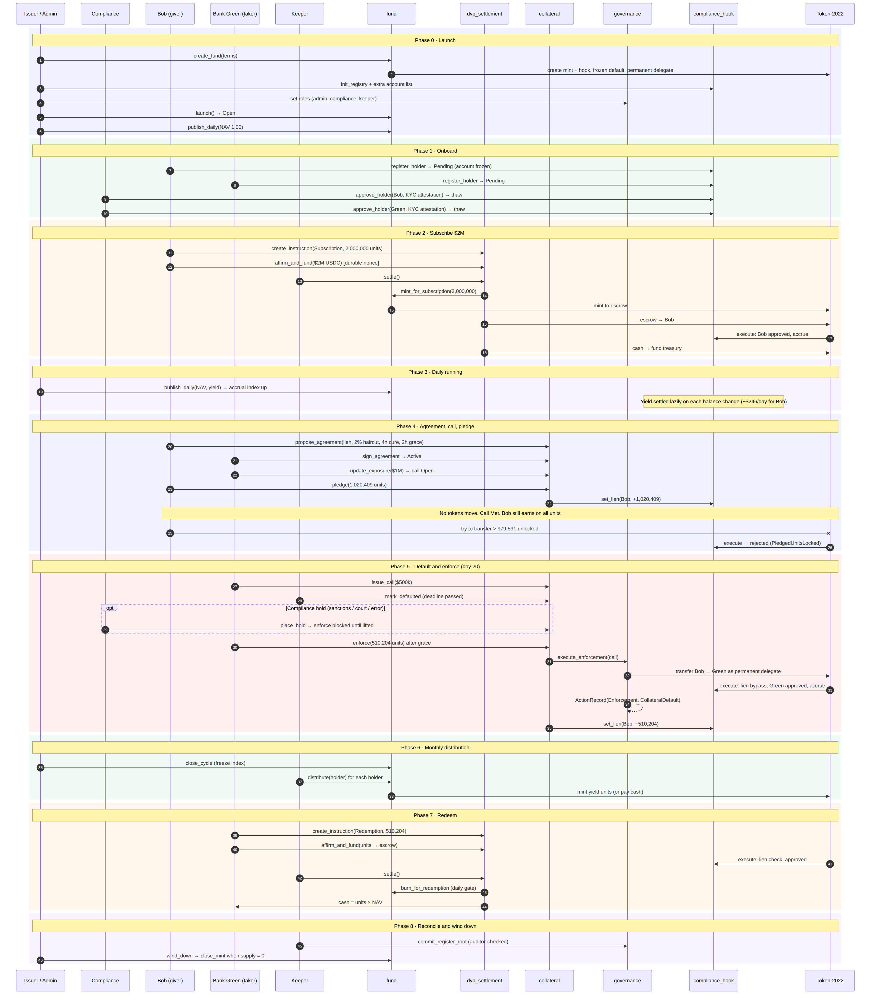
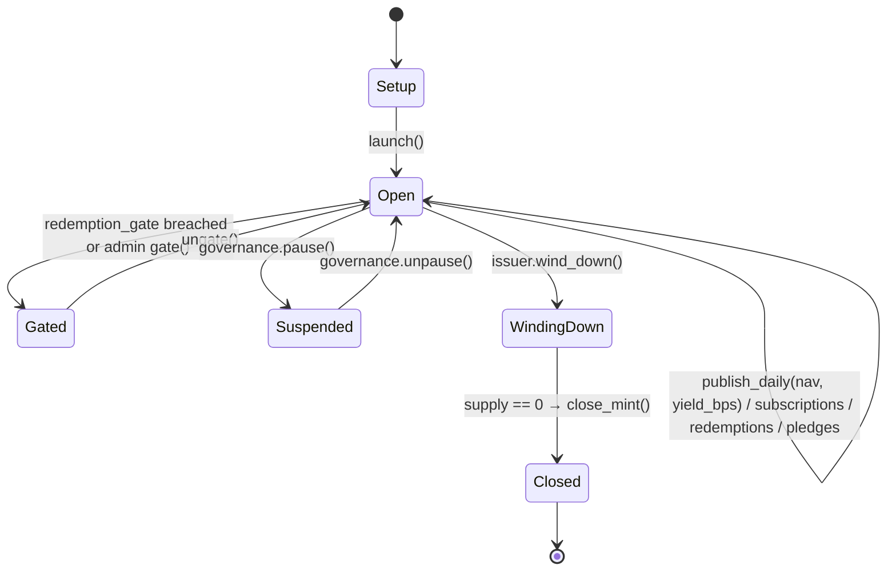
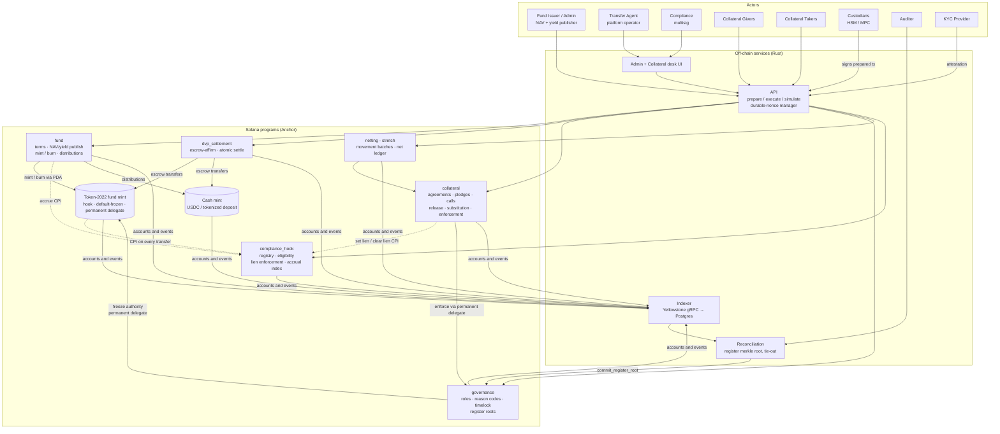
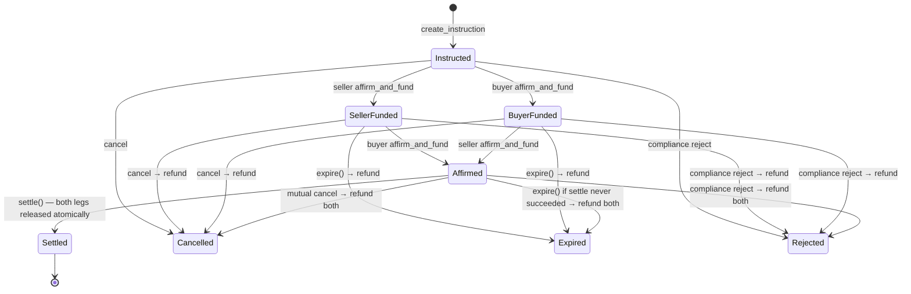
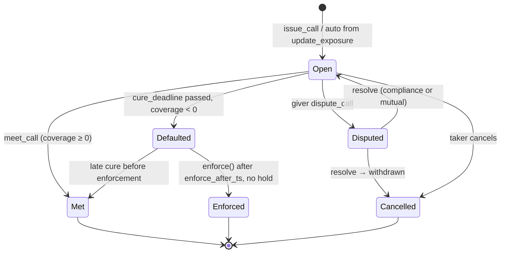
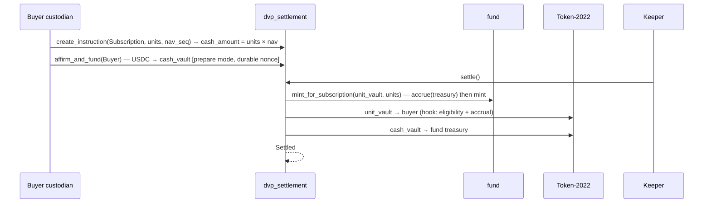

# Implementation Handbook: Tokenized MMF Collateral on Solana

Everything needed to build the full system with Spec Kit, in one file.

| Part | Contents |
|---|---|
| 1 | Workflow: setup, per-feature steps, order |
| 2 | Diagrams: architecture, lifecycle, end-to-end sequence |
| 3 | Spec Kit inputs: constitution, F001–F008 specify inputs, clarify questions, plan inputs, backlog |
| 4 | Shared model: accounts, authorities, CPI rules, hook order, invariants, rounding |
| Appendix | Full design document (background, flows, hard problems, threat model) |

Precedence when documents disagree: Shared model > Spec Kit inputs > Design document.

The same content also exists as separate files in `docs/` (workflow.md, speckit-inputs.md, shared-model.md, design.md). The separate files are the ones Spec Kit commands should reference.

---

# Part 1. Workflow

How this repo is built, feature by feature. Read once before starting; come back at each new feature.

### The documents and what each is for

| File | Role | Who reads it |
|---|---|---|
| `docs/design.md` | Full system design (the "PRD + technical design"). Background, flows, hard problems, threat model. | You; `/speckit-plan` for context |
| `docs/shared-model.md` | Binding contract for everything shared: account layouts, seeds, authorities, allowed CPI calls, hook check order, invariants, rounding. Wins over design.md. | Every `/speckit-plan`; every code review |
| `docs/speckit-inputs.md` | Text to paste into each Spec Kit command: constitution, 8 feature specify inputs, clarify questions, plan inputs. | You, when running commands |
| `docs/workflow.md` | This file. | You |
| `docs/diagrams/` | Architecture, lifecycle flow, end-to-end sequence. | Everyone |
| `.specify/memory/constitution.md` | Generated by `/speckit-constitution`. Shared by all features. | Spec Kit, every command |
| `specs/00X-name/` | One folder per feature: spec, plan, data model, tasks. Generated. | Spec Kit, per feature |

### How the features know about each other

Spec Kit does not link specs to each other. Each command works on the current feature's folder. The links come from four places:

1. **The code.** Each feature is merged before the next is planned, so `/speckit-plan` finds the existing accounts and programs.
2. **The constitution.** It is read by every feature, and principles 12–13 force earlier tests to pass and designs to conform to the shared model.
3. **`docs/shared-model.md`.** It is referenced in every plan input. Accounts already have their final layout, so later features fill fields instead of inventing accounts.
4. **"Builds on" lines.** Each specify input from F002 onward names the earlier specs it reuses.

### One-time setup

1. Create the repo and initialise Spec Kit:
   ```bash
   mkdir mmf-collateral && cd mmf-collateral && git init
   specify init . --ai claude        # or your agent
   ```
2. Check `.specify/extensions.yml`. If the git extension's `before_specify` hook is enabled, each specify run creates a branch. If it isn't, create branches yourself.
3. Copy this `docs/` folder into the repo. Commit to `main`.
4. Run `/speckit-constitution` with section 1 of `docs/speckit-inputs.md`. Review `.specify/memory/constitution.md`. Commit.

### Per feature (F001 → F008, strictly in order)

| Step | Command / action | Check before moving on |
|---|---|---|
| 1 | `git checkout main && git pull` | main contains all earlier features |
| 2 | `/speckit-specify` with the feature's input | a new `specs/00X-…/spec.md` exists |
| 3 | Read `spec.md` | stories have priority, independent test and Given/When/Then; no tech names; scope matches the input |
| 4 | Optional: ask the agent to compare the new spec against earlier `specs/` for conflicts | no entity redefined |
| 5 | `/speckit-clarify` | answer with the feature's open questions (section 3 of the inputs) |
| 6 | `/speckit-plan` with the shared plan input plus the feature's note | `data-model.md` matches `shared-model.md`; any change is listed and made in `shared-model.md` too |
| 7 | `/speckit-tasks` | every FR has tasks; every rule has a rejection test task |
| 8 | `/speckit-analyze` | no spec ↔ plan ↔ tasks gaps |
| 9 | `/speckit-implement` | |
| 10 | Review the code yourself | money math, rounding (shared-model section 8), hook check order (section 6), signer checks (section 5) |
| 11 | Run **all** tests, including earlier features' | all green |
| 12 | Merge to `main` | |

### Order and rough timing

| Week | Feature | Why here |
|---|---|---|
| 1 | F001 launch, roles, onboarding | Foundation: mint with all extensions, hook, register |
| 2 | F002 daily price and interest | Everything values units at a price |
| 3 | F003 subscription / redemption DvP | Units must exist and be paid for |
| 4 | F004 agreements, calls, pledges | The core product |
| 5 | F005 default, holds, enforcement | Makes collateral real |
| 6 | F006 distributions | Pays the interest F002 accrues |
| 7 | F007 governance, audit, wind-down | Wires reason-coded records into everything |
| 8 | F008 custodian API, indexer, desk UI | Off-chain layer and demo |

### Rules of thumb

- Do not run all specifies upfront. A spec written before earlier code exists will drift.
- If a spec looks wrong, fix `spec.md` before planning. It is the cheapest place to fix it.
- If a plan wants a new account for something that already exists, push back and point to `shared-model.md`.
- Keep entity names identical everywhere: Fund, Holder record, Register, Price record, Agreement, Pledge, Call, Hold, Action record, Register root.


---

# Part 2. Diagrams

## 2.1 Architecture



<div style="page-break-before:always"></div>

## 2.2 Lifecycle flow



<div style="page-break-before:always"></div>

## 2.3 End-to-end sequence (Bob and Bank Green)



---

# Part 3. Spec Kit inputs

Covers every phase: launch, onboarding, subscription, daily NAV and yield,
distributions, collateral, enforcement, redemption, governance, audit, and
custodian signing. Scope only. Spec Kit generates the tasks.

---

### 0. How to use this with Spec Kit

**Spec Kit rules this document follows**

- `/speckit-specify` produces **one feature per run**. The whole system is too big for one spec, so it is split into 8 features below. Run specify once per feature, in order.
- Specify input is **what and why only**: no languages, frameworks or chain names. Those go in `/speckit-plan`.
- The generated spec has these mandatory sections, and our inputs supply material for each:
  - **User Scenarios & Testing**: user stories with priority (P1, P2, P3), each with *Why this priority*, *Independent Test*, and *Acceptance Scenarios* (Given / When / Then)
  - **Edge Cases**
  - **Requirements**: Functional Requirements (FR-001 "System MUST …") and Key Entities
  - **Success Criteria**: Measurable Outcomes (SC-001), technology-agnostic
  - **Assumptions**
- At most 3 `[NEEDS CLARIFICATION]` markers per spec. Open questions are listed per feature below, so answer them in `/speckit-clarify`.
- `/speckit-plan` needs: Language/Version, Primary Dependencies, Storage, Testing, Target Platform, Project Type, Performance Goals, Constraints, Scale/Scope. It also runs a Constitution Check.

**So: yes, stories are expected in specify.** Each story must be independently testable and deliver value on its own.

**Order of commands**

```
/speckit-constitution          (once, section 1)
for each feature F001..F008 (start each from an up-to-date main):
    /speckit-specify  <F's specify input>
    (review spec.md; optionally compare it against earlier specs/)
    /speckit-clarify               (answer F's open questions)
    /speckit-plan     <shared plan input + F's plan notes>
    /speckit-tasks
    /speckit-analyze               (optional consistency check)
    /speckit-implement
    run ALL tests (this and earlier features) → merge to main
```

**Feature map**

| # | Feature | Lifecycle phases | Depends on |
|---|---|---|---|
| F001 | Fund launch, roles and holder onboarding | 0, 1, transfer rules of 3 | none |
| F002 | Daily price and yield accrual | 3 | F001 |
| F003 | Subscription, redemption and transfer settlement (DvP) | 2, 7 | F001, F002 |
| F004 | Collateral agreements, margin calls and pledges | 4 | F001, F002 |
| F005 | Default, compliance holds and enforcement | 5 | F004 |
| F006 | Monthly distributions | 6 | F002 |
| F007 | Governance, audit trail and reconciliation | 8, compliance powers, wind-down | F001 (touches all) |
| F008 | Custodian signing, operator API and collateral desk | all (off-chain) | F001 to F007 |
| Backlog | Title-transfer pledges, manufactured income, multilateral netting, confidential balances | | after F008 |

---

### 1. `/speckit-constitution`

```
Project: open-source, issuer-side infrastructure for a tokenized
money market fund used as collateral on Solana. The fund issuer controls
the token. The system covers the full lifecycle: launch, onboarding,
subscription and redemption, daily price and yield, distributions,
collateral pledges, margin calls, enforcement, governance and audit.

Principles:

1. Correctness over features. This code moves regulated assets. A smaller
   feature set that is provably right beats a larger one that is mostly right.

2. Rules live on-chain. Who may hold the token, what is locked, who earns
   yield, and when enforcement is allowed are enforced by the programs and
   the token itself, never only by a UI or backend.

3. Every state change has a named signer. No hidden backend keys. No
   off-chain service ever holds an institution's signing key.

4. One instruction, one state transition. If a description needs "and
   then", it is two instructions (except where atomicity is the point,
   e.g. both legs of a settlement).

5. On-chain state is the source of truth. Indexers and UIs mirror it and
   never decide anything. Values that can be computed (coverage, accrued
   yield) are computed, not stored separately.

6. Every rule has a failing test first. Each requirement gets at least one
   test that proves the rejection path, not just the happy path.

7. Fail closed. Any failed check reverts the whole transaction. No partial
   outcomes, ever.

8. No unpaid units, no silent powers. A unit is never created without its
   cash being locked in the same settlement. Every discretionary admin
   power (freeze, seize, forced transfer, rule change) is role-gated,
   reason-coded and permanently recorded; destructive ones are time-locked.

9. Money math is exact. Integer arithmetic only, rounding direction stated
   for every formula (always in favour of the protected party), and
   overflow checked.

10. Stated assumptions. Anything relied on but not enforced (legal
    agreement terms, KYC provider honesty, price accuracy) is written down.

11. Features ship in order. Each feature is complete, tested and merged
    before the next starts. Ideas outside the current feature go to the
    backlog, not into the code.

12. Earlier features stay green. No feature merges if any earlier
    feature's tests fail.

13. One shared model. Every design conforms to docs/shared-model.md
    (account layouts, seeds, authorities, allowed cross-program calls, hook
    check order, rounding). A change to it is made explicitly, in that
    file, in the same pull request, before code.
```

---

### 2. Feature specify inputs

#### F001: Fund launch, roles and holder onboarding

```
Feature: Launch a tokenized money market fund and control who may hold it.

WHY
A regulated fund may only be held by approved (KYC-checked) institutions.
Today that is enforced by a transfer agent's database. We want the token
itself to refuse any holder who is not approved, so the rule cannot be
bypassed, while the issuer and compliance team keep full control.

USERS
- Fund issuer: creates and launches the fund, assigns roles.
- Compliance officer (a multi-person group): approves, suspends and revokes
  holders; can pause all transfers.
- Institution (via its custodian): applies to hold the fund.
- KYC provider: signs a statement that an institution passed checks.

USER STORIES

US1 (P1) Launch a fund
As the issuer, I want to create a fund with its terms (name, target price,
distribution style, daily redemption limit, link and fingerprint of the
legal documents) and open it, so investors can start onboarding.
Why this priority: nothing else works without a fund.
Independent test: create a fund, launch it, read back its terms and status.
Acceptance:
- Given no fund, when the issuer creates one, then it exists in Setup
  status with the given terms and nobody can hold units yet.
- Given a fund in Setup, when the issuer launches it, then it is Open.
- Given a fund, when anyone other than the issuer tries to launch it,
  then it is rejected.

US2 (P1) Approve holders
As a compliance officer, I want an institution to become able to hold units
only after a recognised KYC provider has signed for it.
Why this priority: the core regulatory promise.
Independent test: register an institution, approve it with a valid
statement, then send it units successfully.
Acceptance:
- Given a newly registered institution, then its account cannot send or
  receive units (Pending).
- Given a valid statement signed by a recognised provider, when compliance
  approves, then the institution can receive units.
- Given a statement from an unknown provider or with a past expiry, then
  approval is rejected.
- Given an unapproved destination, when anyone sends units to it, then the
  transfer is rejected.

US3 (P2) Suspend, revoke and pause
As a compliance officer, I want to suspend or revoke a holder, and pause all
transfers in an emergency.
Independent test: suspend a holder and show it can no longer send or
receive; pause and show no transfer succeeds; unpause and show it works.
Acceptance:
- Given a suspended holder, then it can neither send nor receive units.
- Given transfers are paused, then every ordinary transfer is rejected.
- Given a holder whose KYC has expired, then it is treated as not approved.

US4 (P2) Roles
As the issuer, I want to assign the roles (fund admin, compliance, keeper,
auditor) to specific accounts or groups, so every action has an
accountable owner.
Acceptance:
- Given a role assignment, then only that holder of the role can perform
  that role's actions.

EDGE CASES
- What happens when the holder cap (maximum number of holders) is reached?
- What happens when a holder's KYC expires while it has units?
- How does the system handle an institution registered twice?
- What happens when a transfer has the same sender and receiver?

KEY ENTITIES
- Fund: terms, status (Setup, Open, Gated, Suspended, Winding down,
  Closed), roles.
- Holder record: owner, status (Pending, Approved, Suspended, Revoked),
  class (investor, fund treasury, escrow), jurisdiction, KYC expiry,
  fingerprint of the KYC statement and who signed it.
- Register: list of recognised KYC providers, allowed jurisdictions,
  holder cap, pause flag.

SUCCESS CRITERIA
- No unapproved account ever holds units, across all tests.
- A compliance action (approve, suspend, pause) takes effect in the next
  transaction.
- Every holder status change leaves a permanent, queryable record.

ASSUMPTIONS
- KYC providers are trusted to sign honestly; the system only checks the
  signature and expiry. Real provider integration is mocked.
- The issuer controls the token; this is not a layer on someone else's
  fund token.

OUT OF SCOPE
- Real KYC provider APIs; investor-facing onboarding screens.
```

#### F002: Daily price and yield accrual

```
Builds on 001-fund-launch-onboarding (Fund, Holder record, Register,
roles). Reuse those entities; do not redefine them.

Feature: Publish the fund's daily price and interest, and credit every
holder's share fairly without updating every account each day.

WHY
A money market fund earns interest daily and announces a price per unit
(target $1.00). Each holder must earn exactly for the days they held units,
even if they trade in between. Updating thousands of accounts every day is
slow and fragile; a missed update means someone is paid wrongly.

USERS
- Fund administrator: publishes price and daily interest rate.
- Holders: earn interest.
- Auditor: checks the history.

USER STORIES

US1 (P1) Publish daily price and interest
As the fund admin, I want to publish today's price and interest rate once a
day, kept permanently, so every later calculation uses an official figure.
Why this priority: collateral values and interest both depend on it.
Independent test: publish three days of figures and read the full history.
Acceptance:
- Given an Open fund, when the admin publishes, then a new permanent
  record with a sequence number and time is stored.
- Given someone who is not the fund admin, then publishing is rejected.
- Given a price that moves more than the allowed limit from yesterday,
  then it is rejected unless governance has approved an override.

US2 (P1) Fair interest for every holder
As a holder, I want interest for exactly the units I held on each day,
even if my balance changed, so I am never over- or under-paid.
Why this priority: getting this wrong is a financial error for real people.
Independent test: holder A holds for 10 days, sends half on day 10, holds
the rest for 10 more; compare earned interest to a day-by-day calculation.
Acceptance:
- Given a holder whose balance did not change for N days, then their earned
  interest equals balance × sum of the N daily rates.
- Given a balance change, then interest up to that moment is settled on the
  old balance before the change takes effect.
- Given units are locked as collateral (F004), then they still earn
  interest for their owner.
- Given rates that differ every day, then each day is credited at its own
  rate.

EDGE CASES
- What happens when no price is published for a day (holiday, outage)?
- How are weekends handled (one publish covering three days)?
- What happens with a zero or negative daily rate?
- How are rounding remainders handled over millions of holders?

KEY ENTITIES
- Price record: sequence, price, daily rate, timestamp, publisher.
- Global interest counter: cumulative interest per unit since launch.
- Holder accrual: counter value at last settlement, interest earned so far.

SUCCESS CRITERIA
- Earned interest matches an independent day-by-day calculation to the
  smallest unit, across randomised 90-day simulations.
- Publishing costs the same whether there are 10 or 10,000 holders.
- The price used for any past calculation can be looked up by sequence.

ASSUMPTIONS
- The administrator's figures are accurate; the system guards only against
  obvious typos and staleness.
- Interest accrues to whoever holds units at the moment of publishing.

OUT OF SCOPE
- Paying out interest (F006); computing the rate from the portfolio.
```

#### F003: Subscription, redemption and transfer settlement (DvP)

```
Builds on 001 (Fund, Holder record, roles) and 002 (Price record).
Reuse those entities; do not redefine them.

Feature: Exchange cash for fund units (and back) so that either both sides
move or neither does.

WHY
Buying or redeeming fund units today takes one to two days and relies on
trust between the parties. On-chain, the risk is paying and not receiving
(or delivering and not being paid). Institutions also sign through
custodians who may take hours to approve, so a settlement must stay valid
for that long.

USERS
- Investor (via custodian): subscribes or redeems.
- Fund treasury: receives subscription cash, pays redemption cash.
- Keeper: triggers settlement once both sides are funded.
- Compliance: can reject a pending settlement.

USER STORIES

US1 (P1) Subscribe
As an investor, I want to pay cash and receive newly created units at the
published price, with no risk of paying without receiving.
Why this priority: this is how units come into existence.
Independent test: investor funds $2M; settle; investor has 2,000,000 units
at price $1.00 and treasury has $2M.
Acceptance:
- Given a subscription instruction priced from a specific price record,
  when the investor funds the cash, then the cash is held in escrow.
- Given the cash is funded, when settlement runs, then units are created
  and delivered to the investor and cash goes to the treasury, together.
- Given the investor is not approved, then settlement fails and nothing
  moves.
- Given the cash has not been funded, when settlement runs, then it is
  rejected and no units are created.

US2 (P1) Redeem
As an investor, I want to return units and receive cash at the published
price, within the fund's daily redemption limit.
Independent test: redeem 500,000 units and receive $500,000.
Acceptance:
- Given units locked as collateral, then they cannot be put into a
  redemption.
- Given today's redemptions would exceed the daily limit, then the
  redemption is rejected.
- Given settlement succeeds, then the units are destroyed and cash is paid
  together.

US3 (P2) Secondary transfer against cash
As two approved holders, we want to swap units for cash with each other
with the same both-or-neither guarantee.

US4 (P2) Cancel, expire, reject
As a party, I want unfunded or stuck settlements to be cancelled or to
expire with full refunds, and compliance to be able to reject one.
Acceptance:
- Given an instruction past its expiry, then anyone can expire it and
  each funded side is refunded.
- Given compliance rejects, then all funded sides are refunded.

US5 (P2) Slow signers
As a custodian, I want to approve a settlement step hours after it was
prepared, without it becoming invalid.

EDGE CASES
- One side funds, the other never does.
- The price changes between instruction and settlement (the instruction
  keeps its original price).
- Settlement is attempted twice.
- A party is suspended after funding but before settlement.

KEY ENTITIES
- Settlement instruction: kind (subscription, redemption, transfer),
  parties, units, cash amount, price record used, valid-from, expiry,
  status (Instructed, Seller funded, Buyer funded, Affirmed, Settled,
  Cancelled, Expired, Rejected), external reference.
- Escrow holdings for units and cash per instruction.

SUCCESS CRITERIA
- In every test, after any settlement outcome, either both legs moved or
  every party has exactly what it started with.
- A step signed hours after preparation still succeeds.
- No unit exists without matching cash received.

ASSUMPTIONS
- Cash is a stablecoin or tokenized deposit already available on-chain.

OUT OF SCOPE
- Order books, price discovery, fiat rails.
```

#### F004: Collateral agreements, margin calls and pledges

```
Builds on 001 (Holder record, roles) and 002 (Price record, interest
accrual). Reuse those entities; do not redefine them. The holder's locked
units live on the existing Holder record.

Feature: Let a holder pledge fund units to a counterparty as margin,
without moving them, and keep the pledge in line with the exposure.

WHY
Institutions owe margin on trades (FX forwards, swaps, repos). Meeting a
call from a money market fund means selling units and waiting days for
cash. Pledging the units instead is instant, and they keep earning
interest. The counterparty needs certainty that pledged units cannot be
moved away.

USERS
- Collateral giver (via custodian): owes margin, pledges units.
- Collateral taker (via custodian): demands margin, receives protection.

USER STORIES

US1 (P1) Agree the rules
As giver and taker, we want to record the enforceable terms of our legal
collateral agreement (haircut, time to meet a call, grace period, minimum
transfer amount, pledge limit, maximum price age, fingerprint of the legal
document), active only once both of us have signed.
Why this priority: every later step checks these terms.
Acceptance:
- Given one signature, then the agreement is Proposed, not Active.
- Given both signatures, then it is Active.
- Given either party is not an approved holder, then it is rejected.

US2 (P1) Margin call from exposure
As the taker, I want to set the amount of protection I currently need, and
have a call with deadlines opened automatically if the pledged value falls
short.
Independent test: set exposure $1M with nothing pledged; a call opens for
$1M with a deadline and an enforcement-allowed time.
Acceptance:
- Given pledged value (after haircut, at the latest price) below the
  required amount by more than the minimum transfer amount, then a call
  opens with deadline = now + cure time and enforce-after = deadline +
  grace.
- Given a shortfall below the minimum transfer amount, then no call opens.
- Given the latest price is older than allowed, then no call can be issued.

US3 (P1) Pledge without moving units
As the giver, I want to lock N of my units for the taker, so the call is
met in minutes, while the units stay in my account and keep earning.
Acceptance:
- Given an active agreement and enough unlocked units, when I pledge N,
  then N units are locked, none move, and the call is Met if coverage is
  now zero or more.
- Given N exceeds my unlocked units or the pledge limit, then rejected.
- Given N of my M units are locked, when I try to send, redeem or pledge
  elsewhere more than M−N, then rejected by the token itself.

US4 (P2) Release excess
As the giver, when exposure falls, I want excess units unlocked.
Acceptance:
- Given coverage exceeds the requirement by more than the minimum transfer
  amount, then the giver can open a return call and the taker (or keeper)
  can release that excess.
- Given a release would make coverage negative, then rejected.

US5 (P2) Substitute
As the giver, I want to swap one pledge for another in one step, so
coverage never dips.

US6 (P3) Dispute
As the giver, I want to dispute a call I think is wrong, which blocks
enforcement until resolved.

EDGE CASES
- The price drops after pledging so coverage turns negative (new call).
- Several pledges and calls on one agreement at once.
- The giver is suspended while units are pledged.
- Rounding when converting a value to a unit count (always round up the
  units required from the giver).

KEY ENTITIES
- Agreement: giver, taker, pledge type (lien only in this feature), terms
  above, status, total pledged units, required value.
- Pledge: agreement, units, time, price record used, released units,
  enforced units, status.
- Call: agreement, kind (delivery, return), value, units required, price
  record, issued time, deadline, enforce-after time, status (Open, Met,
  Disputed, Defaulted, Enforced, Cancelled), external reference.
- Holder lock: total locked units per holder.

INVARIANT
- A holder's locked units always equal the sum of their active pledges
  (units − released − enforced).

SUCCESS CRITERIA
- A $1M call is met by a pledge in one transaction with zero units moving.
- No test can move locked units by any path other than enforcement (F005).
- Locked units earn the same interest as unlocked units.

ASSUMPTIONS
- Exposure is calculated off-chain by the taker's risk system; the system
  records it, it does not compute it.
- The legal agreement exists off-chain; on-chain terms mirror it.

OUT OF SCOPE
- Title-transfer pledges, manufactured income, multilateral netting
  (backlog).
```

#### F005: Default, compliance holds and enforcement

```
Builds on 004 (Agreement, Pledge, Call, Holder lock) and 002 (Price
record). Reuse those entities; do not redefine them.

Feature: When a giver fails to meet a call, let the taker take exactly the
shortfall, under the agreed deadlines, unless compliance blocks it.

WHY
Collateral is only worth something if the taker can actually use it when
the giver defaults. But taking it must be limited to what is owed, follow
the agreed timing, and be stoppable for sanctions or court orders.

USERS
- Keeper: marks a call defaulted after the deadline.
- Collateral taker: enforces.
- Compliance officer: places or lifts a hold.
- Auditor: reviews the record.

USER STORIES

US1 (P1) Mark default
As the keeper, I want to mark a call Defaulted once its deadline passed
and coverage is still negative.
Acceptance:
- Given the deadline has not passed, or coverage is not negative, then
  rejected.

US2 (P1) Enforce the shortfall
As the taker, after the grace period, I want units worth the shortfall
moved from the giver to me, with a permanent record.
Why this priority: this is what makes the collateral real.
Independent test: $500k call defaults; after grace, enforce; taker gets
510,204 units at $1.00 and 2% haircut, giver's lock shrinks by the same.
Acceptance:
- Given Defaulted and enforce-after passed, no hold, not disputed, price
  fresh, then units worth at most the shortfall move, the lock and pledge
  shrink equally, and a reason-coded record is written.
- Given I ask for more than the shortfall, then rejected.
- Given I (the taker) am not an approved holder, then everything fails.
- Enforcement moves units only and never triggers a fund redemption.

US3 (P1) Compliance hold
As a compliance officer, I want to block enforcement on a specific call
immediately, with a reason and case reference, and lift it later.
Acceptance:
- Given an active hold, then enforcement is rejected.
- Given the hold is lifted, then enforcement may proceed.

US4 (P2) Late cure
As the giver, I want to cure a defaulted call before enforcement happens.

EDGE CASES
- Hold placed in the same block as enforcement.
- Partial enforcement repeated until the shortfall is covered.
- The giver's units are fewer than the shortfall (take all pledged, record
  the remaining unsecured amount).
- Price stale at enforcement time.

KEY ENTITIES
- Enforcement hold: call, placed by, reason, case reference, placed and
  lifted times.
- Action record: kind (enforcement), reason (collateral default), call
  reference, units, time.

SUCCESS CRITERIA
- Every rejection path above has a passing test.
- Enforcement never transfers more value than the shortfall at the price
  used.
- Every enforcement is traceable to its call, agreement and price record.

ASSUMPTIONS
- The pre-agreed cure and grace periods are the only delay; no extra
  discretionary waiting period applies to enforcement.

OUT OF SCOPE
- Selling the enforced units (the taker uses F003 redemption afterwards).
```

#### F006: Monthly distributions

```
Builds on 001 (Fund, Holder record) and 002 (interest counter and
per-holder accrual). Reuse those entities; do not redefine them.

Feature: Pay each holder the interest they earned, once a month, as extra
units or as cash.

WHY
Interest accrues daily (F002) but is paid monthly. Every holder must be paid
exactly once, the exact amount, even if the payout run is interrupted.

USERS
- Transfer agent: opens and closes a distribution cycle.
- Keeper: pays holders.
- Holders: receive interest.

USER STORIES

US1 (P1) Close a cycle
As the transfer agent, I want to freeze the interest counter at month end,
so everyone is paid up to the same point.

US2 (P1) Pay every holder exactly once
As a holder, I want my month's interest as new units (or cash, per fund
terms), with a receipt, never twice.
Independent test: 50 holders with different histories; run payouts;
interrupt halfway; resume; every holder paid once, totals match.
Acceptance:
- Given a closed cycle, when the keeper pays a holder, then they receive
  exactly their earned amount up to the frozen point and a receipt exists.
- Given a receipt already exists, then paying again is rejected.
- Given pledged units, then their interest goes to the giver (owner).

US3 (P2) Finalise
As the transfer agent, I want to confirm all holders were paid and the
total equals the fund's total interest.

EDGE CASES
- Holder suspended at payout time.
- Holder with zero balance but unpaid interest.
- Rounding dust across many holders.

KEY ENTITIES
- Distribution cycle: number, mode, frozen counter, total due, total paid,
  status.
- Payout receipt per holder per cycle.

SUCCESS CRITERIA
- Sum of payouts equals total interest due within stated rounding rules.
- No holder is paid twice, even with interrupted runs.

OUT OF SCOPE
- Tax withholding and reporting.
```

#### F007: Governance, audit trail and reconciliation

```
Builds on 001 to 006. Admin actions defined there gain a permanent
reason-coded record here. Reuse existing entities; do not redefine them.

Feature: Give the issuer and compliance strong powers, but make every one
accountable, and let an auditor prove the on-chain register matches the
official one.

WHY
Regulators require the issuer to freeze, recover and force-transfer units
(court orders, lost keys). Institutions fear unchecked admin power. Both are
satisfied if powers are role-gated, reason-coded, recorded, and the
destructive ones are announced in advance.

USERS
- Issuer, compliance, auditor.

USER STORIES

US1 (P1) Reason-coded actions
As compliance, every action I take (freeze, thaw, pause, hold, seize,
forced transfer, rule change) must carry a reason code and case reference
and leave a permanent record.

US2 (P1) Delayed destructive actions
As an institution, I want seizure, forced transfer and rule changes to be
proposed publicly and executable only after a waiting period, cancellable
before then.
Acceptance:
- Given a proposal, when executed before the waiting period, then rejected.
- Given protective actions (freeze, pause, hold), then they apply at once.

US3 (P2) Register fingerprint
As an auditor, I want a fingerprint of every holder's balance, locked units
and status (and of all pledges) at a point in time recorded on-chain, so I
can check it against the transfer agent's register.

US4 (P3) Wind down
As the issuer, I want to wind down the fund and close the token once all
units are redeemed.

EDGE CASES
- Proposal for a holder who is later revoked.
- Two conflicting proposals.
- Fingerprint submitted for an old point in time.

KEY ENTITIES
- Role assignments; action record (kind, reason, case reference, actor,
  time, status); proposal (action, earliest execution time);
  register fingerprint (period, time point, value, submitted by).

SUCCESS CRITERIA
- 100% of admin actions in tests produce a record with a reason.
- An independent recomputation of the register fingerprint matches the
  recorded one.

OUT OF SCOPE
- Regulatory report generation.
```

#### F008: Custodian signing, operator API and collateral desk

```
Builds on 001 to 007. No new on-chain data; reads and prepares
transactions for what already exists.

Feature: Let institutions use the system through their custodians, and give
operators and collateral teams a clear view of everything.

WHY
Institutions do not hold keys on laptops; custodians approve transactions
through multi-person workflows that take hours. Collateral teams need to
see coverage, open calls and deadlines at a glance.

USERS
- Custodian, collateral giver and taker teams, fund admin, compliance.

USER STORIES

US1 (P1) Prepare, review, sign later
As a custodian, I want the service to give me an unsigned transaction that
stays valid for hours, plus a simulation showing what it will do and why it
might fail, so I can approve it in my own system.
Acceptance:
- Given a prepared transaction signed hours later, then it still executes.
- Given a simulation, then the rejection reason is human-readable.

US2 (P1) Collateral desk
As a collateral team, I want to see for each agreement the pledged value
at the latest price, the required amount, coverage, open calls with
countdown, and any holds.

US3 (P2) Operator views
As fund admin and compliance, I want views for price publishing, the
holder register, the settlement queue, the action log and reconciliation
status.

US4 (P2) Read model
As an integrator, I want an indexed history of all events, consistent with
on-chain state.

EDGE CASES
- Indexer lag or restart; the UI must show data freshness.
- Prepared transaction used twice.

SUCCESS CRITERIA
- No service component ever holds an institution's signing key.
- The full demo (launch to reconciliation) runs on devnet through the API.
- Indexed balances match on-chain balances at every checkpoint.

OUT OF SCOPE
- Real custodian integrations (mocked signer with delay).
```

---

### 3. Open questions for `/speckit-clarify` (per feature)

Answer these yourselves when Spec Kit asks; each changes behaviour.

**F001**
1. Can an institution register itself, or only compliance registers it?
2. Is there a holder cap, and what happens when it's reached?
3. Does suspension also block receiving, or only sending?

**F002**
1. How is a missed day handled: skip, or the next publish covers several days?
2. What is the maximum allowed daily price move before an override is required?
3. Rounding: truncate per holder, with the remainder kept by the fund?

**F003**
1. Who creates a subscription instruction: the investor or the fund operator?
2. Default expiry for a settlement instruction?
3. Is the daily redemption limit a percentage of total units or a fixed amount?

**F004**
1. Can several pledges exist under one agreement at once?
2. Can the taker set exposure alone, or must the giver confirm it?
3. Maximum price age: one fixed value or per agreement?

**F005**
1. Who may mark a call defaulted: only the keeper role, or anyone after the deadline?
2. Partial and repeated enforcement allowed, or one shot per call?
3. If pledged units don't cover the shortfall, what is recorded?

**F006**
1. Distribution as units only, cash only, or per-fund choice?
2. Who pays the transaction cost of each payout?

**F007**
1. Waiting period length for destructive actions (e.g. 24 h)?
2. How often is the register fingerprint committed (daily?), and by whom?

**F008**
1. Which custodian flow to mock (multi-approver with delay)?
2. Is the UI read-only plus prepare, or does it also submit?

---

### 4. `/speckit-plan`

#### 4.1 Shared plan input (use for every feature)

```
Language/Version: Rust (stable), Anchor framework for on-chain programs.
TypeScript for the thin UI and client SDK.

Primary Dependencies:
- SPL Token-2022 for the fund unit mint, with extensions:
  transfer hook (our compliance program runs on every transfer),
  default account state = frozen (new accounts unusable until approved),
  permanent delegate held by the governance program (enforcement and
  court-ordered transfers only), metadata pointer (fund documents),
  mint close authority. Mint authority = fund program; freeze authority =
  compliance hook program.
- Cash leg: SPL token (USDC on devnet or a mock stablecoin).
- Squads v4 multisig for issuer and compliance roles.
- Off-chain: axum, sqlx, Yellowstone gRPC (or RPC polling on devnet).

Programs (one responsibility each):
- compliance_hook: holder register, approval status, locked units,
  interest accrual, checks on every transfer.
- fund: terms, status, daily price and rate, mint/burn, distributions,
  redemption limit.
- dvp_settlement: escrowed both-or-neither settlement.
- collateral: agreements, pledges, calls, release, substitution, dispute,
  holds, enforcement.
- governance: roles, reason-coded actions, time-locked proposals,
  enforcement transfers as permanent delegate, register fingerprints.

Storage: on-chain program accounts are the source of truth; Postgres for
the indexer read model only.

Testing: LiteSVM (or Bankrun) for program tests, one rejection test per
rule; property tests for interest and collateral math; one end-to-end run
on devnet per feature.

Target Platform: Solana devnet (mainnet-compatible).

Project Type: Anchor workspace (programs/), Rust services (services/),
TypeScript client and UI (app/).

Performance Goals: every user transaction, including the transfer-hook
call, fits within Solana compute and account limits; daily publish cost
independent of holder count.

Constraints: no backend holds institutional keys; prepared transactions use
durable nonces so custodian approval can take hours; integer math only with
stated rounding; all checks fail closed.

Scale/Scope: one fund, up to ~10,000 holders, hundreds of agreements.

Before designing, read: docs/shared-model.md, docs/design.md, and the
data-model.md of every earlier spec under specs/. Extend existing accounts
as listed in shared-model.md section 11; never create a second account for
an existing concept. List any change to shared-model.md explicitly in the
plan.
```

#### 4.2 Per-feature plan notes (append to the shared input)

| Feature | Add to `/speckit-plan` |
|---|---|
| F001 | Build the mint with all extensions in one setup instruction; ExtraAccountMetaList resolves the holder records of sender and receiver; KYC statement verified via ed25519 signature check. |
| F002 | Global accrual index (fixed-point u128, 1e18) on the fund; each holder record stores index at last touch and accrued amount; the hook settles accrual before every balance change; fund settles accrual before mint/burn (hooks don't fire on mint/burn). |
| F003 | Escrow vaults owned by program PDAs; settle mints into escrow for subscriptions and burns from escrow for redemptions; the instruction stores the price record sequence it priced against. |
| F004 | Lien = locked amount in the holder record, set only by CPI from collateral; hook rejects any transfer leaving balance below the locked amount unless the authority is the governance PDA. |
| F005 | collateral calls governance by CPI; governance signs transfer_checked as permanent delegate; the hook bypasses the lock but still checks the receiver; ActionRecord written in the same transaction. |
| F006 | Distribution cycle freezes the index; payout receipt PDA per holder per cycle makes payouts idempotent. |
| F007 | Proposal accounts with earliest-execution timestamp; register fingerprint = merkle root of sorted (owner, balance, locked, status) built off-chain from RPC at a fixed slot. |
| F008 | API returns v0 transactions with AdvanceNonce first, plus simulation logs; indexer from program events; UI reads from the indexer and shows data freshness. |

---

### 5. Backlog (not in any spec until F001 to F008 are merged)

- Title-transfer pledges (units move to a taker-controlled vault) and manufactured income back to the giver
- Multilateral netting when the operator is collateral agent
- Confidential balances
- Multiple share classes or funds
- Real KYC and custodian integrations
- Cross-chain collateral


---

# Part 4. Shared model

**Status:** v1. The single source of truth for anything more than one feature touches.
**Rule:** every `/speckit-plan` must conform to this file. If a feature needs a change here, the plan says so explicitly and this file is updated in the same pull request, before code.
**Precedence:** if this file and `docs/design.md` disagree, this file wins (see section 10).

---

### 1. Conventions

| Topic | Rule |
|---|---|
| Account versioning | Every program account starts with `version: u8` (= 1) and ends with `_reserved: [u8; 64]`. Small additions use reserved bytes instead of resizing. |
| Full layout from day one | Accounts are created with their **final** layout. Fields used by later features exist from the start and stay zero until that feature ships. |
| Ownership of an entity | The feature that first creates an account type owns its definition. Later features extend fields listed here; they never define a second account for the same concept. |
| Integer math | No floats anywhere on-chain. All multiplications in `u128`, checked. Every division states its rounding direction (section 8). |
| Unit decimals | Fund unit: 6 decimals. Cash (USDC or mock): 6 decimals. |
| Price (NAV) | Price of one whole unit, in cash, with 8 decimals: $1.00 = `100_000_000`. |
| Value of units | `value_cash_base = units_base × nav / 10^8` |
| Daily rate | Fraction of value earned that day × 10^12, stored as `u64`. 4.5 % a year ≈ 0.000123288/day = `123_287_671`. |
| Accrual index | `u128`, scale 10^18 (interest per unit since launch). `index += daily_rate_e12 × 10^6` on each publish. |
| Time | `i64` Unix seconds from the Clock sysvar. |
| Seeds | Integers in seeds are little-endian `u64` (`seq.to_le_bytes()`). |
| Events | Every state-changing instruction emits one event (section 9) with `fund`, `slot`, `unix_ts`. |

---

### 2. Programs and what each owns

| Program | Owns accounts | Introduced by |
|---|---|---|
| `compliance_hook` | `Registry`, `HolderState`, `ExtraAccountMetaList` | F001 (extended by F002, F004) |
| `fund` | `FundState`, `NavRecord`, `DistributionCycle`, `DistributionReceipt` | F001 (extended by F002, F003, F006) |
| `dvp_settlement` | `DvpConfig`, `SettlementInstruction`, escrow vaults | F003 |
| `collateral` | `PledgeAgreement`, `Pledge`, `CollateralCall`, `EnforcementHold` | F004 (extended by F005) |
| `governance` | `RoleRegistry`, `ActionRecord`, `RegisterRoot` | F001 roles (extended by F005, F007) |

---

### 3. Fund mint (Token-2022)

| Setting | Value | Holder of the authority |
|---|---|---|
| Transfer hook | `compliance_hook` program | n/a |
| Default account state | `Frozen` | n/a |
| Permanent delegate | PDA `["delegate", mint]` of **governance** | governance |
| Metadata pointer + metadata | name, symbol, `fund_id`, `terms_hash`, `terms_uri` | fund PDA |
| Mint close authority | `FundState` PDA | fund |
| Mint authority | `FundState` PDA | fund |
| Freeze authority | `Registry` PDA | compliance_hook |
| Not used | ConfidentialTransfer, InterestBearing, TransferFee, NonTransferable | |

Created once in F001 by `fund::create_fund`, with all extensions initialised in the same transaction.

---

### 4. Account layouts

Field tags show which feature first **uses** the field: `[F001]` … `[F008]`. Fields tagged `[backlog]` are reserved and must stay zero.

#### 4.1 `compliance_hook`

**Registry**: PDA `["registry", mint]`

```text
version                u8
mint                   Pubkey   [F001]
governance             Pubkey   [F001]  governance program id (role checks read RoleRegistry)
role_registry          Pubkey   [F001]
fund_state             Pubkey   [F001]
collateral_program     Pubkey   [F004]  only caller allowed to change locked units
kyc_providers          [Pubkey; 4] [F001]
allowed_jurisdictions  u64      [F001]  bitmask
max_holders            u32      [F001]  0 = no cap
holder_count           u32      [F001]
transfers_paused       bool     [F001]
bump                   u8
_reserved              [u8; 64]
```

**HolderState**: PDA `["holder", mint, owner]` (`owner` = owner of the token account)

```text
version                u8
mint                   Pubkey   [F001]
owner                  Pubkey   [F001]
status                 u8       [F001]  0 Pending, 1 Approved, 2 Suspended, 3 Revoked
class                  u8       [F001]  0 Investor, 1 FundTreasury, 2 Escrow, 3 CollateralVault [backlog]
jurisdiction           u8       [F001]
investor_type          u8       [F001]
kyc_expiry_ts          i64      [F001]
attestation_hash       [u8; 32] [F001]
attested_by            Pubkey   [F001]
pledged_amount         u64      [F004]  units locked; = Σ active pledges (invariant I1)
active_liens           u16      [F004]
index_at_last_touch    u128     [F002]
accrued_e18            u128     [F002]  interest owed in units × 10^18, not yet paid
last_balance           u64      [F002]
last_slot              u64      [F002]
last_paid_cycle        u32      [F006]
bump                   u8
_reserved              [u8; 64]
```

**ExtraAccountMetaList**: PDA `["extra-account-metas", mint]`, created in F001. It resolves, in this fixed order:

1. `Registry` (read-only)
2. `FundState` (read-only)
3. `HolderState` of source owner (writable; seed from source token account `owner` field)
4. `HolderState` of destination owner (writable; seed from destination token account `owner` field)
5. Governance delegate PDA `["delegate", mint]` (read-only), used to recognise enforcement transfers

Adding entries later changes every client's transfer, so all five exist from F001.

#### 4.2 `fund`

**FundState**: PDA `["fund", mint]` (also the mint authority)

```text
version                u8
mint                   Pubkey   [F001]
role_registry          Pubkey   [F001]
terms                  FundTerms[F001]
status                 u8       [F001]  0 Setup, 1 Open, 2 Gated, 3 Suspended, 4 WindingDown, 5 Closed
nav                    u64      [F002]  latest price (8 dp)
nav_ts                 i64      [F002]
nav_seq                u64      [F002]  last published NavRecord seq (0 = none)
accrual_index          u128     [F002]
daily_rate_e12         u64      [F002]  last published rate
units_outstanding      u64      [F003]
redeemed_today         u64      [F003]
day_start_ts           i64      [F003]
cash_treasury          Pubkey   [F003]  token account for cash
current_cycle          u32      [F006]
bump                   u8
_reserved              [u8; 64]
```

**FundTerms** (embedded)

```text
fund_id                [u8; 12]
cash_mint              Pubkey
target_nav             u64      100_000_000
max_nav_move_bps       u16      typo guard for publish_daily
redemption_gate_bps    u16      max daily redemptions as % of units_outstanding
distribution_mode      u8       0 Reinvest (units), 1 Cash
distribution_cadence_days u16
terms_hash             [u8; 32]
terms_uri              [u8; 128] fixed-size, zero-padded
```

**NavRecord**: PDA `["nav", fund_state, seq]`, immutable once written

```text
version u8 · seq u64 · nav u64 · daily_rate_e12 u64 · index_after u128 · as_of_ts i64 · published_by Pubkey · bump u8
```

**DistributionCycle**: PDA `["dist", fund_state, cycle_u32]` [F006]

```text
version u8 · cycle u32 · mode u8 · index_at_close u128 · total_due_e18 u128 · total_paid u64 · holders_paid u32 · status u8 (0 Open, 1 Closed, 2 Finalised) · bump u8 · _reserved
```

**DistributionReceipt**: PDA `["dreceipt", cycle_account, owner]` [F006]. Its existence makes payouts idempotent.

```text
version u8 · cycle u32 · owner Pubkey · amount u64 · paid_ts i64 · bump u8
```

#### 4.3 `dvp_settlement` [F003]

**DvpConfig**: PDA `["dvp", fund_state]`

```text
version u8 · fund_state Pubkey · next_seq u64 · default_expiry_secs u32 · bump u8 · _reserved
```

**Escrow authority**: PDA `["escrow", fund_state]`. One per fund. It owns:
- the unit escrow token account (fund mint), with its own `HolderState` of class `Escrow`, approved at F003 setup;
- the cash escrow token account (cash mint).

Per-instruction amounts are tracked in `SettlementInstruction`, not in separate vaults.

**SettlementInstruction**: PDA `["settlement", fund_state, seq]`

```text
version          u8
seq              u64
kind             u8      0 Subscription, 1 Redemption, 2 SecondaryTransfer
seller           Pubkey  Subscription: fund_state; others: unit owner
buyer            Pubkey  Redemption: fund_state; others: unit receiver
units            u64
cash_amount      u64     fixed at creation from NavRecord(nav_seq), rounding per section 8
nav_seq          u64
not_before_ts    i64
expires_at_ts    i64
status           u8      0 Instructed, 1 SellerFunded, 2 BuyerFunded, 3 Affirmed, 4 Settled, 5 Cancelled, 6 Expired, 7 Rejected
seller_funded_at i64
buyer_funded_at  i64
external_ref     [u8; 32]
created_by       Pubkey
bump             u8
_reserved        [u8; 64]
```

#### 4.4 `collateral` [F004, F005]

**PledgeAgreement**: PDA `["agreement", fund_state, giver, taker, nonce]`

```text
version                     u8
fund_state                  Pubkey
giver                       Pubkey
taker                       Pubkey
nonce                       u64
mode                        u8      0 Lien (only mode until backlog), 1 TitleTransfer [backlog]
income_to                   u8      0 Giver [backlog for others]
haircut_bps                 u16
max_nav_age_secs            u32
call_cure_secs              u32
enforcement_grace_secs      u32
min_transfer_value          u64     cash base units
concentration_cap_units     u64
taker_may_call_unilaterally bool
agreement_hash              [u8; 32]
status                      u8      0 Proposed, 1 Active, 2 Terminating, 3 Terminated
giver_signed                bool
taker_signed                bool
pledged_units               u64     Σ active pledge units on this agreement
required_value              u64     current exposure, cash base units
pledge_count                u64     next Pledge seq
call_count                  u64     next CollateralCall seq
created_ts                  i64
bump                        u8
_reserved                   [u8; 64]
```

**Pledge**: PDA `["pledge", agreement, seq]`

```text
version u8 · agreement Pubkey · seq u64 · units u64 · mode u8 · posted_at i64 · nav_seq_at_post u64
released_units u64 · enforced_units u64 · status u8 (0 Active, 1 Released, 2 Enforced, 3 Substituted) · bump u8 · _reserved
```

**CollateralCall**: PDA `["call", agreement, seq]`

```text
version          u8
agreement        Pubkey
seq              u64
kind             u8      0 Delivery, 1 Return
value_delta      u64     cash base units
units_required   u64     at issuance, section 8 rounding
nav_seq          u64
issued_at        i64
cure_deadline_ts i64     issued_at + call_cure_secs
enforce_after_ts i64     cure_deadline_ts + enforcement_grace_secs
status           u8      0 Open, 1 Met, 2 Disputed, 3 Defaulted, 4 Enforced, 5 Cancelled
enforced_units   u64     [F005] running total for partial enforcement
enforced_value   u64     [F005]
external_ref     [u8; 32]
bump             u8
_reserved        [u8; 64]
```

**EnforcementHold**: PDA `["hold", call]` [F005]

```text
version u8 · call Pubkey · placed_by Pubkey · reason u8 · case_ref_hash [u8; 32] · placed_at i64 · lifted_at i64 · active bool · bump u8
```

#### 4.5 `governance`

**RoleRegistry**: PDA `["roles", fund_state]` [F001]

```text
version         u8
fund_state      Pubkey
issuer          Pubkey   Squads vault
fund_admin      Pubkey
transfer_agent  Pubkey
compliance      Pubkey   Squads vault
keeper          Pubkey
auditor         Pubkey
timelock_secs   u32      [F007] e.g. 86_400
action_count    u64      next ActionRecord seq
bump            u8
_reserved       [u8; 64]
```

**Delegate authority**: PDA `["delegate", mint]`. This is the mint's permanent delegate. It signs only inside `execute_enforcement` [F005] and `execute_action` for Seize or ForcedTransfer [F007].

**ActionRecord**: PDA `["action", fund_state, seq]`

```text
version          u8
seq              u64
kind             u8   0 FreezeHolder, 1 ThawHolder, 2 SuspendHolder, 3 RevokeHolder, 4 PauseTransfers,
                      5 UnpauseTransfers, 6 Seize, 7 ForcedTransfer, 8 Enforcement, 9 EnforcementHold,
                      10 LiftHold, 11 RejectSettlement, 12 SetRules, 13 CommitRegisterRoot, 14 NavOverride
reason           u8   0 CourtOrder, 1 SanctionsHit, 2 LostKey, 3 OperationalError, 4 CollateralDefault,
                      5 IssuerWindDown, 6 Other
case_ref_hash    [u8; 32]
actor            Pubkey
target           Pubkey   holder, call, settlement or zero
amount           u64
proposed_ts      i64
executable_ts    i64      = proposed_ts for immediate actions
executed_ts      i64
status           u8       0 Proposed, 1 Executed, 2 Cancelled
bump             u8
_reserved        [u8; 64]
```

**RegisterRoot**: PDA `["root", fund_state, epoch]` [F007]

```text
version u8 · epoch u64 · slot u64 · register_root [u8; 32] · pledge_root [u8; 32] · holder_count u32 · total_units u64 · committed_by Pubkey · committed_ts i64 · bump u8
```

---

### 5. Who may call what

#### 5.1 Signer roles per instruction (summary)

| Instruction | Program | Signer | Feature |
|---|---|---|---|
| `create_fund`, `launch` | fund | issuer | F001 |
| `init_roles` | governance | issuer | F001 |
| `init_registry` (+ ExtraAccountMetaList) | compliance_hook | issuer | F001 |
| `register_holder` | compliance_hook | the institution or compliance | F001 |
| `approve_holder` | compliance_hook | compliance + KYC statement (ed25519) | F001 |
| `suspend/revoke_holder`, `pause/unpause` | governance → compliance_hook | compliance | F001 (record from F007) |
| `publish_daily` | fund | fund_admin | F002 |
| `create_instruction`, `affirm_and_fund`, `cancel` | dvp_settlement | parties | F003 |
| `settle`, `expire` | dvp_settlement | keeper or anyone (permissionless, state-checked) | F003 |
| `propose/sign_agreement`, `pledge`, `release`, `substitute`, `dispute_call` | collateral | giver / taker per section 4.4 | F004 |
| `update_exposure`, `issue_call` | collateral | taker (giver affirms unless unilateral) | F004 |
| `mark_defaulted` | collateral | keeper (state-checked) | F005 |
| `enforce` | collateral | taker | F005 |
| `place_hold`, `lift_hold` | collateral | compliance | F005 |
| `close_cycle`, `finalize_cycle` | fund | transfer_agent | F006 |
| `distribute` | fund | keeper | F006 |
| `propose_action`, `execute_action`, `cancel_action` | governance | compliance / issuer | F007 |
| `commit_register_root` | governance | auditor | F007 |
| `wind_down`, `close_mint` | fund | issuer | F007 |

#### 5.2 Cross-program calls (CPI): the only allowed edges

| Caller | Callee instruction | Callee checks |
|---|---|---|
| Token-2022 | `compliance_hook::execute` | standard transfer-hook checks (section 6) |
| `fund` | `compliance_hook::accrue(owner, pre_balance)` | signer = `FundState` PDA |
| `dvp_settlement` | `fund::mint_for_subscription`, `fund::burn_for_redemption` | signer = escrow authority PDA; instruction Affirmed |
| `collateral` | `compliance_hook::set_lien(owner, ±units)` | signer = PDA `["hook-caller"]` of `registry.collateral_program` |
| `collateral` | `governance::execute_enforcement(call)` | signer = collateral PDA `["gov-caller"]`; call account owned by collateral and status Defaulted |
| `governance` | `compliance_hook::set_status` / `set_paused` | signer = governance PDA `["hook-admin"]` |
| `fund`, `dvp_settlement`, `collateral`, `compliance_hook` | `governance::record_action(kind, reason, ref, target, amount)` | signer = the caller's registered PDA; kind allowed for that caller |

No other CPI edge is allowed without updating this table.

---

### 6. Hook `execute`: fixed order of checks

```text
0. Called by Token-2022 during transfer_checked (source and destination have transferring flag)
1. Load Registry, FundState, HolderState(src owner), HolderState(dst owner), delegate PDA
2. is_enforcement = (transfer authority == delegate PDA)
3. if registry.transfers_paused && !is_enforcement          → TransfersPaused
4. if !is_enforcement: src.status == Approved && kyc valid  → SenderNotApproved
5. if !is_enforcement: post_src_balance >= src.pledged_amount → PledgedUnitsLocked
6. dst.status == Approved && kyc valid && class allowed &&
   jurisdiction allowed (ALWAYS, also for enforcement)       → ReceiverNotApproved
7. if dst becomes a new holder and max_holders reached       → HolderCapReached
8. accrue(src, pre_src_balance); accrue(dst, pre_dst_balance)   [F002]
9. src.last_balance, dst.last_balance, last_slot updated
10. emit TransferValidated
```

`pre_src = post_src + amount`, `pre_dst = post_dst − amount`. When source and destination are the same owner, accrue once.

Features insert their logic only at their step. F001 builds steps 0–7 and 9–10 with step 8 as a no-op. F002 fills step 8. F004 activates step 5 (it reads `pledged_amount`, which is zero until then).

Mint and burn do not trigger the hook, so `fund` calls `compliance_hook::accrue` before every mint or burn.

---

### 7. Invariants (tested in every feature from the one that introduces them)

| ID | Invariant | From |
|---|---|---|
| I1 | `HolderState.pledged_amount == Σ (units − released − enforced)` over that holder's active pledges | F004 |
| I2 | `token_balance(holder) >= pledged_amount` at all times | F004 |
| I3 | Only approved holders (or escrow/treasury classes) hold a non-zero balance | F001 |
| I4 | `FundState.units_outstanding == mint supply` | F003 |
| I5 | Every unit minted by subscription has its cash in escrow in the same transaction | F003 |
| I6 | A settlement ends with both legs moved or every party at its starting balance | F003 |
| I7 | Enforced value ≤ shortfall at the price record used | F005 |
| I8 | Every discretionary admin action has an `ActionRecord` | F007 (F001–F006 call `record_action` once F007 lands; before that, events only) |
| I9 | Σ distribution receipts for a cycle == total due, within rounding (section 8) | F006 |

---

### 8. Rounding rules (always in favour of the protected party)

| Formula | Rounding | Why |
|---|---|---|
| Collateral value of units: `units × nav × (10_000 − haircut) / (10^8 × 10_000)` | down | Taker never over-counts collateral |
| Units required for a value: `value × 10^8 × 10_000 / (nav × (10_000 − haircut))` | **up** | Giver always posts enough |
| Units taken on enforcement for a shortfall | **down**, then min(available) | Taker never takes more than owed |
| Subscription cash for N units: `N × nav / 10^8` | up | Fund never under-paid |
| Redemption cash for N units | down | Fund never over-pays |
| Interest accrued: `balance × Δindex` (exact in e18) | exact; paid amount = floor(accrued_e18 / 10^18) | Remainder stays in `accrued_e18` for the next cycle |

Worked check (used in tests): NAV 1.00, haircut 2 %:
- $1,000,000 needs ceil(1,020,408.16…) = **1,020,409** units.
- A $500,000 shortfall enforces floor(510,204.08…) = **510,204** units.

---

### 9. Events (names are shared; payloads include `fund`, `slot`, `unix_ts`)

`FundCreated`, `FundLaunched`, `HolderRegistered`, `HolderApproved`, `HolderStatusChanged`, `TransfersPaused`, `TransferValidated`, `Accrued`, `NavPublished`, `SettlementCreated`, `LegFunded`, `Settled`, `SettlementCancelled`, `SettlementExpired`, `SettlementRejected`, `AgreementProposed`, `AgreementActive`, `ExposureUpdated`, `CallIssued`, `CallMet`, `CallDisputed`, `CallDefaulted`, `Pledged`, `Released`, `Substituted`, `LienSet`, `HoldPlaced`, `HoldLifted`, `Enforced`, `CycleClosed`, `Distributed`, `CycleFinalised`, `ActionProposed`, `ActionExecuted`, `ActionCancelled`, `RegisterRootCommitted`, `FundWindingDown`, `FundClosed`.

---

### 10. Changes from `docs/design.md`

| Area | Design doc | This file | Reason |
|---|---|---|---|
| Daily yield | `daily_yield_bps: u32` | `daily_rate_e12: u64` | 1 bp = 0.01 % per day is too coarse: 4.5 % a year is ~1.23 bp/day, so bps would round it to 1 bp (~3.65 % a year). |
| Escrow vaults | Per-instruction vaults | One escrow authority per fund; amounts tracked per instruction | Fewer accounts and one approved `Escrow` holder; same safety because amounts are checked per instruction. |
| Holds | Governance action | `EnforcementHold` in `collateral`, recorded via `governance::record_action` | Enforcement reads the hold in its own program; governance still keeps the audit record. |
| Distribution tracking | Receipt PDA only | Receipt PDA + `HolderState.last_paid_cycle` | Cheap check before deriving the receipt. |
| Title transfer, netting, manufactured income | In scope (stretch) | Fields reserved, `[backlog]` | Not in F001–F008. |

---

### 11. Field-by-feature checklist

| Feature | Must create | Must fill or activate |
|---|---|---|
| F001 | mint + extensions, `FundState` (Setup/Open), `Registry`, `ExtraAccountMetaList` (all 5 entries), `HolderState`, `RoleRegistry` | hook steps 0–7, 9–10 |
| F002 | `NavRecord` | `FundState.nav*`, `accrual_index`, `daily_rate_e12`; `HolderState.index_at_last_touch`, `accrued_e18`, `last_balance`; hook step 8; `fund::accrue` CPI |
| F003 | `DvpConfig`, escrow authority + its `HolderState`, `SettlementInstruction` | `FundState.units_outstanding`, `redeemed_today`, `cash_treasury` |
| F004 | `PledgeAgreement`, `Pledge`, `CollateralCall` | `Registry.collateral_program`; `HolderState.pledged_amount`, `active_liens`; hook step 5 |
| F005 | `EnforcementHold` | `CollateralCall.enforced_*`; delegate PDA signing in `execute_enforcement` |
| F006 | `DistributionCycle`, `DistributionReceipt` | `FundState.current_cycle`; `HolderState.last_paid_cycle` |
| F007 | `ActionRecord` (full), `RegisterRoot` | `RoleRegistry.timelock_secs`; `record_action` wired into F001–F006 admin paths |
| F008 | none on-chain | reads everything; must not require new on-chain fields |


---

# Appendix. Design document

> Note: where this appendix differs from Part 4 (for example `daily_yield_bps`), Part 4 wins. See Part 4, section 10.

| | |
|---|---|
| **Status** | Draft v0.2 (theme changed from tokenized note to tokenized MMF collateral) |
| **Date** | 2026-09-01 |
| **Target** | Turbin3 capstone → open-source reference implementation |
| **Chain** | Solana (devnet first; mainnet-beta after audit) |
| **Positioning** | **Issuer-side infrastructure**: the stack a tokenized money-market fund's transfer agent runs — fund token with runtime-enforced compliance, subscription/redemption DvP, daily yield accrual, and a **collateral module** (pledge, margin call, release, substitution, enforcement) with bank-grade signing, audit, and netting of daily collateral movements. |

---

### 0. TL;DR

A tokenized money-market fund (TMMF) is a parking lot for institutional cash that earns yield. The 2026 story is not the yield; it is **collateral mobility** — posting fund units directly as margin instead of redeeming to cash first, which today takes a dealing window plus one or two settlement days while the margin call is due at 3 pm. [34][35][38]

This project is the on-chain stack a fund issuer / transfer agent would run to make that work on Solana:

1. **Fund token** on Token-2022 with compliance enforced by the runtime (transfer hook, default-frozen accounts, permanent delegate).
2. **Subscription / redemption / secondary DvP** — atomic, escrow-affirm, custodian-friendly (durable nonces, prepare-mode signing).
3. **Yield accrual** — a hook-maintained per-holder accrual index, so daily dividends are computed on-chain without a trusted snapshot service, and pledged units keep accruing to whoever legally owns them.
4. **Collateral** — pledge as *security interest* (units stay in the pledgor's account, locked by the hook) or *title transfer* (units move); haircuts against a published NAV; margin calls with deadlines; release, substitution, and pre-agreed **default enforcement** via permanent delegate.
5. **Controls & audit** — roles, multisig, reason-coded actions, timelocks, HSM-compatible signing, epoch merkle root of the register.
6. **(Stretch) Netting** — bilateral net exposure per agreement, and multilateral netting of the day's collateral deliveries when the platform acts as collateral agent (a stated legal assumption, §6.7).

The deliberately hard problems: §9.1 async DvP with custodian signing, §9.2 hook-enforced lien + accrual index, §9.3 enforcement semantics, §9.4 netting.

#### 0.1 What this is *not* (read before pitching)

- Not a third-party collateral hub over BlackRock's or Franklin's tokens. Those funds own their mints and hooks; a hub would need a wrapping/receipt model, which breaks the legal chain and is exactly what banks dislike. This platform is what the *fund's* transfer agent runs.
- Not a CCP. Margin under non-cleared agreements is bilateral. Multilateral netting here applies only to *settlement of collateral movements* when a collateral-agent role is contractually in place.
- Not legal advice. Whether a pledge is a title transfer or a security interest, who receives income, and what price applies outside the dealing window are terms of the collateral agreement; the code enforces those terms, it does not decide them. [39]

---

### 1. Background and problem statement

#### 1.1 Market context (mid-2026)

- Tokenized RWA AUM reached ~$8.4 B by May 2026 (+298 % vs 2024); tokenized Treasury/MMF products manage well over $15 B on-chain. Hashnote's USYC (~$3 B) and BlackRock's BUIDL (~$2.9 B) lead. [34]
- **Regulatory unlock:** on 8 Dec 2025 the CFTC launched a Digital Assets Pilot Program with guidance allowing tokenized versions of eligible collateral; the CFTC Global Markets Advisory Committee had recommended TMMFs as eligible collateral. [35][40]
- **Demand:** 66 % of surveyed institutions plan TMMFs by 2027; 44 % expect to *accept* TMMFs as eligible collateral. [34]
- **Pain, quantified:** ~$1.6 trillion of non-cleared initial and variation margin was posted/received at end-2025, on processes that remain dependent on manual reconciliation, fragmented systems, and settlement delays — worst under stress. [34][36]
- **Real transactions:** Lloyds Banking Group and Aberdeen Investments settled FX derivative trades using a TMMF as collateral; BUIDL tokens can now be posted as collateral. [35][38]
- **On Solana specifically:** Solana's tokenized RWA market reached $3.62 B in H1 2026; BUIDL holds ~$615 M on Solana via Securitize; Citi, JPMorgan/Galaxy, Franklin Templeton, and Western Union have production or pilot activity on the network. [1][2][3]

#### 1.2 The operational problem in one paragraph

A fund holds cash in an MMF. At 11 am it receives a margin call due at 3 pm. The MMF units are perfectly good collateral, but the counterparty wants an asset it can take. Redeeming means waiting for the fund's dealing window, then T+1/T+2 settlement — so the desk either keeps an idle cash buffer (earning nothing) or draws a credit line. A tokenized unit can be pledged and moved in minutes, around the clock, without redeeming, and keeps earning while pledged. For a repo or margin desk the gain is timing risk removed, not extra yield. [38][40]

#### 1.3 What institutions say is blocking them → design response

| Hurdle | Who says so | Design response |
|---|---|---|
| Custody: HSM / multi-party approvals take hours; Solana transactions expire in ~90 s | BIS via [4]; DFNS [22] | Prepare-mode signing + durable nonces (§7.3, §9.1) |
| DvP with qualified custodians is non-negotiable | Liquid Mercury [11]; MAS via [6] | `dvp_settlement` for subscriptions, redemptions, secondary transfers (§6.4) |
| Collateral agreement must fix title-transfer vs security-interest, income treatment, intraday accrual, valuation outside dealing window; haircuts must reflect liquidity and settlement-asset risk | Control-model analysis [39] | `collateral` program models both legal modes, income routing, NAV records, haircuts (§6.5) |
| Legally enforceable, custodian-usable, auditable by finance, recoverable under governance | Blockchain Council [7] | Governance + `ActionRecord` + register root (§6.6, §7.2) |
| Interconnection risk: shocks can transmit between funds, collateral users, stablecoins, and traditional markets; continuous ledger ≠ continuous liquidity | NY Fed analysis via [39] | Concentration limits per taker / platform in agreements; enforcement grace periods; no automatic redemption in enforcement (§6.5.6) |
| Netting efficiency and par convertibility; interoperability across ledgers | IMF [5]; DTCC/Euroclear/Clearstream [4] | Bilateral net exposure; hub netting of movements (§6.7); interop out of scope (§15) |
| Adoption is real where tokenization improves settlement, collateral movement, compliance checks, reporting | Blockchain Council [8]; Centrifuge [10] | The entire scope |

#### 1.4 Gap in existing open source on Solana

| Project | Covers | Missing |
|---|---|---|
| Solana Developer Platform [12][13] | Issuance, wallets, payments, compliance ops API | DvP, collateral, accrual, netting; unaudited, hosted-first |
| Loopscale `rwa-token` [24] | Permissioned-token wrapper | Everything post-issuance |
| Upside OS Solana RWA [25] | Access control, hook restrictions, lockups, off-chain-snapshot dividends | On-chain accrual, pledge/lien, DvP, enforcement |
| Gitdigital KYC SDK [28] | Hook-enforced KYC registry | Everything post-issuance |

No open-source Solana project models pledge/lien semantics for a regulated fund token.

---

### 2. Goals and non-goals

#### Goals

- G1. Token-level compliance for fund units (only approved holders; runtime-enforced).
- G2. Atomic DvP for subscriptions, redemptions, and secondary transfers; custody-compatible signing.
- G3. On-chain daily yield accrual per holder without a trusted snapshot service; correct under pledges in both legal modes.
- G4. Collateral: pledge (lien or title transfer), NAV-based valuation with haircuts, margin calls with deadlines, release, substitution, pre-agreed enforcement.
- G5. Governance with reason-coded, event-emitting actions; enforcement that is fast but never silent.
- G6. Verifiable reconciliation via epoch register roots.
- G7. Stretch: netting of daily collateral movements among hub participants; bilateral net exposure per agreement.

#### Non-goals (v1)

- Fund legal structure, prospectus, transfer-agent licensing, ISDA/CSA drafting.
- Real KYC provider integration (attested interface, mocked).
- Fiat rails; the cash leg is USDC or a tokenized deposit (pluggable).
- Portfolio management of the fund's underlying T-bills (off-chain; only NAV/yield are published on-chain).
- Confidential balances (protocol-blocked, §12).
- Cross-chain collateral (Canton/Ethereum) — seam kept, not built (§15).
- Acting as a CCP; novation; close-out netting of derivatives.

---

### 3. Personas and roles

| Role | Description | On-chain representation |
|---|---|---|
| **Fund Issuer** | Legal fund entity | `ROLE_ISSUER` (Squads multisig) |
| **Fund Administrator / NAV publisher** | Publishes daily NAV and yield | `ROLE_FUND_ADMIN` |
| **Transfer Agent** | Maintains register, runs distributions, operates the platform | `ROLE_TRANSFER_AGENT` |
| **Compliance Officer** | Approves/suspends holders; freezes; holds on enforcement | `ROLE_COMPLIANCE` (multisig) |
| **Collateral Giver (pledgor)** | Institution posting fund units as margin | Approved holder; party to `PledgeAgreement` |
| **Collateral Taker (secured party)** | Institution receiving margin | Approved holder; party to `PledgeAgreement` |
| **Collateral Agent** | Operator of the hub for multilateral movement netting (optional role, contractual) | `ROLE_COLLATERAL_AGENT` |
| **Custodian** | Signs for givers/takers from HSM/MPC | Prepare-mode transactions; durable nonce accounts |
| **Auditor** | Independent verifier | `ROLE_AUDITOR`; commits register roots |
| **Keeper** | Automation: settle, expire, accrue, net | `ROLE_KEEPER`; permissionless where safe |
| **KYC Provider** | Eligibility attestations | Pubkey in `Registry.kyc_providers` |

---

### 4. Fund token model

#### 4.1 Instrument

A tokenized share class of a government money-market fund. Constant-NAV target ($1.00) with a published daily NAV (so the design survives a NAV ≠ 1 event); daily yield accrued to holders of record at each daily publish; distributed monthly either as additional units (reinvest) or as cash. Units are transferable between approved holders 24/7; subscriptions and redemptions settle DvP against the cash mint.

```text
FundTerms {
  fund_id:            [u8; 12]
  cash_mint:          Pubkey            // USDC or tokenized deposit
  unit_decimals:      u8                // 6
  nav_decimals:       u8                // 8 (NAV in cash minor units × 10^2)
  target_nav:         u64               // 1.00
  distribution_mode:  enum { Reinvest, Cash }
  distribution_cadence_days: u16        // 30
  dealing_cutoff_utc: u32               // seconds after midnight
  redemption_gate_bps: u16              // max daily redemptions as % of AUM (liquidity control)
  terms_hash:         [u8; 32]
  terms_uri:          String
}
```

#### 4.2 Fund state machine



#### 4.3 Yield accrual — global index pattern

```text
Global:   accrual_index (u128, fixed 1e18), updated once per day at publish_daily:
          accrual_index += daily_yield_bps × 1e18 / 10_000
Holder:   index_at_last_touch (u128), accrued_units (u128)
On every balance change (hook / mint / burn) and on claim:
          accrued_units += balance_before × (accrual_index − index_at_last_touch) / 1e18
          index_at_last_touch = accrual_index
Distribution (monthly): pay accrued_units as new units (Reinvest) or accrued_units × NAV as cash.
```

The day's yield goes to whoever holds the units at the moment of `publish_daily` — the daily record-date semantics of a real MMF — with no snapshot storage and no off-chain calculation. Under a **lien** pledge the units stay in the pledgor's account, so accrual flows to the pledgor automatically; under **title transfer** it flows to the taker, and the agreement's `income_to` field determines whether the taker owes it back (a "manufactured" income payment, §6.5.4).

---

### 5. Architecture overview



#### 5.1 Program inventory

| Program | Responsibility | Authorities |
|---|---|---|
| `compliance_hook` | Hook `Execute`; holder registry; eligibility; **lien enforcement** (pledged quantity cannot leave); **accrual index** updates | Freeze authority of fund mint (PDA) |
| `fund` | Terms, fund state, NAV/yield publishing, subscription/redemption mint & burn, distributions, gates | Mint authority, mint-close authority (PDA) |
| `dvp_settlement` | Escrow-affirm settlement of subscriptions (cash→units), redemptions (units→cash), secondary transfers | Vault owner (PDA) |
| `collateral` | Pledge agreements, pledges (lien / title), NAV-based valuation and haircuts, margin calls, release, substitution, enforcement | CPI rights into hook (lien) and governance (enforcement) |
| `governance` | Roles, reason-coded actions, timelocks, register roots, enforcement execution as permanent delegate | Permanent delegate of fund mint (PDA) |
| `netting` (stretch) | Batches of collateral movements; incremental net ledger; funding, chunked execute, unwind | Batch vault owner (PDA) |

#### 5.2 Trust boundaries

- **Runtime-enforced:** eligibility, liens, accrual, atomic DvP, enforcement only within agreement terms.
- **Trusted with accountability:** fund admin's NAV/yield (signed, on-chain, auditable; stale-NAV guards in `collateral`), compliance multisig (time-locked, reason-coded, events), KYC attestations.
- **Untrusted:** indexer (verifiable via register root), API (builds transactions, holds no institutional keys), UI.

---

### 6. On-chain design

#### 6.1 Fund mint configuration (Token-2022)

| Extension | Setting | Why |
|---|---|---|
| `TransferHook` | `compliance_hook` | Eligibility, lien enforcement, and accrual on every transfer, including escrow moves and enforcement transfers. [15][18] |
| `DefaultAccountState` | `Frozen` | Accounts unusable until `approve_holder` thaws them. |
| `PermanentDelegate` | `governance` PDA | Enforcement (seizure of pledged units on default), recovery, court orders — only via program instructions with records. |
| `MetadataPointer` + `TokenMetadata` | name, symbol, `fund_id`, `terms_hash`, `terms_uri`, `share_class` | Machine-readable link to fund documents. |
| `MintCloseAuthority` | `fund` PDA | Close on wind-down. |
| Mint authority | `fund` PDA | Mint/burn only through `fund` so accrual is settled first (hooks do not fire on mint/burn). |
| Freeze authority | `compliance_hook` PDA | Thaw on approval; freeze on suspension. |
| *Not used* | `ConfidentialTransfer`, `InterestBearing`, `TransferFee`, `NonTransferable` | Confidential: blocked (§12). InterestBearing is display-only. |

#### 6.2 `compliance_hook`

##### 6.2.1 Accounts

```rust
#[account] // PDA ["registry", mint]
pub struct Registry {
    pub mint: Pubkey,
    pub authority: Pubkey,                // governance PDA
    pub fund: Pubkey,                     // FundState (for accrual_index)
    pub collateral_program: Pubkey,       // allowed CPI caller for lien updates
    pub kyc_providers: [Pubkey; 4],
    pub allowed_jurisdictions: u64,
    pub max_holders: u32,
    pub holder_count: u32,
    pub transfers_paused: bool,
    pub bump: u8,
}

#[repr(u8)] pub enum HolderStatus { Pending, Approved, Suspended, Revoked }
#[repr(u8)] pub enum HolderClass { Investor, FundTreasury, Escrow, CollateralVault, Treasury }

#[account] // PDA ["holder", mint, owner]
pub struct HolderState {
    pub mint: Pubkey,
    pub owner: Pubkey,
    pub status: HolderStatus,
    pub class: HolderClass,
    pub jurisdiction: u8,
    pub investor_type: u8,
    pub kyc_expiry_ts: i64,
    pub attestation_hash: [u8; 32],
    pub attested_by: Pubkey,
    // --- lien (security-interest pledges) ---
    pub pledged_amount: u64,              // Σ active lien pledges from this account
    pub active_liens: u16,
    // --- accrual ---
    pub index_at_last_touch: u128,
    pub accrued_units: u128,              // fixed 1e18 units
    pub last_balance: u64,
    pub last_slot: u64,
    pub bump: u8,
}
```

`ExtraAccountMetaList` (`["extra-account-metas", mint]`) resolves `Registry`, `FundState`, `HolderState(source.owner)`, `HolderState(destination.owner)`; holder PDAs are derived with `Seed::AccountData` from the token accounts' `owner` field. Holder states are **writable** extras; the original transfer accounts arrive read-only. [18][19][30]

##### 6.2.2 `execute`

```text
1. assert source.transferring && destination.transferring
2. if registry.transfers_paused && authority != governance_pda → reject
3. amount = ix.amount; post_src = source.amount; post_dst = destination.amount
   pre_src = post_src + amount; pre_dst = post_dst − amount
4. LIEN: if authority != governance_pda:
       require!(post_src >= source_holder.pledged_amount, PledgedUnitsLocked)
   // a pledgor can move only the unpledged part; enforcement (governance PDA) bypasses
5. eligibility(destination_holder): Approved; class allowed; kyc not expired; jurisdiction; holder cap
6. eligibility(source_holder): Approved unless authority == governance_pda (enforcement / recovery)
7. ACCRUAL (settle before balance change is "seen"):
       accrue(source_holder, pre_src); accrue(destination_holder, pre_dst)
       where accrue(h, bal): h.accrued_units += bal × (fund.accrual_index − h.index_at_last_touch) / 1e18
                              h.index_at_last_touch = fund.accrual_index
8. update last_balance / last_slot; emit TransferValidated
```

Step 4 is the security-interest pledge made real: the pledged quantity is locked *inside the pledgor's own account*, no title moves, yield keeps accruing to the pledgor, and the only key that can move those units is the governance permanent delegate acting under an enforcement instruction (§6.5.6).

##### 6.2.3 Registry instructions

| Instruction | Signer | Effect |
|---|---|---|
| `init_registry` | governance | Create `Registry`, `ExtraAccountMetaList` |
| `register_holder(owner, class)` | compliance or self | `HolderState` (Pending) |
| `approve_holder(owner, attestation)` | compliance; attestation ed25519-verified against `kyc_providers` | Approved; thaw account |
| `suspend_holder / revoke_holder(reason)` | compliance | Freeze; event |
| `accrue(owner, balance)` | CPI from `fund` (mint/burn) | Same accrual as step 7 |
| `set_lien(owner, +Δ / −Δ)` | CPI from `collateral` only | Adjust `pledged_amount`; require `balance ≥ pledged_amount` on increase |
| `set_rules(...)` | governance (time-locked) | Jurisdictions, cap |

#### 6.3 `fund`

```rust
#[account] // PDA ["fund", mint]
pub struct FundState {
    pub mint: Pubkey,
    pub terms: FundTerms,
    pub state: FundStatus,                // §4.2
    pub nav: u64,                         // latest published NAV
    pub nav_ts: i64,
    pub nav_seq: u64,
    pub accrual_index: u128,
    pub last_publish_ts: i64,
    pub daily_yield_bps: u32,
    pub units_outstanding: u64,
    pub redeemed_today: u64, pub day_start_ts: i64,
    pub treasury_account: Pubkey,         // class FundTreasury: holds units for primary issuance
    pub bump: u8,
}

#[account] // PDA ["nav", fund, seq] — immutable history for auditors and for collateral valuation
pub struct NavRecord { pub seq: u64, pub nav: u64, pub daily_yield_bps: u32, pub as_of_ts: i64, pub published_by: Pubkey }

#[account] // PDA ["dist", fund, cycle]
pub struct DistributionCycle { pub cycle: u32, pub mode: u8, pub index_at_close: u128, pub total_units: u128, pub paid_units: u128, pub status: u8 }
```

| Instruction | Signer | Effect |
|---|---|---|
| `create_fund(terms)` | issuer | Mint + extensions + `FundState` (Setup) |
| `launch` | issuer | Open |
| `publish_daily(nav, daily_yield_bps)` | fund admin | New `NavRecord`; `accrual_index += yield`; resets daily redemption counter. Rejects if `nav` deviates from previous by more than `max_nav_move_bps` without a governance override (fat-finger guard). |
| `mint_for_subscription(to_escrow, units)` | CPI from `dvp_settlement` (subscription instruction Affirmed) | CPI `hook.accrue(treasury)`; mint to the settlement escrow; the escrow→investor release goes through the hook |
| `burn_for_redemption(from_escrow, units)` | CPI from `dvp_settlement` (redemption Affirmed) | Enforce `redemption_gate_bps`; CPI `accrue`; burn; the cash leg pays `units × nav` |
| `close_cycle(cycle)` | transfer agent | Freeze `index_at_close`; open `DistributionCycle` |
| `distribute(cycle, holder)` | keeper | Settle holder accrual up to `index_at_close`; pay as units (mint) or cash; receipt PDA; idempotent |
| `finalize_cycle(cycle)` | transfer agent | Counts verified; event |
| `gate / ungate` | fund admin | Liquidity gate |
| `wind_down / close_mint` | issuer | Per state machine |

Design note: primary issuance is DvP too — units are minted *into the settlement escrow* only when the cash leg is funded, so there is never an unpaid-for unit in circulation.

#### 6.4 `dvp_settlement`

Unchanged in mechanism from the note design; three instruction kinds now.

```rust
#[repr(u8)] pub enum SettlementKind { Subscription, Redemption, SecondaryTransfer }
#[repr(u8)] pub enum SettlementStatus { Instructed, SellerFunded, BuyerFunded, Affirmed, Settled, Cancelled, Expired, Rejected }

#[account] // PDA ["settlement", fund, seq]
pub struct SettlementInstruction {
    pub fund: Pubkey, pub seq: u64, pub kind: SettlementKind,
    pub unit_mint: Pubkey, pub cash_mint: Pubkey,
    pub seller: Pubkey,                   // for Subscription: fund treasury PDA
    pub buyer: Pubkey,                    // for Redemption: fund treasury PDA
    pub units: u64, pub cash_amount: u64, // cash fixed at instruction time from NavRecord(seq) referenced below
    pub nav_seq: u64,
    pub not_before_ts: i64, pub expires_at_ts: i64,
    pub status: SettlementStatus,
    pub seller_funded_at: i64, pub buyer_funded_at: i64,
    pub external_ref: [u8; 32], pub batch: Option<Pubkey>, pub created_by: Pubkey, pub bump: u8,
}
```



- **Subscription:** buyer funds cash; `settle` CPIs `fund.mint_for_subscription` into the unit vault then releases units→buyer (hook) and cash→fund treasury, atomically.
- **Redemption:** seller (investor) funds units into escrow (hook: Investor→Escrow, lien check applies — pledged units cannot be redeemed); fund treasury funds cash at `units × nav(nav_seq)`; `settle` burns from escrow via `fund.burn_for_redemption` and releases cash.
- **Secondary transfer:** as in the note design.
- Atomicity, expiry, rejection, compute budget, and ALT considerations are unchanged (§9.1).

#### 6.5 `collateral`

##### 6.5.1 Concepts

- **PledgeAgreement** — the on-chain shadow of the bilateral collateral agreement between one giver and one taker: legal mode, haircut, eligibility, valuation rules, income routing, enforcement terms. Both parties sign its creation (co-signed or two-step affirm). It does not replace the legal document; it stores the hash and the enforceable parameters.
- **Pledge** — a quantity of units posted under an agreement. Mode **Lien**: units remain in the giver's account, locked by the hook. Mode **TitleTransfer**: units move to a taker-controlled `CollateralVault` account (class `CollateralVault`, owned by the taker but administered by the program PDA for return obligations).
- **CollateralCall** — a demand by the taker (or the giver, for return of excess) for a value delta by a deadline.
- **Enforcement** — on an uncured shortfall after the agreement's grace period, the taker may take pledged units up to the shortfall value via the governance permanent delegate, without a discretionary governance timelock — because the parties pre-agreed the terms — but with a compliance **hold** veto (§6.5.6).

##### 6.5.2 Accounts

```rust
#[repr(u8)] pub enum PledgeMode { Lien, TitleTransfer }
#[repr(u8)] pub enum IncomeTo { Giver, Taker, TakerOwesGiver }
#[repr(u8)] pub enum AgreementStatus { Proposed, Active, Terminating, Terminated }

#[account] // PDA ["agreement", fund, giver, taker, nonce]
pub struct PledgeAgreement {
    pub fund: Pubkey, pub giver: Pubkey, pub taker: Pubkey,
    pub mode: PledgeMode,
    pub income_to: IncomeTo,
    pub haircut_bps: u16,                 // e.g. 200 = 2 %
    pub max_nav_age_secs: u32,            // reject valuation on stale NAV
    pub call_cure_secs: u32,              // time to meet a call (e.g. 4 h)
    pub enforcement_grace_secs: u32,      // additional grace after cure deadline
    pub min_transfer_value: u64,          // minimum transfer amount (MTA)
    pub concentration_cap_units: u64,     // max units pledged under this agreement
    pub agreement_hash: [u8; 32],         // hash of the legal CSA / annex
    pub status: AgreementStatus,
    pub giver_signed: bool, pub taker_signed: bool,
    pub pledged_units: u64,
    pub required_value: u64,              // current agreed exposure to be covered (cash minor units)
    pub bump: u8,
}

#[account] // PDA ["pledge", agreement, seq]
pub struct Pledge {
    pub agreement: Pubkey, pub seq: u64,
    pub units: u64, pub mode: PledgeMode,
    pub vault: Option<Pubkey>,            // TitleTransfer only
    pub posted_at: i64, pub nav_seq_at_post: u64,
    pub released_units: u64, pub enforced_units: u64,
    pub status: u8,                       // Active / Released / Enforced / Substituted
}

#[repr(u8)] pub enum CallKind { Delivery, Return }
#[repr(u8)] pub enum CallStatus { Open, Met, Disputed, Defaulted, Enforced, Cancelled }

#[account] // PDA ["call", agreement, seq]
pub struct CollateralCall {
    pub agreement: Pubkey, pub seq: u64, pub kind: CallKind,
    pub value_delta: u64,                 // cash minor units
    pub units_required: u64,              // computed at issuance from NAV & haircut, recomputed on cure
    pub nav_seq: u64,
    pub issued_at: i64, pub cure_deadline_ts: i64, pub enforce_after_ts: i64,
    pub status: CallStatus,
    pub external_ref: [u8; 32],           // margin-call reference from the taker's system
}

#[account] // PDA ["hold", call]
pub struct EnforcementHold { pub placed_by: Pubkey, pub reason: u8, pub case_ref_hash: [u8; 32], pub placed_at: i64, pub lifted_at: i64 }
```

##### 6.5.3 Valuation

```text
collateral_value(pledge) = units × nav(NavRecord ≥ agreement.max_nav_age) × (10_000 − haircut_bps) / 10_000
coverage(agreement)      = Σ collateral_value(active pledges) − agreement.required_value
units_required(Δvalue)   = ceil(Δvalue × 10_000 / (nav × (10_000 − haircut_bps)))
```

Valuation always references a specific `NavRecord` seq; if the latest record is older than `max_nav_age_secs`, calls cannot be issued and enforcement cannot proceed (stale-price guard). Intraday accrual is *not* counted in collateral value unless the agreement says so — a conservative default reflecting that accrual is realised only at `publish_daily`. [39]

##### 6.5.4 Instructions

| Instruction | Signer | Effect |
|---|---|---|
| `propose_agreement(params)` | giver or taker | `Proposed`; both must be Approved holders |
| `sign_agreement` | the other party | `Active` when both signed. Prepare-mode friendly. |
| `pledge(agreement, units)` | giver | **Lien:** CPI `hook.set_lien(giver, +units)`; no transfer. **TitleTransfer:** transfer giver→vault through the hook. Checks `concentration_cap`. Emits `Pledged`. |
| `update_exposure(agreement, required_value, ref)` | taker, with giver affirm (two-step) — or taker alone if the agreement's `taker_may_call_unilaterally` is set | Sets `required_value`; if coverage < 0 and shortfall ≥ MTA → auto-creates a `Delivery` call; if coverage > MTA → giver may create a `Return` call |
| `issue_call(kind, value_delta)` | taker (Delivery) / giver (Return) | `CollateralCall` with `cure_deadline = now + call_cure_secs`, `enforce_after = cure_deadline + grace` |
| `meet_call(call, units)` | giver (Delivery) → `pledge`; taker (Return) → `release` | `Met` when coverage ≥ 0 at current NAV |
| `release(pledge, units)` | taker (or keeper when a `Return` call is open and coverage allows) | **Lien:** CPI `set_lien(giver, −units)`. **TitleTransfer:** vault→giver through hook. |
| `substitute(old_pledge, new_units)` | giver, taker affirm | Atomic: new pledge posted then old released, coverage never dips |
| `dispute_call(call, ref)` | giver | `Disputed`; enforcement blocked until compliance or mutual resolution |
| `enforce(call, units)` | taker, after `enforce_after_ts`, no hold, not disputed | §6.5.6 |
| `manufactured_income(agreement, cycle)` | keeper | For `TitleTransfer` + `income_to = TakerOwesGiver`: computes the distribution the vault received for the cycle and creates a cash obligation taker→giver settled via `dvp_settlement` (cash-only leg) |
| `terminate_agreement` | mutual, or taker after all pledges released | `Terminated` |

##### 6.5.5 Call lifecycle



##### 6.5.6 Enforcement semantics

- Pre-condition: call `Defaulted`, `now ≥ enforce_after_ts`, not `Disputed`, no active `EnforcementHold`, NAV not stale.
- Quantity: `min(units_required_at_current_nav, pledge.units − released − enforced)`. Enforcement takes only the shortfall, never the whole pledge.
- Mechanism: `collateral` CPIs `governance.execute_enforcement(call)`; governance signs `transfer_checked` as **permanent delegate** from the giver's account (Lien) or from the vault (TitleTransfer) to the taker's account; the hook runs with `authority == governance_pda` (lien bypass, destination eligibility still checked, accrual settled). A `governance.ActionRecord{kind: Enforcement, reason: CollateralDefault, case_ref = call}` is written; events emitted.
- **No discretionary timelock**, because the parties pre-agreed the terms on-chain when signing the agreement — a 24-hour governance delay would defeat the purpose of margin. Instead: (a) the cure period and grace period are the agreed delay; (b) compliance may place an `EnforcementHold` at any time (sanctions, court order, operational error), which blocks enforcement until lifted; (c) every enforcement is permanently recorded with the call reference.
- Enforcement moves *units*, never triggers a fund redemption. Liquidating the units is the taker's decision afterwards (via a redemption DvP subject to the fund's gate). This keeps enforcement from becoming a run on the fund. [39]

#### 6.6 `governance`

Unchanged from the note design except: `ActionKind` gains `Enforcement` and `EnforcementHold`; `execute_enforcement` is callable only via CPI from `collateral` with a `Defaulted` call account; `commit_register_root` unchanged.

```rust
#[repr(u8)] pub enum ReasonCode { CourtOrder, SanctionsHit, LostKey, OperationalError, CollateralDefault, IssuerWindDown, Other }
#[repr(u8)] pub enum ActionKind { FreezeHolder, ThawHolder, SuspendHolder, PauseTransfers, UnpauseTransfers, Seize, ForcedTransfer, Enforcement, EnforcementHold, RejectSettlement, SetRules, CommitRegisterRoot }
```

| Action | Timelock | Notes |
|---|---|---|
| Freeze / pause / suspend / hold | none | Protective, reversible |
| Thaw / unpause / lift hold | none | |
| `forced_transfer`, `seize`, `set_rules` | `timelock_secs` (24 h) | Discretionary — proposals visible and cancellable |
| `execute_enforcement` | none (agreement-defined delays apply) | Non-discretionary; only from `collateral` CPI with a `Defaulted` call |

#### 6.7 `netting` (stretch)

Two distinct things, kept separate on purpose:

1. **Bilateral net exposure** lives in `PledgeAgreement.required_value`: many trades between two parties collapse to one number, one call, one collateral movement. This is standard CSA behaviour and needs no netting program.
2. **Multilateral netting of collateral movements** applies when the platform operator is contractually the **collateral agent** for a set of participants (triparty-like). Each day's deliveries and returns across all agreements are submitted as obligations; the program maintains incremental per-participant net unit positions, checks conservation, collects from net deliverers, pays net receivers, and unwinds on failure. Design identical to the note version (batch state machine, chunked execute) with obligations being `(from, to, units)` collateral movements.

Stated assumption: without the collateral-agent role, participants do not consent to their collateral being netted against third parties, and the module must not be enabled. This is a legal/contractual switch (`Registry.collateral_agent`), not a technical one.

#### 6.8 PDA index

| Program | PDA seeds |
|---|---|
| compliance_hook | `["registry", mint]`, `["holder", mint, owner]`, `["extra-account-metas", mint]` |
| fund | `["fund", mint]`, `["nav", fund, seq]`, `["dist", fund, cycle]`, `["dreceipt", dist, owner]` |
| dvp_settlement | `["settlement", fund, seq]` + vault ATAs |
| collateral | `["agreement", fund, giver, taker, nonce]`, `["pledge", agreement, seq]`, `["call", agreement, seq]`, `["hold", call]`, `["cvault", agreement]` |
| governance | `["roles", fund]`, `["action", fund, seq]`, `["root", fund, epoch]` |
| netting | `["batch", fund, seq]`, `["net", batch, participant]` |

#### 6.9 Events

`HolderApproved/Suspended`, `TransferValidated`, `LienSet`, `Accrued`, `NavPublished`, `Subscribed`, `Redeemed`, `SettlementCreated/LegFunded/Settled/Cancelled/Expired/Rejected`, `AgreementActive`, `Pledged`, `ExposureUpdated`, `CallIssued/Met/Disputed/Defaulted`, `Released`, `Substituted`, `Enforced`, `HoldPlaced/Lifted`, `CycleClosed`, `Distributed`, `ActionProposed/Executed`, `RegisterRootCommitted`, `BatchClosed/Settled/Unwound`. All carry `fund`, `slot`, `unix_ts`, and `external_ref` where relevant.

---

### 7. Off-chain services

All Rust (axum + sqlx + Postgres); thin TypeScript UI. No institutional signing keys are ever held by these services.

#### 7.1 Indexer
Yellowstone gRPC streams for the six programs and the fund mint; slot-versioned tables for holders, liens, pledges, calls, settlements, NAV history, distributions, actions, batches; exports shaped for collateral-ops systems (agreement ref, call ref, units, value, NAV seq, deadline, status).

#### 7.2 Reconciliation service
Per epoch: fetch all fund-mint token accounts and `HolderState`s at slot *s* from RPC (not the indexer) → sorted `(owner, balance, pledged_amount, status)` → merkle root → auditor commits via `governance.commit_register_root`. Three-way tie-out: on-chain root vs indexer root vs transfer agent's register export. A second root covers **pledges** `(agreement, pledge seq, units, mode, status)` so collateral positions are auditable independently of the UI.

#### 7.3 API — prepare / execute / simulate
As in the note design [13]: `prepare` returns a v0 transaction with `AdvanceNonceAccount` at index 0 on a custodian-owned durable nonce, unsigned, plus an ALT reference; `simulate` returns CU, logs, and hook/collateral rejection reasons before signing. Standard transactions expire after ~150 slots (~60–90 s); durable nonces remove the expiry so approval flows that take hours can complete. [20][21][22][23] Additionally: a **collateral-desk API** — `GET /agreements/{id}/coverage`, `POST /calls`, `POST /calls/{id}/meet` — each returning prepared transactions.

#### 7.4 UI
Fund admin view (NAV publish, gates, cycles), register, settlement queue, **collateral desk** (agreements, coverage at latest NAV, open calls with countdown, enforcement holds), action log, reconciliation status.

---

### 8. Key flows

#### 8.1 Subscription (primary issuance is DvP)



#### 8.2 Intraday margin call met with a lien pledge

```mermaid
sequenceDiagram
    participant TK as Taker (custodian)
    participant C as collateral
    participant H as compliance_hook
    participant GV as Giver (custodian)
    participant K as Keeper

    TK->>C: update_exposure(agreement, required_value=+50M, ref) [11:02]
    C-->>C: coverage < 0 → CollateralCall{Delivery, units_required @ nav_seq, cure 15:02, enforce_after 17:02}
    GV->>C: pledge(agreement, units) [11:40, prepare mode → Squads quorum → submit]
    C->>H: set_lien(giver, +units) — no transfer, units stay in giver's account
    C-->>C: coverage ≥ 0 → call Met [11:41]
    Note over GV,H: Giver's units keep accruing yield; giver cannot transfer/redeem the pledged quantity
    K->>C: (end of day) no action needed
```

#### 8.3 Release after exposure falls

Taker `update_exposure(required_value = 20M)` → coverage > MTA → giver `issue_call(Return)` → taker `release(pledge, units)` (or keeper releases once the Return call is open and coverage remains ≥ 0) → `hook.set_lien(giver, −units)`.

#### 8.4 Default and enforcement

```mermaid
sequenceDiagram
    participant TK as Taker
    participant C as collateral
    participant CO as Compliance
    participant G as governance
    participant T as Token-2022 (hook)

    C-->>C: cure_deadline passed, coverage < 0 → call Defaulted [15:02]
    Note over CO: compliance sees Defaulted event; may place EnforcementHold (sanctions / court / error)
    TK->>C: enforce(call, units) [17:05, after enforce_after_ts, no hold, not disputed, NAV fresh]
    C->>G: execute_enforcement(call) [CPI]
    G->>T: transfer_checked(giver → taker, units) as permanent delegate
    T-->>T: hook: authority == governance → lien bypass, taker eligibility checked, accrual settled
    G-->>G: ActionRecord{Enforcement, CollateralDefault, case_ref = call}, events
    C-->>C: call Enforced, pledge.enforced_units += units, hook.set_lien(giver, −units)
```

#### 8.5 Daily yield and monthly distribution

`publish_daily(nav, yield_bps)` bumps `accrual_index`; every transfer settles holders' accrual lazily; at month end `close_cycle` freezes `index_at_close` and the keeper runs `distribute(cycle, holder)` for each holder (units minted or cash paid). For `TitleTransfer` pledges with `income_to = TakerOwesGiver`, `manufactured_income` creates the taker→giver cash obligation.

#### 8.6 Redemption with lien check
Investor instructs Redemption → funds units into escrow (hook rejects if `post_balance < pledged_amount`) → treasury funds cash at NAV → `settle` burns and pays. Pledged collateral therefore cannot be redeemed out from under a taker.

#### 8.7 Reconciliation epoch
As §7.2; register root and pledge root both committed and published.

---

### 9. Hard problems — decisions and alternatives

#### 9.1 Asynchronous DvP with custodian signing
Unchanged from the note design: escrow-affirm chosen over co-signed single transactions; durable nonces so each party's *own* prepared transaction survives an hours-long approval; release-time compliance via the hook; explicit `Rejected` state for suspended parties mid-flight. [20][22]

#### 9.2 Security-interest pledge enforced by the hook + hook-maintained accrual index

| Option | Legal fit | Yield | Mechanics | Decision |
|---|---|---|---|---|
| Move units to taker (title transfer only) | Title-transfer CSAs | Accrues to taker; manufactured income needed | Simple transfers | Supported as `TitleTransfer` |
| Move units to a program vault, track beneficial owner | Neither cleanly; looks like a wrapper | Program must route yield | Extra accounts, extra trust | Rejected |
| **Lien in `HolderState`, enforced by hook** | Security-interest / pledge CSAs | Accrues to giver automatically | `pledged_amount` check on every outbound transfer; enforcement bypass for governance PDA | **Chosen as `Lien`** |

Accrual: an off-chain snapshot (Upside model [25]) was rejected for trust reasons; a per-holder snapshot ring (the note design) was rejected because daily record dates would evict it; the **global accrual index** settles each holder lazily on every touch and at claim, costs O(1) per transfer, and gives exact daily-record-date semantics because the index only moves at `publish_daily`. Mint/burn paths CPI `accrue` because hooks do not fire on them.

Subtleties tested: transfer in the same slot as `publish_daily`; lien increase when balance is exactly equal; enforcement partially consuming a lien; redemption attempt of pledged units; accrual for a vault under `TitleTransfer`.

#### 9.3 Enforcement without a discretionary timelock

A 24-hour governance delay is right for court orders and wrong for margin: by the time it elapses the exposure has moved. Decision: enforcement is **non-discretionary** — it can only execute against a `Defaulted` call whose agreed cure and grace periods have passed — and **haltable** — compliance can place a hold instantly for legitimate reasons. Alternatives considered: (a) taker-held permanent delegate (rejected: unbounded power); (b) enforcement through a separate multisig of the two parties (rejected: the defaulting party would simply not sign); (c) fully automatic enforcement by keeper at `enforce_after_ts` (rejected: takers may prefer to negotiate; enforcement should be an affirmative act with a record).

#### 9.4 Netting
Bilateral net exposure is free (one number per agreement). Multilateral netting of movements reuses the incremental on-chain net ledger with conservation checks and chunked execute/unwind; enabled only under a collateral-agent role (§6.7). Recursive re-netting on a defaulting participant remains future work.

#### 9.5 Verifiable reconciliation
Register root plus pledge root per epoch, committed by the auditor, reproducible by anyone from RPC. [7]

#### 9.6 Confidential balances — deferred
Hooks and confidential transfers are not composable [16]; the ZK ElGamal program is disabled pending audit [17]. Collateral positions are therefore public on-chain in v1 — a real limitation for institutions, stated openly. Mitigation until the protocol catches up: omnibus custodian accounts (positions visible per custodian, not per client).

---

### 10. Security and threat model

| # | Threat | Mitigation |
|---|---|---|
| T1 | Hook bypass via mint/burn | Mint authority = `fund` PDA; `fund` CPIs `accrue`; burn only through redemption DvP |
| T2 | Direct invocation of hook `execute` / `set_lien` / `accrue` | `transferring` flag check; CPI caller checks (`collateral`, `fund` program IDs + PDA signers) |
| T3 | Hook re-pointing or malicious upgrade | Hook authority and upgrade authority = governance multisig + timelock; revoke before mainnet |
| T4 | Permanent-delegate abuse | Discretionary actions time-locked and reason-coded; enforcement only via `collateral` CPI with a `Defaulted` call; holds |
| T5 | Giver moves units out around a call | Lien check on every outbound transfer including redemption escrow |
| T6 | Double-pledging the same units | `set_lien` requires `balance ≥ pledged_amount + Δ`; `TitleTransfer` units physically leave |
| T7 | Stale or false NAV → wrong haircuts / wrongful enforcement | `NavRecord` history; `max_nav_age`; `max_nav_move_bps` guard; NAV publisher is a distinct role; enforcement blocked on stale NAV |
| T8 | Taker griefing with spurious calls | Calls tied to `required_value` under a signed agreement; giver `dispute_call`; MTA threshold; compliance hold |
| T9 | Enforcement racing a late cure | `meet_call` allowed in `Defaulted`; `enforce` re-checks coverage at execution and takes only the remaining shortfall |
| T10 | Escrow griefing | Expiry + refund |
| T11 | Indexer compromise | Register and pledge roots on-chain; `distribute` verifies accrual on-chain |
| T12 | Concentration / run risk (enforcement triggers mass redemption) | Enforcement never redeems; `redemption_gate_bps`; per-agreement concentration cap [39] |
| T13 | Key loss (giver or taker) | `forced_transfer` with `LostKey` + attestation, time-locked |
| T14 | Compute exhaustion in hook | O(1) work; no loops over holders; CU asserted in CI |
| T15 | Clock manipulation | `Clock` sysvar; deadlines carry tolerance |
| T16 | Program bugs | Property tests (accrual conservation, valuation rounding), scenario suite, adversarial tests, audit before mainnet; SDP itself is unaudited pre-mainnet [12] — same bar |

---

### 11. Compliance and control mapping

| Institutional requirement (source) | Mechanism |
|---|---|
| Collateral agreement defines title vs security interest, income treatment, intraday accrual, valuation outside dealing window; haircuts reflect liquidity and settlement-asset risk [39] | `PledgeAgreement{mode, income_to, haircut_bps, max_nav_age}`; accrual excluded from value by default |
| Smart-contract automation executes agreed rules, does not substitute for them [39] | Enforcement bound to agreement parameters; holds; disputes |
| Concentration limits by platform, settlement asset, custodian, collateral taker [39] | `concentration_cap_units`; registry-level caps (v2) |
| Continuous ledger ≠ continuous liquidity [39] | Enforcement moves units, never forces redemption; fund gates |
| Custody: hours-long approvals; HSM signing [4][22] | Prepare mode + durable nonces |
| Freeze / pause / seize / allowlist with audit memo (SDP [13]) | `governance` + `ActionRecord` |
| DvP non-negotiable [11]; safe settlement asset [6] | `dvp_settlement`; pluggable cash mint |
| Enforceable, custodian-usable, auditable, recoverable [7] | Agreement hash on-chain; register/pledge roots; reason-coded recovery |
| Netting efficiency [5][4] | Bilateral in-agreement; hub netting under collateral-agent role |
| CFTC tokenized-collateral guidance and pilot [35][40] | Tokenized MMF units as the collateral asset; eligibility and haircut parameters explicit |

---

### 12. Runtime constraints and assumptions

| Constraint | Value / status | Impact |
|---|---|---|
| Transaction size | 1 232 bytes | Chunked netting; ALTs |
| Compute budget | ≤ 1.4 M CU | Hook O(1); CI gates |
| Blockhash validity | ~150 slots ≈ 60–90 s [20][23] | Durable nonces |
| Hook accounts | Original accounts read-only; extras writable [18][30] | Liens and accrual in `HolderState` |
| Hooks on mint/burn | Not invoked | `fund` CPIs `accrue` |
| Confidential transfers + hooks | Not composable [16] | Positions public in v1 |
| ZK ElGamal program | Disabled pending audit [17] | Same |
| SDP | Pre-mainnet, unaudited [12] | Reference only |
| Multisig | Squads v4 | Role keys are Squads vaults |
| NAV | Published on-chain by fund admin, once daily (intraday republish allowed) | No third-party oracle dependency in v1 |

---

### 13. Testing strategy

- **Property tests:** accrual conservation (`Σ accrued == supply × Δindex` across arbitrary transfer sequences); valuation rounding; lien invariants (`balance ≥ pledged_amount` always).
- **Program integration (LiteSVM/bankrun):** every instruction and state transition; hook exercised via real `transfer_checked`.
- **Scenario suite (demo):** launch → NAV publish → two subscriptions DvP → agreement signed via two prepared transactions → exposure update → call → lien pledge met in minutes → NAV publish, accrual continues to giver → exposure falls → return → second call defaulted → hold placed and lifted → enforcement → redemption blocked on pledged units → monthly distribution → reconciliation tie-out.
- **Adversarial:** one failing-by-design test per threat row.
- **CU/size gates:** `settle`, `pledge`, `enforce`, `distribute`, `pay_net_receiver`.
- **Fuzz:** random transfers/pledges/releases/publishes vs a reference model computing accrual and coverage exactly.
- **Devnet soak:** compressed 30-day schedule with daily publishes and reconciliation.

---

### 14. Milestones (Turbin3, ~8 weeks)

| Week | Deliverable |
|---|---|
| 1 | Repo, CI; Token-2022 mint with extensions; `compliance_hook` skeleton; first hook-validated transfer on devnet |
| 2 | Eligibility rules; **accrual index** in hook + `fund.publish_daily`; fuzz vs reference model |
| 3 | `fund` (terms, state, mint/burn, cycles); indexer v0 |
| 4 | `dvp_settlement` (subscription, redemption, secondary); `settle` CU gate; ALT |
| 5 | API prepare/execute/simulate; durable-nonce manager; Squads; async subscription demo |
| 6 | `collateral`: agreements, **lien pledge**, valuation, calls, release, substitution |
| 7 | Enforcement + holds via `governance`; reconciliation service with register + pledge roots |
| 8 | Hardening, scenario suite, devnet soak, README with 30-second explainer, three design posts, demo video |
| Stretch | `netting` for hub movements; `TitleTransfer` mode + manufactured income |

Scope cuts if behind (in order): netting → TitleTransfer mode → UI → reconciliation tooling (keep the on-chain root). Never cut: hook + lien + accrual, DvP, calls + enforcement.

---

### 15. Open questions and future work

1. **Cross-network collateral** — units on Solana, exposure on Canton/Ethereum. Keep the `SettlementLeg` / `PledgeLeg` seam; atomicity across networks needs a notary or HTLC model with stated trust assumptions.
2. **Recursive re-netting** on a failed hub participant.
3. **Confidential positions** once ZK ElGamal returns and hook composability lands.
4. **Multiple share classes / multiple funds per registry** with cross-fund collateral baskets and per-fund haircuts.
5. **Automatic substitution** when NAV moves (top-up from a giver's designated pool) — needs giver pre-authorisation semantics.
6. **Regulatory reporting** — CFTC/ESMA-shaped exports of pledges and enforcements.
7. **Fund-side liquidity modelling** — how much of AUM can be pledged before enforcement-driven redemptions threaten the gate (NY Fed concern [39]).
8. **Travel Rule** payloads on settlement instructions.

---

### 16. References

1. The Crypto Basic — *Solana Tokenized RWA Market Soars 4x, Hits Record $3.62B in H1 2026* (10 Jul 2026). https://thecryptobasic.com/2026/07/10/solana-tokenized-rwa-market-soars-4x-hits-record-3-62b-in-h1-2026/
2. Cointelegraph via TradingView — *Solana enters 2026 with last-minute boost in RWA momentum* (2 Jan 2026). https://www.tradingview.com/news/cointelegraph:2b324f6f0094b:0-solana-enters-2026-with-last-minute-boost-in-rwa-momentum/
3. Vocal Media — *Solana RWA Tokenization Platform Development* (JPMorgan/Galaxy, Franklin Templeton). https://vocal.media/01/solana-rwa-tokenization-platform-development
4. CoinDesk — *Market infrastructure firms warn tokenized securities face higher costs, split liquidity without interoperability* (DTCC, Euroclear, Clearstream, 4 Mar 2026). https://www.coindesk.com/markets/2026/03/04/market-infrastructure-firms-warn-tokenized-securities-face-higher-costs-split-liquidity-without-interoperability — and G. Chandrasekaran, *The Institutional Tokenization Blueprint, Part III* (BIS custody bottleneck). https://medium.com/@cgayathrisai/the-institutional-tokenization-blueprint-banks-barriers-the-road-ahead-part-iii-31256307b02a
5. IMF — *Tokenized Finance*, IMF Notes 2026/001. https://www.elibrary.imf.org/view/journals/068/2026/001/article-A001-en.xml
6. InvestaX — *RWA Tokenization: Trends and Outlook for 2026* (CACEIS, MAS). https://investax.io/blog/real-world-asset-tokenization-trends-and-outlook-for-2026
7. Blockchain Council — *Institutional Tokenized Asset Adoption in 2026*. https://www.blockchain-council.org/news/institutional-tokenized-asset-adoption-2026-trends-challenges-opportunities/
8. Blockchain Council — *Institutional Tokenization Trends 2026*. https://www.blockchain-council.org/news/institutional-tokenization-enterprise-blockchain-adoption-2026/
9. Zeeve — *Institutional Tokenization in 2026: 5 Signals*. https://www.zeeve.io/blog/institutional-tokenization-in-2026-5-signals-banks-and-asset-managers-should-watch/
10. Centrifuge — *Tokenization Outlook 2026*. https://centrifuge.io/tokenization-outlook-2026
11. Liquid Mercury — *RWA Tokenization Platform Guide for Institutions*. https://www.liquidmercury.com/resources/rwa-tokenization
12. Solana Foundation — `solana-developer-platform` (pre-mainnet, unaudited). https://github.com/solana-foundation/solana-developer-platform
13. SDP docs — *What is Solana Developer Platform?* https://platform.solana.com/docs/what-is-solana-developer-platform
14. Solana Foundation — *Solana Foundation Launches Solana Developer Platform*. https://solana.com/news/solana-developer-platform
15. Solana — *Real World Assets* solutions page. https://solana.com/solutions/real-world-assets
16. Solana — *Token Extensions* (hook/confidential incompatibility). https://solana.com/solutions/token-extensions
17. Solana docs — *Confidential Transfer: Transfer Tokens* (ZK ElGamal disabled). https://solana.com/docs/tokens/extensions/confidential-transfer/transfer-tokens
18. Solana developer guide — *Token Extensions: Transfer Hook*. https://solana.com/developers/guides/token-extensions/transfer-hook
19. solana-program.com — *Transfer Hook Interface: Examples*. https://www.solana-program.com/docs/transfer-hook-interface/examples
20. Solana docs — *Durable Nonces*. https://solana.com/docs/core/transactions/durable-nonces
21. Solana developer guide — *Durable & Offline Transaction Signing using Nonces*. https://solana.com/developers/guides/advanced/introduction-to-durable-nonces
22. DFNS — *Solana Durable Nonces Support* (Jun 2026). https://dfns.co/article/solana-durable-nonces-support
23. Chainstack — *Solana: Durable nonces for offline signing* (Jul 2026). https://docs.chainstack.com/docs/solana-durable-nonces
24. Loopscale Labs — `rwa-token`. https://github.com/LoopscaleLabs/rwa-token
25. Upside OS — `upsideos-solana-rwa`. https://github.com/upsideos/upsideos-solana-rwa — docs: https://docs.upside.gg/solana-rwa/overview/
26. QuillAudits — *Solana sRFC 00020*. https://www.quillaudits.com/research/rwa-development/non-evm-standards/solana-srfc-00020
27. QuillAudits — *Solana RWA Token Program Explained*. https://www.quillaudits.com/research/rwa-development/non-evm-standards/solana-rwa-token-program
28. Gitdigital — `solana-kyc-compliance-sdk`. https://github.com/Gitdigital-products/solana-kyc-compliance-sdk
29. Chainstack — *Solana Transfer Hooks: Anchor 0.31 Token-2022 Guide*. https://chainstack.com/solana-transfer-hooks-anchor-token-2022/
30. CrossChainCode — *Transfer Hooks on Solana with Token Extensions*. https://www.crosschaincode.dev/blog/solana-transfer-hooks
31. QuickNode — *Confidential Transfers on Solana*. https://www.quicknode.com/guides/solana-development/spl-tokens/token-2022/confidential
32. LBank — *Top Blockchain Chains for RWA Tokenization 2026*. https://www.lbank.com/creator/top-rwa-tokenization-blockchain-chains-tvl
33. B2Broker — *Institutional Adoption of Crypto: 2026*. https://b2broker.com/news/institutional-adoption-of-crypto/
34. Yahoo Finance — *66% of Institutions Plan Tokenized Money Market Funds by 2027: Report* (8 Jul 2026; $1.6 T margin, 44 % collateral acceptance, AUM figures). https://finance.yahoo.com/markets/crypto/articles/66-institutions-plan-tokenized-money-182904201.html
35. CoinDesk — *Tokenization's Breakout Asset Class: Tokenized Money Market Funds* (CFTC GMAC recommendation, Lloyds/Aberdeen). https://www.coindesk.com/coindesk-indices/2025/12/10/crypto-for-advisors-tokenization-trends
36. GDF / U.S. Tokenized MMF Working Group — *Unlocking Capital with U.S. Tokenized Money Market Funds for Collateral Mobility* (Jul 2026). https://www.gdf.io/wp-content/uploads/2026/07/6.07.26_Unlocking-Capital-with-U.S-Tokenized-Money-Market-Funds-for-Collateral-Mobility.pdf
37. Taurus — *Tokenized Money Market Funds: What They Are + How They Work* (Jul 2026); *Tokenized Funds in 2026*. https://www.taurushq.com/blog/tokenized-money-market-funds/ · https://www.taurushq.com/blog/tokenized-funds-what-they-are-how-they-work-in-2026/
38. GL Insight — *Tokenized Money Market Funds as Valuable Collateral* (Jun 2026; BUIDL collateral use). https://www.glinsight.com/tokenized-money-market-funds-collateral/
39. Global Banking & Finance — *Tokenised Money Market Funds: 2026 Control Model* (collateral-agreement terms, haircuts, NY Fed interconnection analysis). https://www.globalbankingandfinance.com/tokenised-money-market-funds-control-model/
40. ETHNews — *Tokenized Money Market Funds Unlock Trillions in Collateral* (CFTC Digital Assets Pilot Program, 8 Dec 2025; Federated Hermes). https://ethnews.com/tokenized-money-market-funds-unlock-trillions-in-collateral/

Unlinked references: Squads v4; ERC-3643 (T-REX); ISDA Credit Support Annex (title-transfer and security-interest forms); SPL Token-2022 source in the `solana-program` GitHub organisation.

