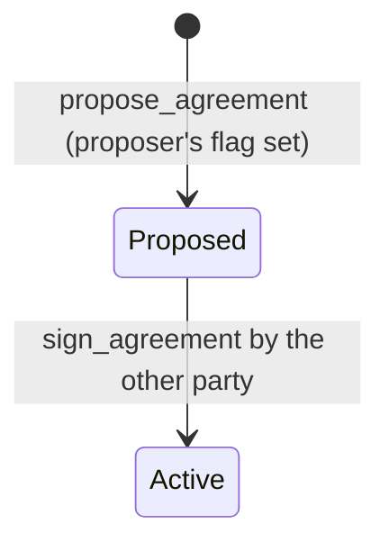
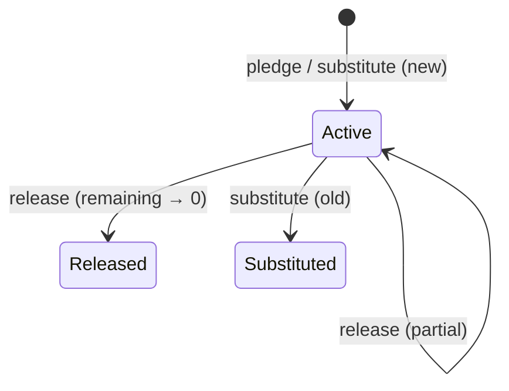

# Data Model: Collateral Agreements, Margin Calls and Pledges (F004)

This file maps the spec's entities to on-chain accounts in `docs/shared-model.md`. It lists only
what F004 creates, fills or changes. Everything else is as in the
[F001](../001-fund-launch-onboarding/data-model.md),
[F002](../002-daily-price-accrual/data-model.md) and [F003](../003-dvp-settlement/data-model.md)
data models. Changes to the shared model are marked **[SM change]** and listed in
[plan.md](plan.md#shared-model-changes).

| Spec entity | Account | Program | PDA seeds |
|---|---|---|---|
| Holder record (lock) | `HolderState.pledged_amount`, `active_liens` | `compliance_hook` | `["holder", mint, owner]` |
| Fund, Price record (read) | `FundState.nav`, `nav_ts`, `nav_seq`, `status` | `fund` | `["fund", mint]` |
| Agreement | `PledgeAgreement` | `collateral` | `["agreement", fund_state, giver, taker, nonce]` |
| Pledge | `Pledge` | `collateral` | `["pledge", agreement, pledge_ref]` **[SM change: seeds, R6]** |
| Call | `CollateralCall` | `collateral` | `["call", agreement, external_ref]` **[SM change: seeds, R6]** |
| (signer) lock caller | PDA, no data | `collateral` | `["hook-caller"]` |
| (signer) compliance caller | PDA, no data | `governance` | `["collateral-caller"]` **[SM change, R10]** |

## Units and formulas

A new module `mmf_common::collateral`, shared by `collateral` and `mmf-sdk`; the test model keeps
its own copy (R15). Units and cash both have 6 decimals; prices have 8 (shared-model §1).

```text
collateral_value(units, nav, h) = floor(units × nav × (10_000 − h) / (10^8 × 10_000))   down: taker never over-counts   (§8, existing row; on the agreement total [SM change])
units_for_value_up(v, nav, h)   = ceil(v × 10^8 × 10_000 / (nav × (10_000 − h)))         up: giver always posts enough   (§8, existing row)
units_for_value_down(v, nav, h) = floor(v × 10^8 × 10_000 / (nav × (10_000 − h)))        down: taker keeps enough        [SM change: new §8 row]
coverage(a)  = collateral_value(a.pledged_units, fund.nav, a.haircut_bps) − a.required_value    (i128)
shortfall(a) = max(0, −coverage(a));   excess(a) = max(0, coverage(a))
uncalled(a)  = shortfall(a) − a.called_outstanding           (after observe, below; never negative)
fresh(a, fund, now) = fund.nav_seq > 0 ∧ now − fund.nav_ts ≤ a.max_nav_age_secs     else NoPrice / StalePrice
eligible(h, now)    = h.class == Investor ∧ h.status == Approved ∧ h.kyc_expiry_ts > now
remaining(p)        = p.units − p.released_units − p.enforced_units
```

`h < 10_000` and `nav > 0` are guaranteed by the terms check and by `fresh`. Products are checked
`u128`; a unit count that doesn't fit `u64` is `Overflow`.

**Observe** (R5), run first by every step that values an agreement at a fresh price, and by a
lower exposure at any price age when the new value is zero (then `S = 0` without a price):

```text
S = shortfall(a)
a.called_outstanding = min(a.called_outstanding, S)
if S == 0: a.met_below_seq = a.call_count; a.called_outstanding = 0; a.open_delivery_calls = 0
```

**Derived call status** (Constitution V): a delivery call with stored status Open or Disputed and
`seq < agreement.met_below_seq` **is Met**. Instructions that touch a call store Met first
(`settle_status`); readers (SDK, F005, F008) apply the same rule.

Worked checks (tests, `mmf-common` vectors; price $1.00 = `100_000_000`, haircut 200 bps):

| Input | Result (base units) | Units |
|---|---|---|
| `units_for_value_up(1_000_000_000_000)` | `1_020_408_163_266` | 1,020,408.163266 |
| `collateral_value(1_020_408_163_266)` | `1_000_000_000_000` (product ends …068, floored) | $1,000,000.000000 |
| `units_for_value_down(600_000_000_000)` | `612_244_897_959` | 612,244.897959 |
| `collateral_value(408_163_265_307)` | `400_000_000_000` | $400,000.000000 |
| same pledge at $0.99 (`99_000_000`) | value `990_000_000_000`, shortfall `10_000_000_000` (= MTA: no call) | |
| same pledge at $0.985 (`98_500_000`) | value `985_000_000_000`, shortfall `15_000_000_000` → `units_for_value_up` = `15_539_210_609` | 15,539.210609 |

## `HolderState` (compliance_hook): fields F004 fills

No layout change. `pledged_amount u64` and `active_liens u16` exist from F001 and are written only
by `set_lien`.

| Field | Meaning | Written by |
|---|---|---|
| `pledged_amount` | units locked, = Σ `remaining(p)` over the owner's Active pledges in every agreement (I1) | `set_lien` |
| `active_liens` | number of the owner's Active pledges | `set_lien` (`opened`, `closed`) |

Transfer rule (hook step 5): `post_src_balance ≥ src.pledged_amount`, otherwise
`PledgedUnitsLocked`. Lock rule (`set_lien`): if the lock grows,
`holding_account.amount ≥ new pledged_amount`, otherwise `InsufficientUnlockedUnits`. Together
they keep I2.

## `Registry` (compliance_hook): field F004 fills

`collateral_program`, set by `init_registry` to `COLLATERAL_PROGRAM_ID` for every new fund (R2).
Empty on registries created before F004, so `set_lien` refuses (`NotCollateralCaller`).

## `FundState` (fund): read only

No change to `fund`. `FundStateView` gains `nav_ts` (offset `FUND_NAV + 8`) for the price-age test.

## `PledgeAgreement` (collateral): new

PDA `["agreement", fund_state, giver, taker, nonce.to_le_bytes()]`. Size **432 B** (8 + 424).
Never closed. Fields after `created_ts` are **[SM change]** (new in the final layout, R5, R7, R8).

```text
version                     u8
fund_state                  Pubkey
giver                       Pubkey
taker                       Pubkey
nonce                       u64     chosen by the proposer
mode                        u8      0 Lien (only value accepted)
income_to                   u8      0 Giver (only value accepted)
haircut_bps                 u16     < 10_000
max_nav_age_secs            u32     > 0
call_cure_secs              u32     > 0
enforcement_grace_secs      u32     any
min_transfer_value          u64     cash base units; any
concentration_cap_units     u64     pledge limit; > 0
taker_may_call_unilaterally bool
agreement_hash              [u8; 32] non-zero
status                      u8      0 Proposed, 1 Active (2 Terminating, 3 Terminated reserved)
giver_signed                bool
taker_signed                bool
pledged_units               u64     Σ remaining(p) over this agreement's Active pledges (I15)
required_value              u64     current exposure, cash base units
pledge_count                u64     next Pledge seq (starts 1)
call_count                  u64     next CollateralCall seq (starts 1)
created_ts                  i64
activated_ts                i64     0 while Proposed
pending_raise_value         u64     0 = none
pending_raise_ref           [u8; 32]
pending_raise_ts            i64
exposure_ref                [u8; 32] reference of the exposure in force
exposure_updated_ts         i64
called_outstanding          u64     demanded part D (I16)
open_delivery_calls         u16     unresolved delivery calls with seq ≥ met_below_seq (I16)
met_below_seq               u64     delivery calls with seq below this are Met
open_return_call            Pubkey  default = none
bump                        u8
_reserved                   [u8; 64]
```

Validation (`propose_agreement`): `giver ≠ taker`; proposer ∈ {giver, taker}; both `eligible`;
Fund Open; terms as annotated. Terms and parties never change afterwards (FR-005).

### Agreement states



Terminating and Terminated are reserved (no F004 instruction reaches them).

## `Pledge` (collateral): new

PDA `["pledge", agreement, pledge_ref]`. Size **196 B**. Never closed.

```text
version          u8
agreement        Pubkey
seq              u64     agreement.pledge_count at creation
pledge_ref       [u8; 32] giver's reference; non-zero (in the seeds: unique per agreement)   [SM change]
units            u64     > 0
mode             u8      0 Lien
posted_at        i64
nav_seq_at_post  u64     FundState.nav_seq at posting (0 if no price yet)
released_units   u64
enforced_units   u64     [F005]
status           u8      0 Active, 1 Released, 2 Enforced [F005], 3 Substituted
closed_at        i64     0 while Active                                                     [SM change]
bump             u8
_reserved        [u8; 64]
```



## `CollateralCall` (collateral): new

PDA `["call", agreement, external_ref]`. Size **268 B**. Never closed.

```text
version          u8
agreement        Pubkey
seq              u64     agreement.call_count at creation
kind             u8      0 Delivery, 1 Return
value_delta      u64     delivery: uncalled shortfall; return: excess (cash base units)
units_required   u64     delivery: units_for_value_up; return: units_for_value_down
nav_seq          u64     price record used
issued_at        i64
cure_deadline_ts i64     issued_at + call_cure_secs
enforce_after_ts i64     delivery: cure_deadline_ts + enforcement_grace_secs; return: 0
status           u8      0 Open, 1 Met, 2 Disputed, 3 Defaulted [F005], 4 Enforced [F005], 5 Cancelled
enforced_units   u64     [F005]
enforced_value   u64     [F005]
external_ref     [u8; 32] non-zero; unique per agreement (in the seeds)
units_released   u64     return calls: units released against it                           [SM change]
dispute_ref      [u8; 32] giver's dispute reference (zero if never disputed)                 [SM change]
disputed_at      i64                                                                        [SM change]
closed_at        i64     time of Met (stored) or Cancelled; 0 while unresolved              [SM change]
bump             u8
_reserved        [u8; 64]
```

### Call states

```mermaid
stateDiagram-v2
    [*] --> Open : update_exposure / confirm_exposure (auto) or issue_call
    Open --> Met : delivery: observe finds coverage ≥ 0 (derived, R5); return: releases reach units_required
    Disputed --> Met : observe finds coverage ≥ 0 (derived)
    Open --> Disputed : dispute_call (giver; delivery)
    Disputed --> Open : withdraw_dispute (giver) / resolve_dispute(Open) (compliance)
    Open --> Cancelled : cancel_call (taker: delivery; giver: return)
    Disputed --> Cancelled : cancel_call (taker) / resolve_dispute(Cancelled) (compliance)
    Met --> [*]
    Cancelled --> [*]
```



Defaulted and Enforced arrive with F005. Agreement bookkeeping per transition:

| Transition | `open_delivery_calls` | `called_outstanding` | `open_return_call` |
|---|---|---|---|
| delivery call opens for U | +1 | += U (= S) | — |
| delivery call Met (observe, S = 0) | → 0 | → 0 | — |
| delivery call Cancelled (not derived Met) | −1 | −= min(D, value) (→ 0 if count is 0) | — |
| return call opens | — | — | = call |
| return call Met or Cancelled | — | — | = default |

## Events

All `collateral` events are emitted with `emit_cpi!`, one per instruction, with `fund`, `slot`,
`unix_ts`. Steps that value the agreement also carry `coverage: i128`, `nav_seq`,
`called_outstanding`, `met_below_seq` so the history can be rebuilt (SC-009).

| Event | Instruction | Payload (besides the common fields) |
|---|---|---|
| `AgreementProposed` | `propose_agreement` | agreement, giver, taker, nonce, proposer, all terms, agreement_hash |
| `AgreementActive` | `sign_agreement` | agreement, signer |
| `ExposureUpdated` | `update_exposure`, `confirm_exposure` | agreement, required_value, external_ref, outcome (Applied, Pending, Confirmed), signer, call (key, seq, value, units, deadlines) if one opened |
| `CallIssued` | `issue_call` | agreement, call, seq, kind, value, units_required, deadlines, external_ref |
| `CoverageChecked` | `check_coverage` | agreement, triggered_by |
| `CallCancelled` | `cancel_call` | agreement, call, seq, signer |
| `CallDisputed` | `dispute_call` | agreement, call, dispute_ref |
| `DisputeWithdrawn` | `withdraw_dispute` | agreement, call |
| `DisputeResolved` | `resolve_dispute` | agreement, call, outcome, reason, case_ref_hash, actor |
| `Pledged` | `pledge` | agreement, pledge, seq, pledge_ref, units, giver, giver_locked_after |
| `Released` | `release` | agreement, pledge, units, signer, return_call (if named), return_call_met |
| `Substituted` | `substitute` | agreement, old_pledge, new_pledge, old_remaining, new_units |
| `LienSet` (compliance_hook, `emit!`) | `set_lien` | owner, lock, unlock, opened, closed, pledged_amount, active_liens |

`CallMet` (shared-model §9) is replaced by the `met_below_seq` field, plus `return_call_met` on
`Released` **[SM change]**.

## Invariants

| ID | Invariant | Tested by |
|---|---|---|
| I1 | `HolderState.pledged_amount == Σ remaining(p)` over the owner's Active pledges; `active_liens ==` their count | `collateral_prop.rs`, `invariants_prop.rs` |
| I2 | `holding_account.amount ≥ pledged_amount` for every holder, after every operation | same, plus the lock-bypass suite |
| I15 **[new]** | `PledgeAgreement.pledged_units == Σ remaining(p)` over its Active pledges, and `≤ concentration_cap_units` | `collateral_prop.rs` |
| I16 **[new]** | `open_delivery_calls ==` the number of delivery calls with stored status Open/Disputed and `seq ≥ met_below_seq`; `called_outstanding ≤ Σ` their `value_delta`; `called_outstanding == 0` when that number is 0 | `collateral_prop.rs` |

I3, I10, I11 (locked units still earn interest), I12, I13 and I4 stay green with F004 operations
mixed in.
